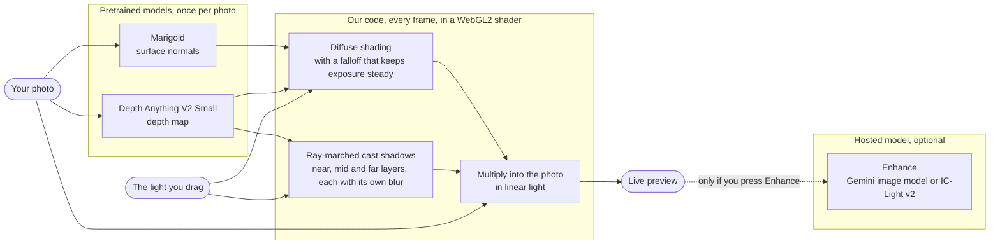

# Relight

Drag a light around a photo and watch the highlights and shadows follow, live, in your browser. Two pretrained vision models measure the photo's shape once; from then on every frame is drawn by our own lighting maths in a WebGL shader, with no model and no server in the loop.


*The Portrait sample with the light on the path the app's Sweep button takes (the small orange dot is the light). These frames were rendered by our Python reference of the shading; the browser runs the same maths in a shader.*

**Live demo: https://aarooshpravici.github.io/BanannaHacksSubmission/** (the four sample photos or your own, in your browser, nothing to install)

Built for the Banana Hacks hackathon. The app has a "How it works" button in the top bar that shows the same pipeline in pictures (it folds step 5 into step 4).

The sun on the photo is the light. Drag it to move the light. Scroll on it (or pinch with two fingers on a touch screen, or press + and - with it selected) to bring the light nearer or push it back: the sun grows as the light comes nearer, and the Height slider follows.

## How it works



1. **Depth, once per photo (pretrained: Depth Anything V2 Small).** How near each pixel is to the camera. We scale it into a height field.
2. **Surface normals, once per photo (pretrained: Marigold, a generative diffusion model fine-tuned from Stable Diffusion 2).** Which way each surface faces. Normals worked out from the depth map alone left faces almost unshaded, so a second model does this.
3. **Diffuse shading, every frame (ours).** Each pixel is lit by how squarely its surface faces the light, easing to dark as it turns away. Distance falloff is measured against the centre of the scene, so moving the light changes where it falls and not the overall exposure.
4. **Cast shadows, every frame (ours).** Each pixel walks toward the light across the height field. Whatever blocks it is sorted into a near, mid or far layer by how far in front of the receiving surface it stands, and each layer is blurred by a different amount: a contact shadow stays crisp, a shadow on a far background spreads and fades.
5. **Into the photo, every frame (ours).** The shading is multiplied into the photo in linear light. From 80% of white upward the result eases toward white, so highlights roll off softly instead of clipping.
6. **Enhance, only on request (hosted: the Gemini image model; a second route, IC-Light v2 on fal.ai, is coded but has never been run).** Sends the shaded preview for a more photographic finish. The app is complete without it.


*The one real Enhance run (Gemini's image model), on an earlier version of our preview: cleaner, but it undid most of our lighting. Placing the light is the part a prompt cannot do, which is why the dragging is ours and Enhance is an extra.*

Steps 3 to 5 exist three times and are kept in agreement: `backend/app/ideas/relight.py` (the Python reference), `frontend/lib/relightMath.ts` (a CPU port) and `frontend/lib/relightGL.ts` (the shader you watch).

If a device cannot run the shader, the page falls back by itself: first to the same shader with 8-bit shadow buffers, then to the CPU port in a background thread (a quick preview while the light moves, the full picture when it stops). With the backend running, a processor that needs more than 1.2 seconds a picture hands the drawing to the backend. The last line of the GEOMETRY panel says which path is in use. Only the full-quality shader has run on real hardware; the fallbacks were tried by switching features off in the same browser.

## What is ours and what is not

| | |
| --- | --- |
| **Ours** | All of the lighting: the diffuse shading, the exposure-steady falloff, the soft edge where a surface turns from the light, the ray-marched shadows and their three layers, the linear-light mix, written three times (Python, TypeScript, GLSL). The server that runs the two models once and hands the browser the maps, and the port of its depth-to-maps step to the browser (`sceneGeometry.ts`). The self-test that compares a graphics chip's answer from the depth model with the processor's before a photo is trusted to it (`depthCheck.ts`). The page. |
| **Not ours** | The depth model (Depth Anything V2 Small, Apache-2.0) and the normals model (Marigold normals v1-1, a diffusion model fine-tuned from Stable Diffusion 2, CreativeML Open RAIL++-M): pretrained, downloaded, run as they are. We trained nothing. The optional Enhance model is a hosted service we call. The libraries that run the models and the page (PyTorch, transformers, diffusers and OpenCV on the server; transformers.js, Apache-2.0, and ONNX Runtime Web, MIT, in the browser; Next.js, React and Tailwind). The decoder for iPhone HEIC photos (libheif-js, LGPL-3.0), which the browser fetches from jsDelivr only when such a photo arrives. The four sample photos, public domain or CC0, from scikit-image's sample data (`testing/photos/README.md`). |

Without the two pretrained models there is nothing to shade; without our code there is nothing to drag. Dragging the light never calls a model.

## Honest limits

- One photo gives a height field, not real 3D, so shadows are approximate. Light from below looks blotchy on faces, and cast shadows still land on open sky: a faint column on the Rocket sample, a plain dark band on an outdoor photo of your own.
- Shading is diffuse only: no shine. Light already in the photo is not removed.
- The live shader has run on five real devices so far: an Apple-chip Mac (Chrome and Safari), a Windows laptop with Intel graphics (Chrome), a Windows laptop with a Snapdragon chip (Chromium) and two phones (an iPhone 11, and a Galaxy S21 Ultra in Chrome and Opera GX). On the Galaxy the samples worked but every photo of the tester's own was refused: the page emptied its file input before reading the file, which Android does not forgive. That is fixed in the code and has not yet been retried on that phone.
- Real Enhance has run once, and it weakened the side lighting. In the default setup (`MOCK_MODE=1`) Enhance returns the preview unchanged, and with no backend at all (`npm run dev` on its own) it is a contrast-and-glow filter made in the browser. Neither is a model.
- With no backend (the static demo, mock mode, or the backend not answering), your own photo is analysed in the browser by the same depth model (an ONNX build, `onnx-community/depth-anything-v2-small`, Apache-2.0, run by transformers.js on WebGPU or WebAssembly; about 25 MB downloaded once from Hugging Face and jsDelivr; the photo itself is not uploaded). The normals model is too large for a browser, so these scenes take their normals from the slope of the depth map: faces shade flatter, and near its edge an object is lit as if it faced you, so thin things are lit evenly across. This has worked on an Apple-chip Mac and on an iPhone 11 (both in Chrome). On one tester's Snapdragon laptop (Qualcomm Adreno graphics, Windows) the model ran on WebGPU without an error and gave a depth map covered in a grid of dimples, so the page now tests each graphics chip on a built-in picture before trusting it and uses the processor (slower, correct) when the answer is wrong, and for that chip family on Windows without trying. That test has passed on one healthy Apple chip, so a healthy chip of another make may be turned away to the slower route. The tester has confirmed both on the faulty laptop, in one Chromium browser: in normal use it now gets a smooth picture, on the processor, and with the list set aside the page's own test turns that chip away. Edge and Chrome have not been tried there. Details: `frontend/README.md`.
- A photo of your own is worked on at no more than 1024 pixels on its longer side, and Export PNG saves that size. The four samples are exported at their own size.
- iPhone photos (`.heic`, `.heif`) are accepted. Safari decodes them itself; Chrome, Edge and Firefox fetch a decoder the first time one arrives ([`libheif-js`](https://www.npmjs.com/package/libheif-js) 1.23.5, LGPL-3.0: one pinned 2 MB file from jsDelivr, checked against a fingerprint, not part of this repository). The photo is converted on the device and not uploaded. Tried on one Mac only, with files made by macOS and once by hand by a team member; not in Firefox or on Windows.
- Changing the light's distance on the photo has been tried by hand by scrolling on one Mac. The two-finger pinch on a touch screen has only been driven by a program, and in Safari on a Mac the trackpad pinch does nothing (two-finger scrolling works).

`testing/PENDING.md` is the full list of what has not been verified.

## Run it

You need git and Node.js 22 or newer; the backend also needs Python 3.12. The commands on this page are for macOS and Linux. On Windows follow `testing/SETUP.md`, which has the PowerShell versions.

```bash
git clone --branch relight https://github.com/aarooshpravici/BanannaHacksSubmission.git
cd BanannaHacksSubmission
```

Three ways, shortest first:

- **No backend:** `cd frontend && npm install && npm run dev`, then open http://localhost:3000 and click a sample or upload your own photo (its depth is estimated in the browser). The pill in the top-right corner then reads `backend: mock`, and Enhance is a stand-in in this mode: a contrast-and-glow filter made in the browser, not a model. See "Frontend".
- **Everything, including detailed normals and Enhance:** start the backend ("Backend"), then the frontend with `NEXT_PUBLIC_MOCK=0`.
- **A static folder for a web host:** see "Static demo".

The earlier three-idea version of the project is on the `overnight-foundation` branch; `docs/overnight-report.md` describes it.

## Layout

```
backend/    FastAPI app (Python 3.12)
  app/ideas/relight.py        depth, surface normals, shading and cast shadows
  app/routers/                the HTTP endpoints: /health, /jobs, /relight/scene, /relight/render, /relight/enhance
  app/providers/generation.py the hosted Enhance call (Gemini or fal.ai), its disk cache and its spending cap
  app/schemas.py              every request and response shape (the API contract)
  scripts/                    proof_relight.py (proof sheets), make_samples.py (bakes the built-in sample scenes),
                              live_checks.py (one real Enhance call)
  tests/                      pytest suite
frontend/   Next.js app. One page, served at / and /relight
  out/                        the static demo, written by `npm run build:demo` (see "Static demo")
  public/samples/             the four sample scenes: photo, depth, normals, thumbnail (written by make_samples.py)
  public/how-it-works/        the stills in the "How it works" panel (written by docs/make_explainer_images.py)
  app/, components/           the page (app/relight/page.tsx) and the parts it is built from
  lib/                        relightGL.ts (the shader), relightMath.ts (the CPU port), and the CPU fallback that runs it:
                              relightCPU.ts, relightCpuCore.ts, relightCpu.worker.js
                              localScene.ts, depth.worker.js, sceneGeometry.ts (a photo's depth and normals worked out in
                              the browser when there is no backend)
                              depthCheck.ts, depthCheckReference.ts (the test picture a graphics chip has to get right
                              before the depth model is trusted on it, and the processor's answer to that picture)
                              heic.ts, heic.worker.js (iPhone HEIC photos decoded in the browsers that cannot read them;
                              the decoder itself is fetched at run time, see "Honest limits")
docs/       relight-sweep.gif and the script that renders it; submission/ holds the write-up drafts
proofs/     output images from the scripts
testing/    what to test and how, written for the testers
tools/      check_secrets.py (keeps keys out of the repository), screenshots.mjs (retakes the tester kit's screenshots),
            publish_demo.sh (builds the static demo and pushes it to the gh-pages branch)
```

## Backend

```bash
cd backend
conda create -y -p .venv python=3.12   # no conda? use: python3.12 -m venv .venv
.venv/bin/python -m pip install -r requirements.txt
cp ../.env.example ../.env        # never commit .env
.venv/bin/uvicorn app.main:app --port 8000
```

The first photo downloads the two local models (a few GB), so it is slow once.

`MOCK_MODE=1` in `.env` (the default) means Enhance never calls a paid service: it returns the preview unchanged. Depth, normals and shading are always real. Set `MOCK_MODE=0` and add a key to use the real Enhance.

## Frontend

```bash
cd frontend
npm install
cp .env.local.example .env.local   # set NEXT_PUBLIC_MOCK=0 to use the backend
npm run dev
```

Open http://localhost:3000. With `NEXT_PUBLIC_MOCK=1` the page runs with no backend at all: an uploaded photo's depth is estimated in the browser (see "Honest limits"), and the samples keep the shape they were baked with. The dot in the top-right corner says which mode you are in.

## Static demo

```bash
cd frontend
NEXT_PUBLIC_BASE_PATH=/BanannaHacksSubmission npm run build:demo   # leave the variable out for a site at the root of its address
```

This writes a plain static site to `frontend/out/`, for a host with no server of ours (GitHub Pages, say), so a judge can open the app from a link. The four samples and your own photos work in it, analysed and shaded in the browser; Enhance is switched off and the page says why. Upload everything inside `out/`, including the hidden `.nojekyll`. A build only works at the path it was built for; `frontend/README.md` has the details.

## Sample scenes

The four samples on the first page (Portrait, Coffee cup, Cat, Rocket) are static files under `frontend/public/samples/<name>/`, so they open with no backend running. Real Enhance on a sample still needs the backend. To bake them again from `testing/photos` after changing the depth or normals code:

```bash
cd backend
MOCK_MODE=1 .venv/bin/python -m scripts.make_samples
```

It uses only the local models and writes about 1 MB in total. Commit the changed files. `frontend/README.md` says how to add a fifth sample.

The animation at the top of this page and the stills in the app's "How it works" panel are rendered from the Portrait sample by the Python reference. After changing the shading maths or that sample, render them again:

```bash
cd backend
MOCK_MODE=1 PYTHONPATH=. .venv/bin/python ../docs/make_explainer_images.py
```

## Tests

```bash
cd backend
MOCK_MODE=1 .venv/bin/python -m pytest -q            # fast tests
MOCK_MODE=1 .venv/bin/python -m pytest -q --models   # also the tests that load the local models

cd ../frontend
npm run lint && npm run build && npx tsc --noEmit
```

The tests never call a paid service. `backend/scripts/live_checks.py` does (one image call), so run it only on purpose.

## Testing by hand

`testing/` is a kit for three human testers: setup steps, a test plan with screenshots of what should appear, and `PENDING.md`, the list of what the developer could not verify.

Testers: do not use the commands above. Start at `testing/README.md` and follow `testing/SETUP.md`; they say exactly what to install, what to click and what should appear.
