# Relight tester kit: start here

**What Relight is.** You upload a photo, or click one of four built-in sample photos, and drag a small sun icon around it; the highlights and shadows on the photo move with the sun, live. The app works out the 3D shape of the photo once (how far away each part is, and which way each surface faces), then your browser redraws the lighting many times a second. An optional "Enhance" button sends the result to an image model for a more photo-like finish.

**What we ask of you.** Run the app on your own computer, follow the steps in this folder, and write down what you see. You are the only eyes on this: the developer is an AI and cannot look at your screen or read the group chat. It only reads **GitHub issues** (and results files passed on by Aaroosh). It does not read chat. See [Reporting](#reporting-what-you-found).

**Open it on every device you own, your phone included.** The lighting is drawn by your device, and until now it has only been seen working on one Mac. For each device we need two things: which **shading path** the page reports, and whether the photo follows the light. That is case **W-16** in the test plan; it takes five minutes.

**The project is due Sunday 11:59 PM EDT.** A bug reported early can be fixed. A bug reported Sunday night cannot.

Short on time? Read [TEST_FIRST.md](TEST_FIRST.md): one page saying what to test today.

**Cannot get the backend installed?** You can still test most of the app. The four sample photos on the first page need no backend at all. Follow [Plan B in SETUP.md](SETUP.md#plan-b-no-backend-mock-mode): it needs only Node and takes about five minutes.

**Were you given a demo address?** The static demo is a copy of the app on a web address. It needs no setup at all: open the address in a browser, on a computer or a phone. It has only the four samples; uploading and Enhance are switched off there. Test it with group H in [TEST_PLAN.md](TEST_PLAN.md#h-hosted-demo-static-build).

## How long it takes

| Part | Time |
| --- | --- |
| Setup, once ([SETUP.md](SETUP.md)) | 30 to 60 minutes, mostly waiting for downloads |
| Plan B setup (no backend, samples only) | about 5 minutes |
| The hosted demo, if you were given its address | no setup |
| 10-minute smoke test (below) | 10 minutes |
| Your share of the full plan ([TEST_PLAN.md](TEST_PLAN.md)) | 1.5 to 3 hours |
| The whole plan alone | 5 to 6 hours |

The plan has **186 test cases** in 17 groups. Some need a key, a touch screen or a second browser, and some can only be done if your device happens to take a rare path; skip those you cannot do and mark them NOT RUN.

If setup fails, that is a result too. Report it (see [Reporting](#reporting-what-you-found)) and switch to "Plan B" in [SETUP.md](SETUP.md#plan-b-no-backend-mock-mode).

## The files in this folder

| File | What it is for |
| --- | --- |
| [README.md](README.md) | This page, and the 10-minute smoke test |
| [TEST_FIRST.md](TEST_FIRST.md) | One page: what helps most to test **today**, and what to leave until the next update. Rewritten after every update |
| [SETUP.md](SETUP.md) | Getting the app running on macOS or Windows, Plan B for testing with no backend, Plan C for building the static demo, and fixing common problems |
| [TEST_PLAN.md](TEST_PLAN.md) | Every test case, with steps, expected result and a screenshot |
| [PENDING.md](PENDING.md) | Problems that are already known (do not report these), and what the developer could **not** check and most needs you to look at |
| [Reporting what you found](#reporting-what-you-found) (bottom of this page) | The two links for reporting a bug or a finished test run, and how to take a screenshot |
| [results/TEMPLATE.md](results/TEMPLATE.md) | Results form to fill in **only** if you cannot use GitHub |
| [photos/](photos/README.md) | The test photos. Everyone uses the same ones. The first four are also built into the app as the samples Portrait, Coffee cup, Cat and Rocket |
| [screenshots/](screenshots/) | What each screen should look like: 152 pictures, all retaken on Saturday Oct 10 (night) on a Mac in Chrome, window 1440 x 900 unless the test case says otherwise |

## Splitting the work between three testers

Everyone does the smoke test first. Then pick one share and say which in your report. If nobody has agreed a split, take the share for the order you joined (first tester A, second B, third C).

| Share | Groups in [TEST_PLAN.md](TEST_PLAN.md) |
| --- | --- |
| A | Upload (U), Scene preparation (P), Moving the light (L), Controls (C), The "How it works" panel (G) |
| B | Shadows (S), Compare (K), Enhance (E), Export (X), Picture quality (Q) |
| C | Layout (W), Kinds of photos (T), Errors (R), Shading paths (F), Speed (D), What a judge would try (J) |
| Everyone, if an address was given | Hosted demo (H). On a real phone if you have one |

Everyone also does three cases, whatever their share: **W-16** (which shading path your device uses, and whether the light works), on every device you own; **Q-11** (the face under side light); and **G-07** (is the "How it works" card clear and right to a newcomer). In group F, most cases can only be done if your device takes that path by itself; mark the others NOT RUN. If you have time left, do the rest of the "Picture quality (Q)" group as well. It needs human judgement, and three opinions are better than one.

## Words used in this kit

- **Top-right pill**: the small rounded label in the top-right corner that starts with "backend:" (on the static demo, "demo:"). It tells you which mode the app is in. On a window narrower than 640 pixels (a phone) it is shorter: it has no "backend:" in front, "online, mock providers" becomes "online", and the demo's pill reads only "demo".
- **How it works**: the words in the top bar, just left of the pill. They open a card that explains the app in five steps.
- **Shading line**: the last small grey line of the opened GEOMETRY panel. It starts with "shading:" and says what draws the lit picture on your device, for example "shading: graphics chip, full quality". The table at the top of [group F](TEST_PLAN.md#f-shading-paths) in the test plan says what each wording means.
- **Grey note**: a grey box above the stage that starts "Shading on this device's processor" (or "This device's processor is slow"). It is not an error. It means the picture is drawn in a slower way that still works.
- **Stage**: the big dark area on the left that holds the photo.
- **Sun**: the round button with a sun icon on the stage. It is the light.
- **Sidebar**: the column on the right with three panels: LIGHT, ENHANCE, GEOMETRY. GEOMETRY starts folded into one row; click the row to open it. On a phone-sized window the sidebar sits under the stage.
- **Sample**: one of the four small pictures on the first page (Portrait, Coffee cup, Cat, Rocket). Clicking one opens that photo at once. Samples need no backend.
- **Backend**: the Python program that studies the photo. **Frontend**: the web page.
- **Static demo** (or hosted demo): a copy of the web page made of plain files, with no backend anywhere. Samples only. Its pill is green and reads "demo: runs in your browser".
- **Preset**: one of the buttons **Left**, **Right**, **Top**, **Low and warm** in the LIGHT panel. Each puts the light at a fixed place. **Reset light**, beside them, puts the light back where a photo starts.

## 10-minute smoke test

Before you start: the app is running as described in [SETUP.md](SETUP.md), and the top-right pill reads **backend: online, mock providers** with an amber dot.

**No backend (Plan B, pill "backend: mock")?** Do the same eight steps with one change: in step 2 click the **Portrait** sample thumbnail in place of choosing the file. Say "Plan B" in your report.

**On the hosted demo (pill "demo: runs in your browser")?** Open the demo address in step 1; the page has a card in place of the dashed box (see H-01 in the test plan). In step 2 click the **Portrait** sample. In step 5 the button is named **Other samples**. Skip step 7 and mark it NOT RUN: Enhance is switched off on the demo. In step 8 there is no tab to click. Say "demo" in your report.

Record PASS or FAIL for each step. Report as one issue with the "finished test run" link in [Reporting](#reporting-what-you-found).

**Where the test photos are.** In your home folder: `BanannaHacksSubmission`, then `testing`, then `photos`. macOS: in the file chooser press Cmd+Shift+H to jump to your home folder. Windows: type `%USERPROFILE%\BanannaHacksSubmission\testing\photos` in the address bar of the file chooser and press Enter. Wherever this kit says `testing/photos/...`, it means that folder.

**Step 1. Open the page.** Go to http://localhost:3000.
Expected: at the right end of the top bar, the words "How it works" and then the pill. Yellow words "MOVE THE LIGHT", the title "Relight a photo by dragging the light.", a dashed box "Drop a photo here", and under it "Or try a sample photo:" with four small pictures: Portrait, Coffee cup, Cat, Rocket. Now click "How it works": a dark card titled "How Relight works" opens over the dimmed page. Press the Escape key (or click **Close**): the card goes and the page is as before.

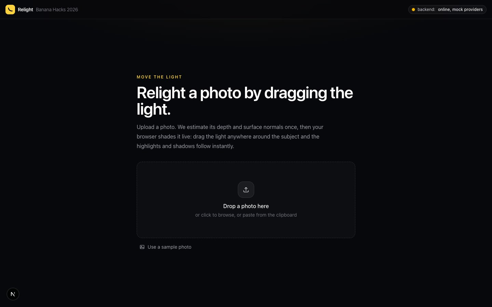
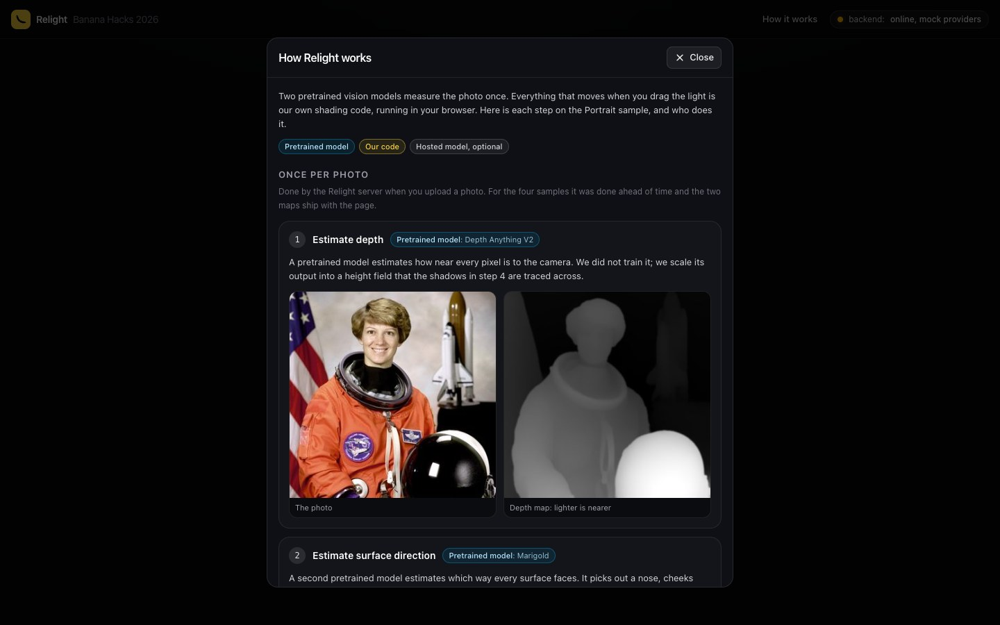

**Step 2. Load the portrait.** Click the dashed box and choose `testing/photos/01-portrait-astronaut.jpg`.
Expected: the photo appears dimmed with the words "Estimating depth and surface normals…". After a few seconds (much longer if you skipped the model download in SETUP step 4) it brightens and a white sun appears near the left edge of the photo, on the flag. The left of the face is bright and the right cheek is in shadow. The sidebar shows x 0.12, y 0.35. The dark side of the face fades in softly; there is no hard, straight line across the forehead or cheek. Now click the **GEOMETRY** row at the bottom of the sidebar and read its last small grey line. On most computers it reads "shading: graphics chip, full quality". **Copy that line into your report**, whatever it says. If there is also a grey note above the photo, copy that too; it is not a failure (see "Grey note" above).

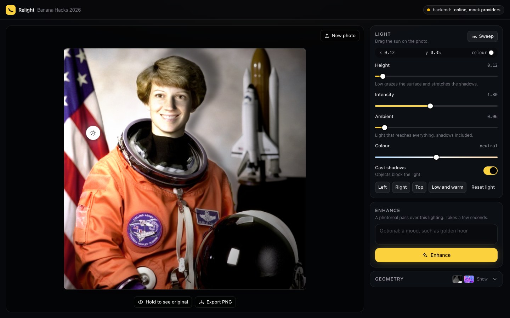
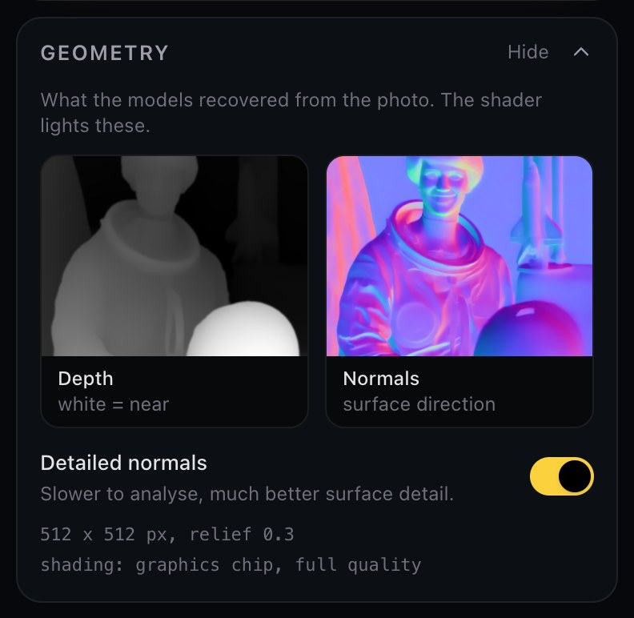

**Step 3. Light from the left, then the right.** In the LIGHT panel click **Left**, look, then click **Right**.
Expected after Left: the sun jumps to just left of the photo and the readout says x -0.10, y 0.40; the left half of the face is bright and the right half darker. After Right: the opposite, with the left half of the face dark, and the readout says x 1.10, y 0.40. In both, bright turns to dark gradually, with no hard, straight line on the face.

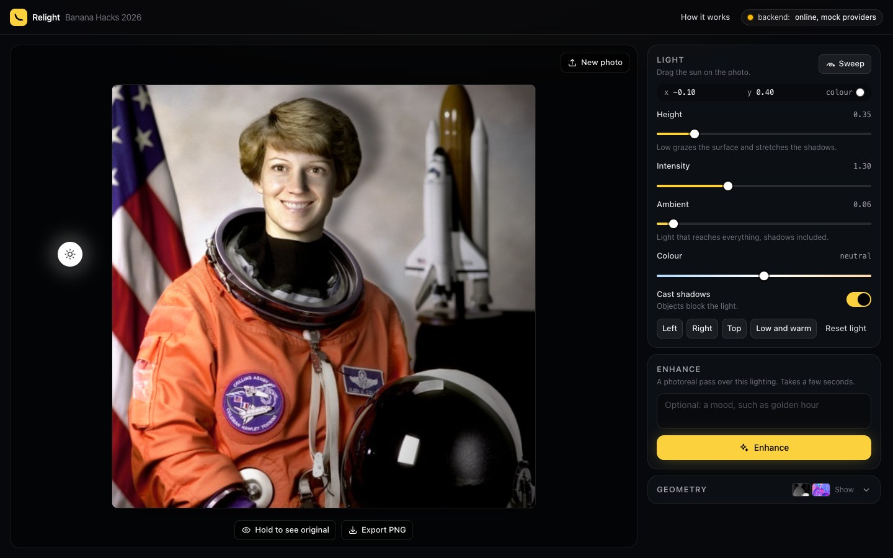
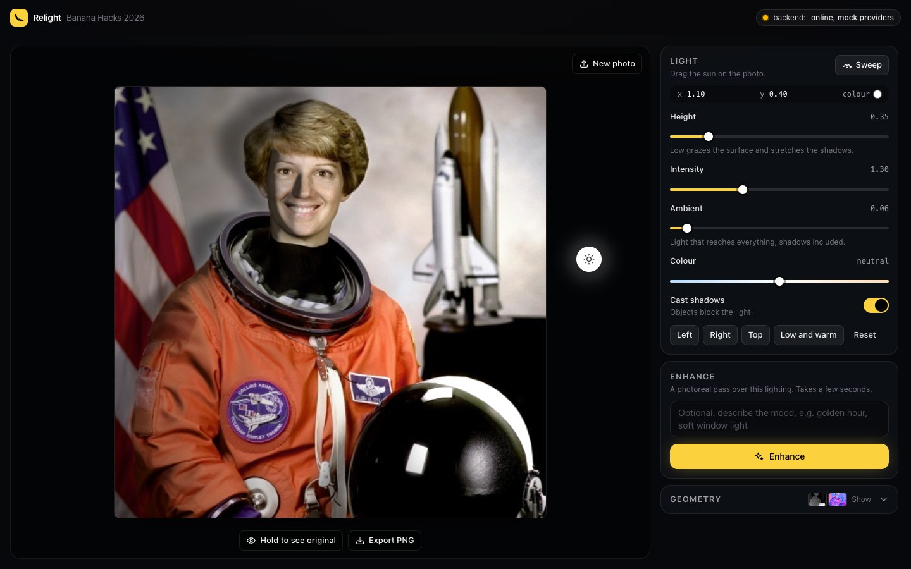

**Step 4. Drag the sun.** Press on the sun and drag it slowly in a circle around the face, then out past the right edge of the photo. Then click **Sweep** (top right of the LIGHT panel) and watch.
Expected: the lighting follows your mouse with no visible delay or stutter. (If your shading line says "processor", the picture is a slightly soft preview while the sun moves and sharpens when it stops. That is expected.) The x and y numbers in the sidebar change as you drag. The sun stops at the edge of the stage. With x above 1 the right side of the face is bright. After **Sweep**: the button reads "Stop sweep" in yellow letters, the sun travels once round the photo by itself in about 6 seconds, and it ends exactly where it started.

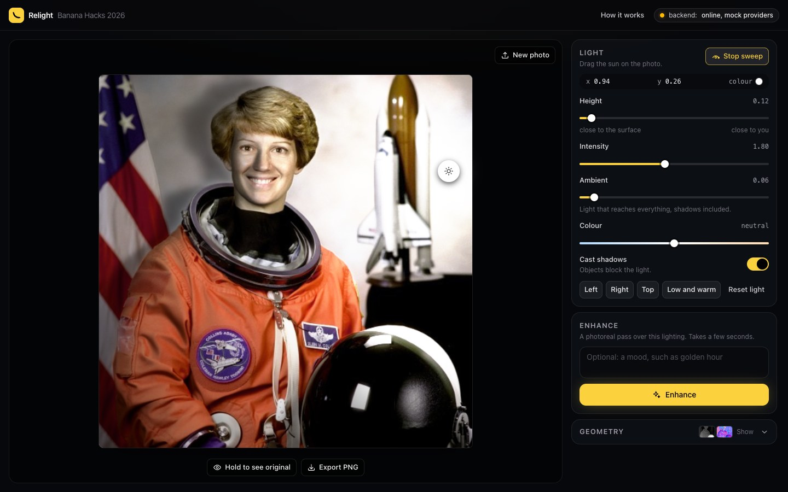

**Step 5. Shadows on an object.** Click **New photo** (top right of the stage). Click the **Coffee cup** sample thumbnail. Click **Left**. Drag the **Height** slider left to about 0.10. Then click the **Cast shadows** switch off and on again.
Expected: the coffee photo opens at once, with no "Estimating…" wait. The readout says x -0.10, and the sun sits at the left edge of the stage. With the switch on (yellow): a soft dark shadow to the right of the cup, with blurred edges. With it off (grey): that shadow disappears and the right of the saucer gets lighter.

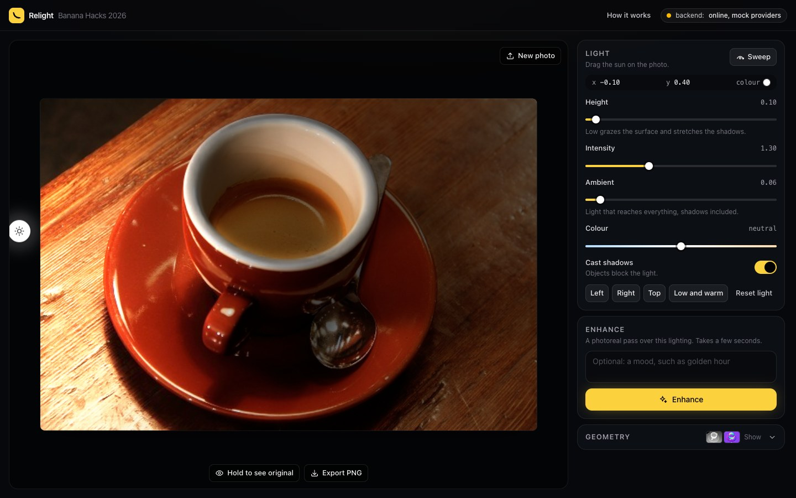
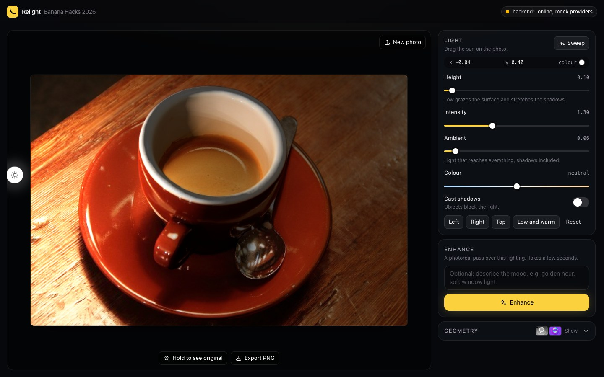

**Step 6. Compare with the original.** Press and hold **Hold to see original** under the photo, then let go.
Expected: while held, the plain photo shows, with a small tag "Original" in its top-left corner, and the button itself turns yellow. On release the relit photo comes back.

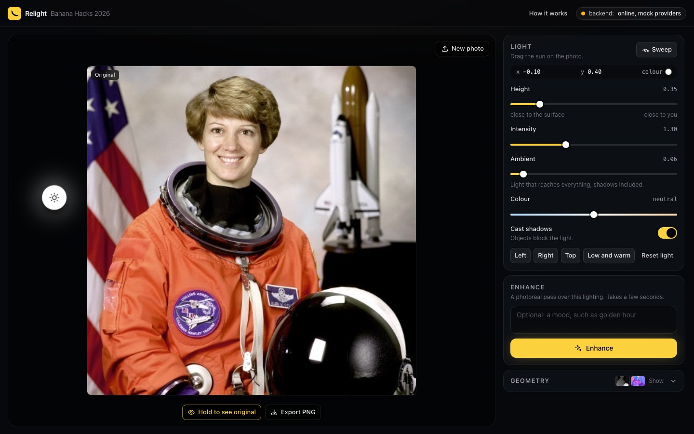

**Step 7. Enhance.** In the ENHANCE panel click the yellow **Enhance** button.
Expected: the button reads "Enhancing…"; within a few seconds the stage shows a split picture with a white vertical line, "Live preview" on the left and "Enhanced" on the right. Drag the round handle on the line left and right: the line follows. (In this mode both halves look almost the same. That is expected: Enhance is a stand-in until a key is added. In Plan B the right half has a little more contrast.)

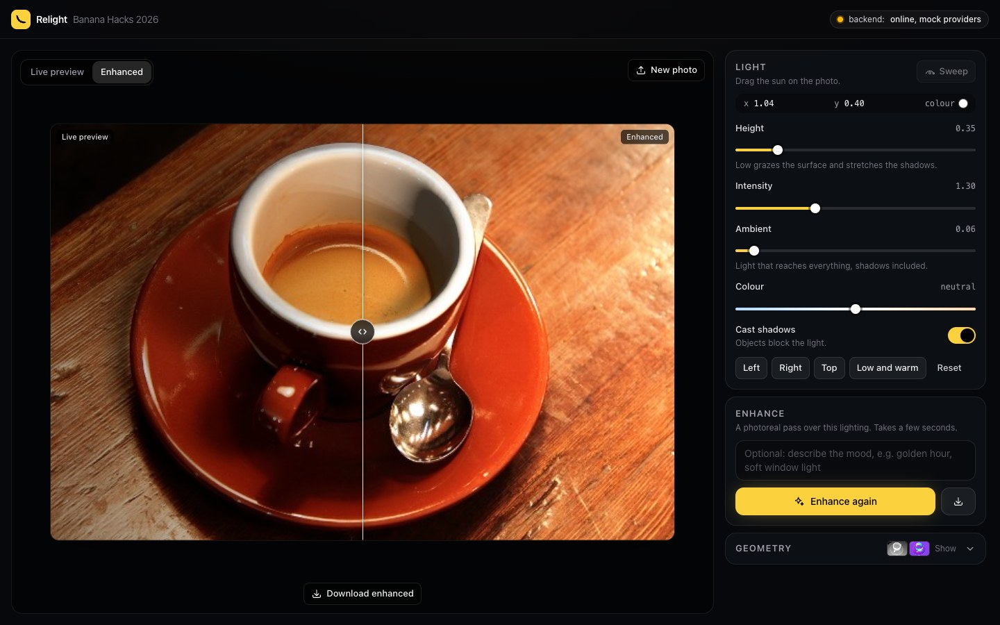

**Step 8. Export.** Click the **Live preview** tab (top left of the stage), then **Export PNG** under the photo.
Expected: a file named `relit.png` is downloaded. Open it: it shows the photo with the lighting you saw, and **no** sun icon on it.

Done. Now write it up as described in the next section.

---

## Reporting what you found

**The developer reads GitHub issues, not chat.** The developer is an AI coding assistant working with Aaroosh. It cannot see the group chat, texts, calls or anything said out loud. If a problem is not in a GitHub issue, the developer will not see it and it will not be fixed. (The only other way in is a results file sent to Aaroosh, described at the end of this section.)

Write things up early. Do not save everything for the end. Before you report, look at "Already known: no need to report" at the top of [PENDING.md](PENDING.md#already-known-no-need-to-report).

### The normal way: a GitHub issue

1. Sign in at https://github.com in any browser. A free account is enough.
2. Click one of these two links. Each opens a new issue in our repository with every heading already written for you:
   - **[Report a bug](https://github.com/aarooshpravici/BanannaHacksSubmission/issues/new?title=%5BCASE-ID%5D%20BLOCKER%20%2F%20WRONG%20%2F%20UGLY%20%2F%20IDEA%3A%20short%20description&body=%3C%21--%20Never%20paste%20a%20key%2C%20a%20password%20or%20the%20contents%20of%20a%20.env%20file.%20This%20repository%20is%20public.%20--%3E%0A%0A%2A%2ATest%20case%20ID%2A%2A%20%28from%20testing%2FTEST_PLAN.md%2C%20or%20%22none%22%29%3A%0A%0A%2A%2AVersion%2A%2A%20%28run%20%60git%20log%20-1%20--format%3D%25h%60%20in%20the%20project%20folder%20and%20write%20what%20it%20prints%3B%20on%20the%20hosted%20demo%20write%20%22hosted%20demo%22%20and%20the%20page%20address%29%3A%0A%0A%2A%2AComputer%2A%2A%20%28model%2C%20macOS%20or%20Windows%20version%2C%20Apple%20chip%20%2F%20NVIDIA%20card%20%2F%20neither%29%3A%0A%0A%2A%2ABrowser%20and%20version%3A%2A%2A%0A%0A%2A%2ATop-right%20pill%20reads%2A%2A%20%28mock%20%2F%20online%2C%20mock%20providers%20%2F%20online%20%2F%20offline%20%2F%20demo%29%3A%0A%0A%2A%2AShading%20line%2A%2A%20%28click%20the%20GEOMETRY%20row%20at%20the%20bottom%20of%20the%20sidebar%20and%20copy%20its%20last%20grey%20line%2C%20for%20example%20%22shading%3A%20graphics%20chip%2C%20full%20quality%22%3B%20write%20%22none%22%20if%20there%20is%20no%20such%20line.%20Also%20copy%20any%20grey%20note%20above%20the%20photo%29%3A%0A%0A%2A%2APhoto%20used%2A%2A%20%28sample%20name%3A%20Portrait%20%2F%20Coffee%20cup%20%2F%20Cat%20%2F%20Rocket%3B%20or%20file%20name%20from%20testing%2Fphotos%3B%20or%20describe%20your%20own%29%3A%0A%0A%2A%2ALight%20readout%2A%2A%20%28x%2C%20y%2C%20Height%2C%20Intensity%2C%20Ambient%2C%20Colour%2C%20Cast%20shadows%20on%20or%20off%2C%20Detailed%20normals%20on%20or%20off%29%3A%0A%0A%23%23%20Steps%0A%0A1.%0A2.%0A3.%0A%0A%23%23%20What%20happened%0A%0A%3C%21--%20Copy%20the%20exact%20words%20of%20any%20red%20message.%20--%3E%0A%0A%23%23%20What%20I%20expected%0A%0A%23%23%20Screenshot%0A%0A%3C%21--%20Click%20here%20and%20paste%20%28Cmd%2BV%20or%20Ctrl%2BV%29.%20Show%20the%20whole%20browser%20window.%20--%3E%0A%0A%23%23%20Extra%2C%20if%20something%20failed%20outright%0A%0A%3C%21--%20Last%2020%20lines%20of%20the%20backend%20terminal.%20Red%20lines%20from%20the%20browser%20console%20%28F12%2C%20Console%29.%20--%3E%0A%0A%2A%2ADoes%20it%20happen%20every%20time%3F%2A%2A%20%28yes%20%2F%20sometimes%20%2F%20once%29%0A&labels=bug)**. One thing that went wrong. **One issue per bug.**
   - **[Report a finished test run](https://github.com/aarooshpravici/BanannaHacksSubmission/issues/new?title=Test%20result%3A%20YOUR%20NAME%2C%20share%20A%20%2F%20B%20%2F%20C%20%2F%20smoke%20test%2C%20DATE&body=%3C%21--%20Never%20paste%20a%20key%2C%20a%20password%20or%20the%20contents%20of%20a%20.env%20file.%20This%20repository%20is%20public.%20--%3E%0A%0A%2A%2ATester%3A%2A%2A%0A%0A%2A%2ADate%20and%20time%3A%2A%2A%0A%0A%2A%2AVersion%2A%2A%20%28run%20%60git%20log%20-1%20--format%3D%25h%60%20in%20the%20project%20folder%20and%20write%20what%20it%20prints%3B%20on%20the%20hosted%20demo%20write%20%22hosted%20demo%22%20and%20the%20page%20address%29%3A%0A%0A%2A%2AComputer%2A%2A%20%28model%2C%20macOS%20or%20Windows%20version%2C%20Apple%20chip%20%2F%20NVIDIA%20card%20%2F%20neither%29%3A%0A%0A%2A%2ABrowser%20and%20version%3A%2A%2A%0A%0A%2A%2ATop-right%20pill%20reads%2A%2A%20%28mock%20%2F%20online%2C%20mock%20providers%20%2F%20online%20%2F%20offline%20%2F%20demo%29%3A%0A%0A%2A%2AShading%20line%2A%2A%20%28click%20the%20GEOMETRY%20row%20at%20the%20bottom%20of%20the%20sidebar%20and%20copy%20its%20last%20grey%20line%2C%20for%20example%20%22shading%3A%20graphics%20chip%2C%20full%20quality%22%3B%20write%20%22none%22%20if%20there%20is%20no%20such%20line.%20Also%20copy%20any%20grey%20note%20above%20the%20photo%29%3A%0A%0A%2A%2AWhat%20I%20ran%2A%2A%20%28smoke%20test%20%2F%20share%20A%20%2F%20share%20B%20%2F%20share%20C%20%2F%20group%20H%20demo%20%2F%20other%29%3A%0A%0A%23%23%20Setup%0A%0A-%20Did%20SETUP.md%20work%20as%20written%3F%20%28yes%20%2F%20no%2C%20and%20what%20you%20had%20to%20change%29%3A%0A-%20Minutes%20for%20the%20model%20download%20%28SETUP%20step%204%29%3A%0A-%20Seconds%20per%20photo%20after%20that%20%28case%20D-01%29%3A%0A%0A%23%23%20Smoke%20test%20%28testing%2FREADME.md%29%0A%0AWrite%20PASS%20or%20FAIL%20after%20each.%0A%0A-%20Step%201%20Open%20the%20page%3A%0A-%20Step%202%20Load%20the%20portrait%3A%0A-%20Step%203%20Left%2C%20then%20Right%3A%0A-%20Step%204%20Drag%20the%20sun%3A%0A-%20Step%205%20Shadows%20on%20an%20object%3A%0A-%20Step%206%20Compare%20with%20the%20original%3A%0A-%20Step%207%20Enhance%3A%0A-%20Step%208%20Export%3A%0A%0A%23%23%20Does%20the%20light%20work%20on%20this%20device%3F%20%28case%20W-16%29%0A%0APlease%20answer%20this%20even%20if%20you%20test%20nothing%20else.%0A%0A-%20When%20you%20move%20the%20sun%2C%20does%20the%20picture%20change%3F%20%28yes%20%2F%20no%20%2F%20only%20slowly%29%3A%0A-%20Open%20%2A%2AGEOMETRY%2A%2A%20in%20the%20sidebar.%20The%20last%20line%20starts%20with%20%22shading%3A%22.%20Copy%20it%20here%3A%0A-%20Any%20grey%20or%20red%20note%20above%20the%20photo%3F%20Copy%20its%20words%2C%20or%20write%20%22none%22%3A%0A%0A%23%23%20Test%20plan%20cases%20%28testing%2FTEST_PLAN.md%29%0A%0AOne%20line%20per%20case%20you%20ran%3A%20%60ID%20%20PASS%20%2F%20FAIL%20%2F%20NOT%20RUN%20%20note%60.%20For%20every%20FAIL%2C%20open%20a%20separate%20%22Bug%20report%22%20issue%20and%20put%20its%20number%20in%20the%20note.%0A%0A%60%60%60%0AU-01%0AU-02%0A%60%60%60%0A%0A%23%23%20Picture%20quality%20scores%20%28group%20Q%29%2C%201%20%3D%20fake%2C%205%20%3D%20like%20a%20real%20photo%0A%0A%60%60%60%0AQ-01%0AQ-02%0AQ-03%0A%60%60%60%0A%0A%23%23%20Items%20from%20testing%2FPENDING.md%20that%20I%20checked%0A%0A%23%23%20The%20three%20worst%20things%20I%20saw%0A%0A1.%0A2.%0A3.%0A%0A%23%23%20The%20best%20thing%20to%20show%20a%20judge%0A%0A%23%23%20Screenshots%0A%0A%3C%21--%20Paste%20here%20%28Cmd%2BV%20or%20Ctrl%2BV%29.%20--%3E%0A)**. Your PASS / FAIL list after a test session.
3. Change the title at the top: replace the words in capitals with your own.
4. Fill in every heading. Paste screenshots straight into the text box (click in the box, press Cmd+V or Ctrl+V).
5. Click **Create** (it may read **Submit new issue**).

Do not use the green **New issue** button on the GitHub site. It will most likely show an empty form with no headings. Use the two links above.

If a link opens an empty form anyway (some apps cut long links short): keep the form open, open [bug-report.md](../.github/ISSUE_TEMPLATE/bug-report.md) or [test-result.md](../.github/ISSUE_TEMPLATE/test-result.md) in another tab, click **Raw**, and copy everything below the second `---` line into the form.

### What every bug issue needs

| Item | Example |
| --- | --- |
| Test case ID | `S-01` (or "none" if you found it by accident) |
| Version | the code printed by `git log -1 --format=%h` in the project folder, for example `887bda5`. On the hosted demo you have no project folder: write "hosted demo" and the page address |
| Computer | "MacBook Air M2, macOS 15" or "Dell XPS, Windows 11, no NVIDIA card" |
| Browser and version | "Chrome 141" (Chrome menu, Help, About Google Chrome) |
| Top-right pill | "online, mock providers" (on the hosted demo: "demo") |
| Shading line | "shading: graphics chip, full quality": the last grey line of the opened GEOMETRY panel. Add the words of any grey note above the photo |
| Photo used | "sample: Coffee cup", or `02-object-coffee.jpg`, or "my own: a selfie, 3024 x 4032" |
| Steps | numbered, exactly what you clicked |
| What happened | what you saw, including the exact words of any red message |
| What you expected | usually the "Expected" text of the test case |
| Screenshot | of the whole browser window |
| Light readout | the x, y and slider values, if the bug is about how the picture looks |

Useful extras when something fails outright:

- **The backend terminal**: copy the last 20 lines.
- **The browser console**: press F12 (macOS: Cmd+Option+I), click **Console**, and copy any red lines.

**Never** include the contents of a `.env` file or anything that looks like a key or password. If a screenshot shows one, crop it out.

Only attach photos you are happy for the public to see. The repository is public.

### How serious is it? Put one of these words in the title

- **BLOCKER**: cannot install, cannot start, or the main thing (drag the light, see the picture change) does not work.
- **WRONG**: works, but does the wrong thing or looks clearly wrong.
- **UGLY**: works, but looks bad or confuses.
- **IDEA**: a suggestion.

Example title: `[S-01] WRONG: shadow stays after Cast shadows is switched off (Windows, Edge)`.

### Taking a screenshot

**macOS**

- Part of the screen: Shift+Cmd+4, then drag a box. The picture is saved on the Desktop.
- One window: Shift+Cmd+4, then Space, then click the window.
- Straight to the clipboard (to paste into an issue): add Ctrl, so Ctrl+Shift+Cmd+4.
- A short video (useful for stutter or flicker): Shift+Cmd+5, choose "Record Selected Portion", click Record; stop with the square button in the menu bar. Drag the video file into the issue.

**Windows**

- Part of the screen: Windows key+Shift+S, then drag a box. The picture goes to the clipboard: click in the issue text box and press Ctrl+V.
- Whole screen saved as a file: Windows key+PrtScn. It is saved in Pictures, Screenshots.
- A short video: Windows key+Shift+R (Snipping Tool, Windows 11), or Windows key+G for the Game Bar.

Capture the **whole browser window**, including the top-right pill and the sidebar. The numbers in the sidebar tell the developer where the light was.

### If you cannot use GitHub

Use this only if you really cannot open a GitHub issue. It is slower: the developer sees nothing until Aaroosh passes your file on.

1. Copy the file [results/TEMPLATE.md](results/TEMPLATE.md) **to your Desktop** and name the copy `results-YOURNAME-DATE.md` (for example `results-sam-oct10.md`). Do not keep it inside the project folder: a later update of the project could get in its way. Any text editor will do: TextEdit, Notepad.
2. Fill it in.
3. Put your screenshots in a folder next to it, also on the Desktop, named `screenshots-YOURNAME`.
4. Send the file and the folder to **Aaroosh** by whatever way you normally reach him. He will pass it to the developer.

### What happens next

The developer reads new GitHub issues, fixes what it can, and answers in the issue with what changed and which test cases to run again. It does not answer in chat. Check your issues for replies. To get a fix, follow "Getting fixes" in [SETUP.md](SETUP.md#what-to-expect).
