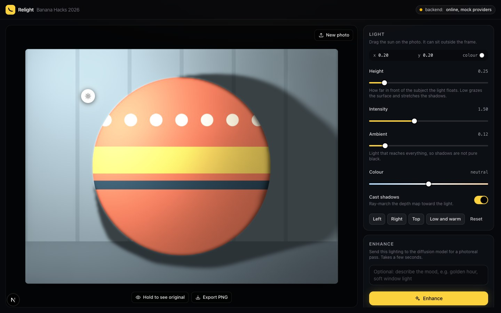

# Relight test plan

Every test case has an ID (for example `L-03`), numbered steps, the expected result, a screenshot where one exists, and a result line. Use the ID in every report ([Reporting](README.md#reporting-what-you-found)).

## How to use this plan

- **Standard start.** Unless a case says otherwise: the app runs as in [SETUP.md](SETUP.md), the top-right pill reads **backend: online, mock providers**, the photo `testing/photos/01-portrait-astronaut.jpg` is loaded, and you have clicked **Reset** in the LIGHT panel.
- **Recording results.** On GitHub, use the "Report a finished test run" link in [README.md](README.md#reporting-what-you-found) and write one line per case. Only if you cannot use GitHub, fill in a copy of [results/TEMPLATE.md](results/TEMPLATE.md). Mark each case **PASS** (matches "Expected"), **FAIL** (does not; open a bug issue) or **NOT RUN**.
- **Screenshots** were made on a Mac in Chrome with a 1440 x 900 window. Small differences in size and position on your screen are normal. Different words, missing parts, or lighting on the wrong side are not.
- **The x and y numbers.** x 0.00 is the photo's left edge and 1.00 its right edge; y 0.00 is the top and 1.00 the bottom. Numbers below 0 or above 1 mean the sun is outside the photo. The sun cannot leave the stage, so on a small window a preset may show a number closer to the photo than this plan says (for example x -0.04 where the plan says -0.10). That is expected.
- **The round black "N" badge** bottom-left is not part of the app. Ignore it.
- **Known issues** are listed near the top of [PENDING.md](PENDING.md#already-known-no-need-to-report), under "Already known: no need to report". Read that list once before you start. Do not report those again unless they are worse than described.
- **Test photos** are in the `testing/photos` folder of the project. Where that is on your disk: see the top of the smoke test in [README.md](README.md#10-minute-smoke-test).
- **"Developer note: possible bug"** under a case means: the Expected text says what the code does today, but the developer suspects that behaviour is wrong. If you see what Expected describes, mark PASS **and** open a bug issue saying you saw it and how much it bothered you.
- **Cases written from the code.** Cases without a screenshot were not run by the developer. Their Expected text was read from the program code. If the app does something else, that is a FAIL worth reporting.

Groups: [U Upload](#u-upload) · [P Scene preparation](#p-scene-preparation) · [L Moving the light](#l-moving-the-light) · [C Controls](#c-controls) · [S Shadows](#s-shadows) · [K Compare](#k-compare-with-the-original) · [E Enhance](#e-enhance) · [X Export](#x-export) · [W Layout](#w-layout-and-window-sizes) · [T Kinds of photos](#t-kinds-of-photos) · [R Errors](#r-error-handling) · [D Speed](#d-speed) · [Q Picture quality](#q-picture-quality-human-judgement) · [J Judge](#j-what-a-judge-would-try)

---

## U. Upload

Start each case on the first page with no photo (click **New photo** if a photo is loaded).

### U-01 First page

1. Open http://localhost:3000.

**Expected:** browser tab title "Relight: drag the light around any photo". Top bar: yellow square with a banana, "Relight", grey "Banana Hacks 2026", and the pill on the right. Page: yellow "MOVE THE LIGHT"; title "Relight a photo by dragging the light."; a paragraph starting "Upload a photo."; a dashed box with "Drop a photo here" and "or click to browse, or paste from the clipboard"; "Use a sample photo" below it.

`Result: PASS / FAIL / NOT RUN` Note:

### U-02 Choose a file by clicking

1. Move the mouse over the dashed box. 2. Click it. 3. Choose `testing/photos/01-portrait-astronaut.jpg`.

**Expected:** on hover the box border and background get slightly lighter. The click opens your computer's file chooser, which offers pictures only. After choosing, the page changes to the workspace: photo on the left, sidebar on the right.

`Result: PASS / FAIL / NOT RUN` Note:

### U-03 Drag and drop a file

1. Open the `testing/photos` folder in Finder or File Explorer. 2. Drag `02-object-coffee.jpg` over the dashed box and hold it there. 3. Let go.

**Expected:** while the file is over the box, the box border turns yellow and its background gets a yellow tint. After dropping, the coffee photo loads in the workspace. (No screenshot exists for the yellow box.)

`Result: PASS / FAIL / NOT RUN` Note:

### U-04 Paste from the clipboard

1. Copy a picture: on any web page right-click a picture and choose "Copy image", or take a screenshot to the clipboard (macOS: Ctrl+Shift+Cmd+4; Windows: Win+Shift+S). 2. Click an empty part of the Relight first page. 3. Press Cmd+V (macOS) or Ctrl+V (Windows).

**Expected:** the pasted picture loads in the workspace, the same as choosing a file.

`Result: PASS / FAIL / NOT RUN` Note:

### U-05 Sample photo

1. Click **Use a sample photo**.

**Expected:** an orange ball with white dots and a yellow and a dark-blue stripe, on a grey-blue wall. Sun in the upper left (x 0.20, y 0.20). The upper left of the ball is brightest and a large soft shadow falls down and to the right on the wall. GEOMETRY shows "960 x 720 px, relief 0.3".

`Result: PASS / FAIL / NOT RUN` Note:

### U-06 A file that is not a picture

1. Drag `testing/photos/not-an-image.txt` onto the dashed box and drop it. (The file chooser may not let you pick it, so drag it.) 2. Click the X at the right end of the red bar.

**Expected:** a red bar under "Use a sample photo" reads "That file is not an image." The page stays on the first page. The X removes the bar.

`Result: PASS / FAIL / NOT RUN` Note:

### U-07 New photo starts over

1. Load the astronaut. Click **Low and warm**. Turn **Cast shadows** off. Type `test` in the ENHANCE text box. 2. Click **New photo** (top right of the stage). 3. Choose `02-object-coffee.jpg`.

**Expected:** step 2 returns to the first page. After step 3 the coffee photo shows with the light back at x 0.20, y 0.20, Height 0.25, Intensity 1.50, Ambient 0.12, Colour neutral. **Cast shadows stays off** and the text box still says `test` (the app keeps those two on purpose; say in the note if this surprised you).

`Result: PASS / FAIL / NOT RUN` Note:

### U-08 The same file twice

1. Load the astronaut. 2. Click **New photo**. 3. Choose the same astronaut file again.

**Expected:** it loads again normally.

`Result: PASS / FAIL / NOT RUN` Note:

### U-09 Dropping a file in the wrong place

1. On the first page, drop a photo on the page **outside** the dashed box. Write down what happens. Use the browser's Back button if the app disappears. 2. Load a photo normally. Drop a different photo onto the **stage**. Write down what happens.

**Expected:** not defined. The app only listens for drops on the dashed box, so the browser will probably open the dropped picture by itself and leave the app. **Write down exactly what happened** and whether you lost your work. This is a likely first move by a judge.

`Result: PASS / FAIL / NOT RUN` Note:

### U-10 A photo from your own phone or camera

1. Load a photo taken on a phone, ideally one taken holding the phone upright. 2. If you have an iPhone photo ending in `.heic`, try that too.

**Expected:** the photo appears the right way up, not on its side. A `.heic` file in Chrome will probably be refused with "That file is not an image this browser can read." (Chrome cannot open that format); in Safari it may load. Write down the file type, the browser and what happened.

`Result: PASS / FAIL / NOT RUN` Note:

### U-11 A picture with a see-through background

1. Load a PNG picture that has a transparent background (a logo or sticker), if you have one.

**Expected:** it loads, and the transparent parts are shown white.

`Result: PASS / FAIL / NOT RUN` Note:

### U-12 Keyboard on the first page

1. Reload the page. Do not use the mouse. 2. Press Tab once, then again. 3. Press Enter. Close the file chooser with Escape. 4. Press the Space bar. Close the file chooser again. 5. Press Tab once more, then Enter.

**Expected:** step 2: the first Tab selects the "Relight" logo. The second Tab puts a yellow outline round the dashed box. Step 3: Enter opens the file chooser. Step 4: Space opens it too, and the page does not scroll. Step 5: Tab moves to **Use a sample photo** (it gets the browser's own selection ring), and Enter loads the sample ball. In Safari the Tab key may skip buttons unless "Press Tab to highlight each item" is on in Safari's settings; say so if it does.

`Result: PASS / FAIL / NOT RUN` Note:

### U-13 Pasting things that are not a picture

1. On the first page: copy some words from anywhere, click an empty part of the page, press Cmd+V or Ctrl+V. 2. In Finder or File Explorer select `not-an-image.txt`, copy it (Cmd+C or Ctrl+C), go back to the page and paste. 3. Load the astronaut. Copy a picture (as in U-04). Click on the top bar of the page and paste. 4. Click in the ENHANCE text box and paste again.

**Expected:** steps 1 and 2: nothing happens. No photo loads and no red bar appears. Step 3: nothing happens; the astronaut stays. Paste only loads a picture on the first page. Step 4: nothing is added to the text box (a picture is not text) and the photo does not change.

`Result: PASS / FAIL / NOT RUN` Note:

### U-14 Dropping several files, a folder, or a picture from a web page

Do each on the first page, onto the dashed box. Click **New photo** between steps.

1. Select `02-object-coffee.jpg` and `03-animal-cat.jpg` together and drop both at once. 2. Select `not-an-image.txt` and `03-animal-cat.jpg` together and drop both. Try twice, starting the drag from a different file each time. 3. Drop the whole `photos` folder. 4. Open any web page with a picture in another window. Drag that picture onto the dashed box.

**Expected:** step 1: one photo loads, never both. The app uses only the first file the browser hands over; you cannot choose which. Step 2: either the cat loads, or a red bar reads "That file is not an image." It depends on which file the browser lists first. Write down which you got. Step 3: for a moment the box reads "Reading image…", then a red bar reads "That file is not an image this browser can read." (it may read "That file is not an image." in some browsers). Step 4: either the picture loads, or **nothing happens at all**: the yellow tint goes away, no photo, no message. Write down the browser and which you got.

Developer note: possible bug (step 4, when nothing happens and no message is shown).

`Result: PASS / FAIL / NOT RUN` Note:

### U-15 Broken files

Make three files first. Copy `not-an-image.txt` to the Desktop three times and name the copies `broken.jpg`, `mystery` (no ending at all) and `empty.jpg`. Open `empty.jpg` in a text editor, delete everything, save. (If the computer hides file endings: macOS Finder, Settings, Advanced, "Show all filename extensions"; Windows File Explorer, View, Show, "File name extensions".)

1. Drop `broken.jpg` on the dashed box. 2. Click the X on the red bar. Drop `mystery`. 3. Drop `empty.jpg`.

**Expected:** all three: the page stays on the first page and a red bar under "Use a sample photo" reads "That file is not an image this browser can read." The box may read "Reading image…" for an instant first. Note the difference from U-06: a file ending in `.txt` gives the shorter "That file is not an image." A new red bar replaces the old one; there are never two. The backend's own message "could not read image" should never appear from the page; if you ever see it, report what file caused it.

`Result: PASS / FAIL / NOT RUN` Note:

### U-16 Unusual picture types and sizes

Use whatever of these you have or can make. Skip the rest and say which you skipped. (a) an animated GIF; (b) a `.webp` file; (c) a `.avif` file; (d) a `.bmp` file; (e) a `.svg` file; (f) a 1 x 1 pixel picture; (g) a very thin strip, for example 4000 x 40 pixels; (h) a very large camera photo, 30 MB or about 50 megapixels. To make (f) and (g): open any picture in Preview (macOS: Tools, Adjust Size, untick "Scale proportionally") or Paint (Windows: Resize, Pixels, untick "Maintain aspect ratio"), set the size, and save under a new name.

1. Load each one in turn. For each, click **Left** and look at the line at the bottom of GEOMETRY.

**Expected:** (a) loads as a still picture: the first frame only. It does not move. (b), (c), (d): load like a normal photo if your browser can open that type (Chrome can open all three). If it cannot: "That file is not an image this browser can read." (e): either loads, or shows "That file is not an image this browser can read." or "That image has no size." (f) and (g): **not known.** The browser accepts them; what the backend's models do with a picture that small or that thin was never tried. For (g) the GEOMETRY line should read "1024 x 10 px". Write down exactly what happened, with the words of any red bar. If the red bar reads "The server hit an unexpected error. See the backend log.", copy the last 30 lines of terminal 1 into the issue. (h): the box may read "Reading image…" for a second or more, then the photo loads at normal speed and GEOMETRY shows 1024 for the longer side.

`Result: PASS / FAIL / NOT RUN` Note:

### U-17 "Reading image…"

1. On the first page choose `08-huge-astronaut-3000px.jpg` and watch the dashed box closely. 2. If you saw nothing, click **New photo** and try again with the largest photo you have.

**Expected:** for a moment (well under a second on a fast computer) the icon and the words in the dashed box are replaced by a spinner and "Reading image…". While that shows, **Use a sample photo** is faded and cannot be clicked. Then the workspace appears. If it is too fast to see, mark NOT RUN and say so.

`Result: PASS / FAIL / NOT RUN` Note:

---

## P. Scene preparation

"Scene preparation" is the wait after choosing a photo, while the backend works out the photo's shape.

### P-01 Loading screen

1. From the first page, choose the astronaut and watch closely.

**Expected:** at once the workspace appears with the photo dimmed, a centred label "Estimating depth and surface normals…" with a spinner, and a faint yellow band moving down the photo. No sun yet. For a moment it may read "Preparing the shader…". Then the photo brightens and the sun appears. (In the screenshot the sidebar has been scrolled down to show the two empty grey boxes in GEOMETRY. Yours starts at the top, with LIGHT showing.)

`Result: PASS / FAIL / NOT RUN` Note:

### P-02 Controls are locked while loading

1. Choose a photo and, while the loading label shows, try to click **Left**, the **Enhance** button, **Hold to see original** and **Export PNG**.

**Expected:** the LIGHT panel is faded and does not react. **Enhance**, **Hold to see original** and **Export PNG** are faded and do not react. GEOMETRY shows two empty grey boxes. **New photo** still works. (If loading is too fast to try this, mark NOT RUN and say so.)

`Result: PASS / FAIL / NOT RUN` Note:

### P-03 Geometry panel

1. Load the astronaut. 2. Scroll the sidebar to the bottom.

**Expected:** two small pictures. "Depth" with "white = near": a grey version of the scene in which the helmet at bottom right is whitest (it is nearest the camera) and the wall is dark. "Normals" with "surface direction": a pink, blue and purple picture in which you can recognise the face and suit. Under them the **Detailed normals** switch (on, yellow) and the line "512 x 512 px, relief 0.3".

`Result: PASS / FAIL / NOT RUN` Note:

### P-04 Detailed normals switch

1. Click **Left**. Scroll to GEOMETRY. 2. Click the **Detailed normals** switch off. Wait for loading to finish. 3. Click it on again.

**Expected:** each click shows the loading label again, straight away, for the same photo. With the switch off, the Normals picture is mostly flat pale blue with only outlines; Depth looks the same; the lighting on the photo is smoother with less surface detail. With it on, Normals is vivid and detailed again. The light position and sliders do not change.

`Result: PASS / FAIL / NOT RUN` Note:

### P-05 Model download and the first photo (do once, during setup)

1. During setup, time the model download (SETUP step 4). 2. Start both programs and load the first photo. Time it.

**Expected:** step 1: progress bars show in the terminal and the last line is `models ready`. It takes 10 to 30 minutes or more on home internet. Step 2: the first photo is ready in well under a minute on an Apple-chip Mac (about 7 seconds was measured), with no download bars in terminal 1. **Write down both times** and your internet speed if you know it. If you skipped step 4, the page shows "Estimating depth and surface normals…" for many minutes while terminal 1 shows download bars; say so in the note.

`Result: PASS / FAIL / NOT RUN` Note:

### P-06 Detailed normals switch while a photo is loading, and after New photo

1. Reload the page. Choose `08-huge-astronaut-3000px.jpg`. 2. At once scroll the sidebar to GEOMETRY and click **Detailed normals** off, while "Estimating depth and surface normals…" still shows. Wait. 3. Click **New photo** and choose the coffee photo. Scroll to GEOMETRY. 4. Click **Reset** in the LIGHT panel. 5. Reload the page and load any photo.

**Expected:** step 2: the switch reacts at once and turns grey, although every other control is locked. The loading label stays; loading starts again for the same photo. When it ends, the Normals picture is the flat pale-blue kind (as in screenshot 26). The photo does not flicker or load twice, and the detailed Normals picture never appears afterwards. Step 3: the switch is **still off** for the new photo, and its Normals picture is the flat kind. Step 4: Reset does not turn it on. Step 5: after a reload the switch is on (yellow) again. (If loading is too fast to click during it, do steps 3 to 5 anyway and say so.)

`Result: PASS / FAIL / NOT RUN` Note:

---

## L. Moving the light

### L-01 Starting position

1. Standard start.

**Expected:** a round white button with a sun icon and a soft glow, in the upper left of the photo, on the wall between the flag and the hair. Readout "x 0.20", "y 0.20", "colour" with a white dot. The face is lit from the upper left; a soft shadow falls to the right of the head.

`Result: PASS / FAIL / NOT RUN` Note:

### L-02 Drag the sun to each side

1. Drag the sun to the left edge of the photo, half way down. 2. Drag it to the right edge, half way down. 3. Drag it to the top edge, in the middle. 4. Drag it to the middle of the photo.

**Expected:** the bright side of the face follows the sun each time: (1) left side bright, about x 0.03, y 0.50; (2) right side bright, about x 0.97; (3) hair and forehead brightest, darker toward the bottom; (4) the collar and chest are brightest, the face is evenly lit with no strong side shadow, the corners a little darker. The mouse pointer is a grab hand over the sun.

`Result: PASS / FAIL / NOT RUN` Note:

### L-03 Click anywhere to move the light

1. Without touching the sun, click once on the photo near the bottom right. 2. Click on the black area beside the photo.

**Expected:** the sun jumps to where you clicked each time and the lighting changes to match. The mouse pointer over the stage is a crosshair (a thin plus sign).

`Result: PASS / FAIL / NOT RUN` Note:

### L-04 Drag the sun outside the photo

1. Drag the sun to the right, past the edge of the photo, as far as it goes. 2. Keep the mouse button down and move the mouse over the sidebar and even outside the browser window. 3. Release.

**Expected:** the sun stops at the edge of the stage and never goes under the sidebar or disappears. The x readout is above 1 (about 1.21 on a 1440-wide window). The right side of the face is bright, the left clearly darker. The sun never goes further out than x 1.50 / -0.50 or y 1.50 / -0.50.

`Result: PASS / FAIL / NOT RUN` Note:

### L-05 Move the light with the keyboard

1. Reload the page and load the astronaut. Do not click anything else. 2. Press the Tab key twice: the first Tab selects the "Relight" logo, the second puts a white ring round the sun. 3. Press the Right arrow key five times. 4. Hold Shift and press the Down arrow once. 5. Press the Up arrow once and the Left arrow once. 6. In Chrome only: click the sun with the mouse, then press the Right arrow.

**Expected:** step 2: a white ring shows the sun is selected. Step 3: x goes up by 0.02 each press (0.20 to 0.30). Step 4: y goes up by 0.10 (0.20 to 0.30). Step 5: y goes down by 0.02 and x goes down by 0.02. The lighting updates each time. The page itself does not scroll. Step 6: the sun moves in Chrome. In Safari step 6 is known not to work, because in Safari a mouse click does not select a button: use the Tab key there.

`Result: PASS / FAIL / NOT RUN` Note:

### L-06 Readout matches the sun

1. Drag the sun to the top-left corner of the photo, then to the bottom-right corner.

**Expected:** at the top-left corner the readout is close to x 0.00, y 0.00; at the bottom-right corner close to x 1.00, y 1.00.

`Result: PASS / FAIL / NOT RUN` Note:

### L-07 Other mouse buttons

1. Right-click on the photo. 2. Scroll the mouse wheel over the photo.

**Expected:** the sun does not move for either. (A browser menu may open on right-click; that is fine.)

`Result: PASS / FAIL / NOT RUN` Note:

### L-08 Arrow keys at the limits

1. Load `05-tall-astronaut-crop.jpg`. Press Tab twice so the sun has a white ring. 2. Hold Shift and press the Left arrow ten times. 3. Hold Shift and press the Right arrow twenty-five times. 4. Hold Shift and press the Up arrow ten times. 5. Hold Shift and press the Down arrow twenty times.

**Expected:** step 2: x goes down by 0.10 each press and stops at **-0.50**. More presses change nothing. Step 3: x stops at **1.50**. Steps 4 and 5: y stops when the sun reaches the top or bottom edge of the stage (a number a little below 0 or a little above 1; it depends on your window height). (On a window narrower than about 1300 pixels x may stop earlier, at the edge of the stage. Say so in the note.) In every case the sun stays fully visible inside the stage. It never jumps back, wraps round to the other side or disappears, and the readout never shows a number below -0.50 or above 1.50.

`Result: PASS / FAIL / NOT RUN` Note:

---

## C. Controls

All in the LIGHT panel. Each case begins: standard start, then click **Left**, so that results match the screenshots.

### C-01 Height

1. Drag **Height** all the way left. 2. Drag it all the way right.

**Expected:** the value goes from 0.03 to 2.00. At 0.03 the light skims the surface: most of the picture goes dark and only the left edge and left-facing surfaces stay bright. At 2.00 the picture is evenly and brightly lit with almost no shadows, close to the original photo. Hint text under the slider: "How far in front of the subject the light floats. Low grazes the surface and stretches the shadows."

`Result: PASS / FAIL / NOT RUN` Note:

### C-02 Intensity

1. Drag **Intensity** all the way left. 2. All the way right.

**Expected:** value 0.00 to 4.00. At 0.00 the photo is very dark and flat, only just visible, and the sun has almost no glow. At 4.00 the left of the face, the flag and the wall are nearly white, with hard dark shadows on the right of the face.

`Result: PASS / FAIL / NOT RUN` Note:

### C-03 Ambient

1. Drag **Ambient** all the way left. 2. All the way right.

**Expected:** value 0.00 to 1.00. At 0.00 the shadows turn nearly black (right side of the face, the area right of the head) while the lit left side stays the same. At 1.00 everything is bright and shadows are almost gone. Hint: "Light that reaches everything, so shadows are not pure black."

`Result: PASS / FAIL / NOT RUN` Note:

### C-04 Colour

1. Drag **Colour** all the way right. 2. All the way left. 3. Back to the middle.

**Expected:** the slider track is blue on the left, white in the middle, orange on the right. Right end: value "warm 100", the sun and the colour dot turn pale orange, the photo gets a yellow-orange tint. Left end: "cool 100", pale blue sun and dot, blue tint. Middle: "neutral", white. The pattern of bright and dark does not change, only the tint.

`Result: PASS / FAIL / NOT RUN` Note:

### C-05 Presets Left, Right, Top

1. Click **Left**. 2. Click **Right**. 3. Click **Top**. 4. Set Colour to warm, set Ambient to 0.50, then click **Left** again.

**Expected:** every one sets Height 0.35 and Intensity 1.30.
Left: sun just left of the photo, x -0.10, y 0.40; left of face bright.
Right: sun just right of the photo, x 1.10, y 0.40; right of face bright (mirror image of Left).
Top: sun above the photo in the middle, x 0.50, y between -0.15 and -0.05; hair and forehead brightest, under the chin darker.
Step 4: Colour goes back to "neutral"; Ambient **stays** at 0.50.

`Result: PASS / FAIL / NOT RUN` Note:

### C-06 Preset Low and warm

1. Click **Low and warm**.

**Expected:** sun at the bottom-left corner of the photo, coloured cream/orange. Readout x 0.00, y 0.90; Height 0.12; Intensity 1.60; Ambient 0.20; Colour "warm 100". The picture has a yellow-orange tint and is darker; the bottom left is brightest and the face is dim.

`Result: PASS / FAIL / NOT RUN` Note:

### C-07 Reset

1. Click **Low and warm**. Turn **Cast shadows** off. 2. Click **Reset** (plain text, right of the presets).

**Expected:** x 0.20, y 0.20, Height 0.25, Intensity 1.50, Ambient 0.12, Colour neutral, **Cast shadows on**. Reset does not change the **Detailed normals** switch or the ENHANCE text box.

`Result: PASS / FAIL / NOT RUN` Note:

### C-08 Sliders with the keyboard

1. Click the **Height** slider knob. 2. Press the Right arrow key three times.

**Expected:** the value goes up by 0.01 each press and the lighting updates. (Intensity steps by 0.05, Ambient by 0.01, Colour by 2.)

`Result: PASS / FAIL / NOT RUN` Note:

### C-09 The sun's look follows the light

1. Drag **Intensity** slowly from 0 to 4 while watching the sun. 2. Drag **Colour** from one end to the other.

**Expected:** the glow around the sun gets brighter as Intensity rises (it stops changing above 3). Its size does not change. The sun's fill colour and the colour dot in the readout match the Colour slider.

`Result: PASS / FAIL / NOT RUN` Note:

### C-10 Every control with the keyboard

Do not use the mouse except where a step says so.

1. Standard start. Press Tab again and again, right through the page, and watch where the selection ring goes. 2. Stop on the **Height** slider. Press End, then Home. Press Page Up once. 3. Tab to the **Cast shadows** switch. Press Space twice. Press Enter twice. 4. Tab to **Hold to see original**. Hold Enter for two seconds, then let go. 5. With the mouse click **Enhance**, then quickly press Tab until you reach the tabs at the top left of the stage.

**Expected:** step 1: the order is: "Relight" logo, the sun, **New photo**, **Hold to see original**, **Export PNG**, then down the sidebar: Height, Intensity, Ambient, Colour, **Cast shadows**, Left, Right, Top, Low and warm, Reset, the ENHANCE text box, **Enhance**, **Detailed normals**. Every one shows a ring or outline when selected: white on the sun, yellow on the others (the logo gets the browser's own ring). Nothing is skipped and the selection never disappears. Step 2: End sets Height to 2.00, Home sets it to 0.03. Page Up raises it by a bigger step than an arrow key (how big depends on the browser). Step 3: each press of Space or Enter flips the switch, and the shadows on the photo follow. The page does not scroll. Step 4: the original photo shows while Enter is held, and the relit photo returns on release. Step 5: Tab stops on **Live preview** but skips the greyed "Enhancing…" tab.

`Result: PASS / FAIL / NOT RUN` Note:

---

## S. Shadows

A "cast shadow" is the dark patch one thing throws onto another, like a cup's shadow on a table. "Shading" is a surface getting darker because it faces away from the light. The **Cast shadows** switch controls only the first.

### S-01 Cast shadows on and off

1. Load `02-object-coffee.jpg`. Click **Left**. Set **Height** to 0.10. 2. Click **Cast shadows** off. 3. Click it on.

**Expected:** on (yellow): a wide dark shadow from the cup, across the saucer and table to the right. Off (grey): that shadow is gone and the right side of the saucer and table is clearly lighter; surfaces facing away from the light are still a little darker. Hint under the switch: "Ray-march the depth map toward the light."

`Result: PASS / FAIL / NOT RUN` Note:

### S-02 Shadows fall away from the light

1. Coffee photo, **Cast shadows** on, Height 0.10. 2. Click **Left**, then **Right**, then **Top**. 3. Drag the sun slowly all the way round the cup.

**Expected:** the cup's shadow is always on the side opposite the sun: sun left, shadow right; sun right, shadow left; sun above, shadow below. As you drag, the shadow swings round smoothly, like the hand of a clock, with no jumps or flicker.

(This picture was taken at Height 0.35. At Height 0.10 your shadow is longer and darker.)

`Result: PASS / FAIL / NOT RUN` Note:

### S-03 Height changes shadow length

1. Coffee photo, **Left**, **Cast shadows** on. 2. Move **Height** slowly from 0.03 to 1.00.

**Expected:** at low Height the shadow is long and dark. As Height rises it gets shorter and fainter, and is nearly gone by 1.00.

`Result: PASS / FAIL / NOT RUN` Note:

### S-04 Shadow on the sample ball

1. Click **New photo**, then **Use a sample photo**. 2. Drag the sun around the ball.

**Expected:** a large soft shadow of the ball on the wall, always opposite the sun. The side of the ball facing the sun is brightest.

`Result: PASS / FAIL / NOT RUN` Note:

### S-05 Shadows switch with the portrait

1. Astronaut, **Left**, Height 0.10. 2. Switch **Cast shadows** off and on a few times.

**Expected:** with shadows on there are extra dark patches on the side away from the sun (look at the wall right of the head and the cheek beside the nose). With shadows off those patches go but the right side of the face stays somewhat darker. Write down which looks more natural to you.

`Result: PASS / FAIL / NOT RUN` Note:

---

## K. Compare with the original

### K-01 Hold to see original, with the mouse

1. Click **Left**. 2. Press and hold **Hold to see original** under the photo. 3. Release.

**Expected:** while held, the plain photo shows (evenly lit face, no added shadow) with a small dark tag "Original" at its top-left corner. The sun stays where it was. On release the relit picture returns at once. Also write down: does the button itself change colour (to yellow) while held? The code says it should; the developer could not confirm it.

`Result: PASS / FAIL / NOT RUN` Note:

### K-02 Hold, then slide off the button

1. Press and hold **Hold to see original**. 2. Still holding, move the mouse off the button. 3. Release.

**Expected:** the relit picture returns as soon as the mouse leaves the button. It never stays stuck on the original.

`Result: PASS / FAIL / NOT RUN` Note:

### K-03 Hold with the keyboard

1. Press Tab until **Hold to see original** has a ring around it. 2. Hold the Space bar. 3. Release.

**Expected:** same as K-01: the original while Space is down, the relit picture when released.

`Result: PASS / FAIL / NOT RUN` Note:

### K-04 Hold to see original: unusual cases

1. Touch (touch screen, or Chrome's phone imitation from group W): press a finger on **Hold to see original** for three seconds, then lift it. 2. Keyboard: Tab to **Hold to see original**, hold the Space bar, and while holding it press Tab. 3. Keyboard and mouse: Tab to the button, hold Space, and while holding it press the mouse button on the photo and drag. 4. Click **Enhance**. At once press and hold **Hold to see original** with the mouse (it has moved to the bottom right of the stage). Keep holding until the split picture appears. Let go. Click the **Live preview** tab. Do not move the mouse over the buttons under the photo yet. Look. Then move the mouse over **Hold to see original** and away again.

**Expected:** step 1: the original shows while the finger is down and the relit photo returns when it lifts. No menu pops up and no text gets selected. Step 2: the relit photo returns the moment Tab moves the selection away, although Space is still down. Step 3: the relit photo returns the moment you press on the photo, and the sun follows the mouse. Step 4: while you hold, the original shows and Enhance keeps running. When the result arrives the stage switches to the Enhanced tab. Back on **Live preview**, the photo is **stuck on the original**: the "Original" tag is there, the button has a yellow border and yellow words, and dragging the sun changes nothing you can see. It stays like that until the mouse passes over **Hold to see original** and leaves it, or you press that button once. If instead the relit photo shows normally after you click **Live preview**, say so in the note: that is the better behaviour.

Developer note: possible bug (step 4: the app misses the release because the button is taken away while it is held).

`Result: PASS / FAIL / NOT RUN` Note:

---

## E. Enhance

Cases E-01 to E-09 use the normal setup (pill "online, mock providers"). There, Enhance is a **stand-in**: the result is the same lighting drawn by the backend instead of the browser, so the two halves look almost the same. Tiny differences in shadow softness between the halves are expected.

**In the normal setup the text box is ignored.** Typing in it changes nothing in the result. That is expected. The words only matter with real Enhance (E-10).

### E-01 Before Enhance

1. Standard start, click **Left**. Scroll the sidebar to ENHANCE. Look. 2. Type `golden hour` in the text box.

**Expected:** hint "Send this lighting to the diffusion model for a photoreal pass. Takes a few seconds." Before step 2 the two-line text box is empty and shows the grey hint text "Optional: describe the mood, e.g. golden hour, soft window light". After step 2 it shows your words in white, as in the screenshot. A bright yellow **Enhance** button with a sparkle icon. No tabs at the top left of the stage. Delete the words again before the next case.

`Result: PASS / FAIL / NOT RUN` Note:

### E-02 While Enhance runs

1. Click **Enhance** and look quickly.

**Expected:** the button dims, shows a spinner and reads "Enhancing…". Top left of the stage: two tabs, "Live preview" (selected) and a greyed "Enhancing…" that cannot be clicked. Bottom left of the stage: "Enhancing in the background, keep dragging". The two buttons under the photo (**Hold to see original** and **Export PNG**) move to the bottom right while this message shows, and move back to the centre afterwards. (In this mode it lasts only 1 to 3 seconds. If you miss it, try again.)

`Result: PASS / FAIL / NOT RUN` Note:

### E-03 Enhance result

1. Wait for Enhance to finish.

**Expected:** the stage switches by itself to the **Enhanced** tab. The photo has a white vertical line down the middle with a round handle showing two arrows. Tag "Live preview" at top left of the photo and "Enhanced" at top right. No sun. Under the photo: **Download enhanced**. In the sidebar the button now reads **Enhance again**, with a small square download button beside it.

`Result: PASS / FAIL / NOT RUN` Note:

### E-04 Before/after divider

1. Drag the round handle to the left, then to the right. 2. Click somewhere else on the photo. 3. Click the round handle, then press the Left and Right arrow keys.

**Expected:** the white line follows the mouse; left of the line is "Live preview", right is "Enhanced". Clicking on the photo moves the line there. Each arrow key press moves it a small step (4% of the width). The line can reach both edges. The light does **not** move when you click on this tab.

`Result: PASS / FAIL / NOT RUN` Note:

### E-05 Back to Live preview

1. Click the **Live preview** tab. 2. Drag the sun. 3. Click the **Enhanced** tab.

**Expected:** step 1: the sun is back, the buttons under the photo are "Hold to see original" and "Export PNG", both tabs stay visible, the sidebar still shows **Enhance again**. Step 2: the light moves as normal. Step 3: the earlier Enhanced comparison is still there, unchanged (it does not follow the new light until you enhance again).

`Result: PASS / FAIL / NOT RUN` Note:

### E-06 Keep dragging while it runs

1. Click **Enhance** and immediately drag the sun around.

**Expected:** the light keeps moving smoothly while "Enhancing…" shows. When the result arrives the stage switches to the Enhanced tab. The "Live preview" half shows the lighting from the moment you clicked Enhance, not from where you dragged afterwards.

`Result: PASS / FAIL / NOT RUN` Note:

### E-07 Enhance again

1. After a result, click **Live preview**, click **Right**, then click **Enhance again**.

**Expected:** the stage goes back to the Live preview tab with "Enhancing…" as in E-02, then switches to a new comparison lit from the right.

`Result: PASS / FAIL / NOT RUN` Note:

### E-08 What clears an Enhance result

1. Get an Enhance result. Click **Live preview**. Scroll to GEOMETRY and click **Detailed normals** off. 2. Get another result. Click **New photo** and load any photo.

**Expected:** in both cases the two tabs disappear, the sidebar button reads **Enhance** again and the small download button is gone.

`Result: PASS / FAIL / NOT RUN` Note:

### E-09 Sliders while on the Enhanced tab

1. Get an Enhance result and stay on the **Enhanced** tab. 2. Move the **Intensity** slider and click **Top**.

**Expected:** the comparison picture does **not** change (it is a saved result). Click **Live preview**: the changes you made are there. Write down whether this was confusing.

`Result: PASS / FAIL / NOT RUN` Note:

### E-10 Real Enhance (only with a key, only if asked)

Needs the real-Enhance setup in [SETUP.md](SETUP.md#enhance-mock_mode-and-keys). Pill: green "online". Each run costs money, so do this case once per photo, not repeatedly. With a Gemini key the backend stops after 10 calls per computer. With a fal.ai key there is **no** limit: every click on **Enhance** costs money, so count your clicks. (Hover over the pill to see which service says `ready`.)

1. Load the astronaut. Click **Left**. Leave the text box empty. Click **Enhance**. Time it. 2. Drag the divider across. 3. Repeat once with the coffee photo, **Left**, Height 0.10, and the words `golden hour` in the text box.

**Expected:** it takes from a few seconds up to about a minute. The "Enhanced" half should be the same person or object, the same framing, **lit from the same side** as the "Live preview" half, but looking more like a real photograph (softer, more natural shadows). Write down, and attach a screenshot: how many seconds; is the light still on the same side; did the face, text or colours change; did the typed words have a visible effect; which half would you show a judge. Note: in the developer's one saved real result ([proofs/live/relight_enhance.jpg](../proofs/live/relight_enhance.jpg)) the enhanced picture kept much less of the side lighting than the preview. Say whether you see the same.

`Result: PASS / FAIL / NOT RUN` Note:

### E-11 Real mode with no key

Only if you have **no** `.env` file in the project folder. Costs nothing.

1. Stop the backend. Start it with `MOCK_MODE=0` in place of `MOCK_MODE=1` in the step 5 command of SETUP ("Start the backend") (Windows: `$env:MOCK_MODE = "0"`). 2. Reload the page. 3. Load a photo and click **Enhance**. 4. Click the X on the red box. 5. Stop the backend and start it normally again.

**Expected:** pill turns green, "backend: online"; hovering over it shows "fal: no key, gemini: no key". Enhance fails within a couple of seconds with a red box inside the ENHANCE panel that ends "FAL_KEY is not set in .env" (it may begin "GenerationError:"). The button goes back to **Enhance**. The photo still relights normally. The X removes the red box.

`Result: PASS / FAIL / NOT RUN` Note:

### E-12 Same request twice is free (only with a key)

1. Right after E-10 step 1, without moving anything, click **Enhance again**.

**Expected:** the result comes back much faster than the first time and is the identical picture (the backend saved it). With a Gemini key it does not use up one of the 10 calls. With either key the repeat costs nothing.

`Result: PASS / FAIL / NOT RUN` Note:

### E-13 Spending limit (only with a key; do not force it)

Gemini key only. A fal.ai key has no limit, so this message never appears with it. Do not use up calls on purpose. Only if it happens to you:

**Expected:** after 10 Gemini calls on one computer, Enhance fails with a red box containing "spending cap reached: 10 gemini_image calls already made." A call that failed also counts as one of the 10. Report that you reached it. Do not raise the limit without asking Aaroosh.

`Result: PASS / FAIL / NOT RUN` Note:

### E-14 A very long Enhance (only with a key)

You cannot cause this on purpose. Only if it happens to you:

**Expected, if it happens:** after about 3 minutes the red box in the ENHANCE panel reads "GenerationError: Gemini gemini-3.1-flash-image did not answer within 180 s" (with a fal.ai key: "GenerationError: fal fal-ai/iclight-v2 did not answer within 180 s"). That is the correct behaviour for a stalled service. Only if nothing at all has appeared after 5 minutes should you see "The job is taking too long. Try again." Report either one, with the time. Anything over 1 minute is worth reporting with the time.

`Result: PASS / FAIL / NOT RUN` Note:

### E-15 A failed "Enhance again" throws away the earlier result

1. Get an Enhance result (E-03). 2. Stop the backend (click terminal 1, press Ctrl+C). 3. Click **Enhance again** in the sidebar. 4. Start the backend again and wait for "Uvicorn running".

**Expected:** step 3: the stage goes back to the Live preview tab. Within a second or two a red box in the ENHANCE panel reads "Cannot reach the backend at http://localhost:8000. Is it running?". The button reads **Enhance**, not "Enhance again". The two tabs at the top left of the stage are gone. The small square download button and **Download enhanced** are gone. **The earlier enhanced picture is lost** and cannot be brought back or downloaded. The light still moves. Write down whether losing the picture surprised you. After step 4, reload the page before the next case (the restarted backend has forgotten the photo).

Developer note: possible bug (a failed second try destroys a good first result).

`Result: PASS / FAIL / NOT RUN` Note:

### E-16 Enhance with other settings

Standard start, once. After each step, drag the divider across the photo and compare the halves, then click **Live preview**.

1. Click **Left**, set Height to 0.10, turn **Cast shadows** off, click **Enhance**. 2. Click **Low and warm**, click **Enhance again**. 3. Set Colour to "cool 100", click **Enhance again**. 4. Drag the sun as far right as it goes (outside the photo), click **Enhance again**. 5. Click **Left**, set Height to 0.03, click **Enhance again**. 6. In the text box type each of these in turn, clicking **Enhance again** after each: only five spaces; a smiley or other emoji; two lines of words (press Enter between them); one sentence pasted 50 times.

**Expected:** every run finishes in 1 to 3 seconds with no red box. In every result the "Enhanced" half matches the "Live preview" half: step 1: **no** cast shadow in either half; step 2: both halves orange; step 3: both halves blue; step 4: both lit from the right; step 5: both mostly dark with only the left edges bright. Step 6: the text box accepts all of them and stays two lines tall (long text scrolls inside it). The results look the same as without words, because the normal setup ignores the words.

`Result: PASS / FAIL / NOT RUN` Note:

### E-17 Enhance on photos of other shapes

1. Do this for each of: `05-tall-astronaut-crop.jpg`, `06-wide-coffee-crop.jpg`, `07-tiny-cat-200px.jpg`, `08-huge-astronaut-3000px.jpg`. Load it, click **Left**, click **Enhance**. 2. Drag the divider slowly from one edge to the other. 3. Click **Download enhanced** and check the file's size in pixels (as in X-02).

**Expected:** the split picture sits exactly where the photo sat, with the same shape and size on screen. The two halves line up: an edge that crosses the white line (the cup rim, the helmet, the cat's ear) continues straight through, not shifted or stretched, wherever the line is. The tags "Live preview" and "Enhanced" stay inside the photo's top corners. The downloaded `relit-enhanced.png` has the size shown at the bottom of GEOMETRY: 288 x 512, 600 x 200, 200 x 133 and 1024 x 1024.

`Result: PASS / FAIL / NOT RUN` Note:

### E-18 Real mode: other failure messages (only with a key, only if asked)

Only if Aaroosh asked you to test real Enhance. **With a Gemini key each failed try below uses up one of the 10 calls**, so do each step once.

1. Wrong key: open `.env` and type the word `wrong` directly in front of the key, so the line reads `GEMINI_API_KEY=wrong` followed by the key. Save. Restart the backend as in the real-Enhance steps of SETUP. Load a photo and click **Enhance**. 2. Delete the word `wrong` again, save, and restart the backend. Reload the page and load the photo again (a restarted backend has forgotten it). Click **Top**, a light you have not enhanced before; a repeated request is answered from a saved copy and shows no error. Now turn off the computer's Wi-Fi (the app itself still works, because it runs on your computer). Click **Enhance**. Turn Wi-Fi on again.

**Expected:** step 1: after a few seconds a red box in the ENHANCE panel begins "GenerationError: Gemini gemini-3.1-flash-image failed (" followed by a number and the service's own explanation that the key is not valid. With a fal.ai key it begins "GenerationError: fal fal-ai/iclight-v2 failed". Step 2: the red box reads "GenerationError: could not reach Gemini gemini-3.1-flash-image". (With a fal.ai key the words for step 2 are not known. Copy them into your report.) In both steps the button returns to **Enhance**, the light still moves, and the X removes the box. Two more messages cannot be caused on purpose: "… returned no image" and "… did not answer within 180 s" (see E-14). If you ever see them, or a red box that shows part of a key, report it at once. Copy the exact words, but never the key.

`Result: PASS / FAIL / NOT RUN` Note:

---

## X. Export

### X-01 Export PNG

1. Standard start, click **Left**. 2. Click **Export PNG** under the photo. 3. Open the downloaded file.

**Expected:** a file named `relit.png` downloads (a second one may be named `relit (1).png`). It shows the photo lit from the left exactly as on screen. It does **not** contain the sun, the buttons or the black surround.

`Result: PASS / FAIL / NOT RUN` Note:

### X-02 Export size

1. Export the astronaut (512 x 512), then `08-huge-astronaut-3000px.jpg`. 2. Check each file's size in pixels (macOS: select the file, press Cmd+I; Windows: right-click, Properties, Details).

**Expected:** the first is 512 x 512 pixels. The second is 1024 x 1024 (the app shrinks big photos). The size always equals the line at the bottom of GEOMETRY. In mock mode (Plan B, pill "backend: mock") the second file is 1536 x 1536. That is expected.

`Result: PASS / FAIL / NOT RUN` Note:

### X-03 Export follows the controls

1. Click **Low and warm**. Export. 2. Turn **Cast shadows** off. Export. 3. Open both files.

**Expected:** file 1 has the orange tint and shadows; file 2 has the tint and no cast shadows. Each matches what was on screen when you clicked.

`Result: PASS / FAIL / NOT RUN` Note:

### X-04 Download the enhanced picture

1. Get an Enhance result. 2. Click **Download enhanced** under the photo. 3. Click the small square download button beside **Enhance again** in the sidebar (hover over it first).

**Expected:** each click downloads `relit-enhanced.png`. Both files are the same picture: the full "Enhanced" image, without the white line or tags. Hovering over the small button shows "Download the enhanced image".

`Result: PASS / FAIL / NOT RUN` Note:

### X-05 Export many times

1. Click **Export PNG** five times quickly while moving the light between clicks.

**Expected:** five files, each a complete picture (none blank, black or half-drawn).

`Result: PASS / FAIL / NOT RUN` Note:

### X-06 Export fails

You cannot cause this on purpose. If **Export PNG** ever fails, it is a result:

**Expected, if it happens:** no file is downloaded. A red bar appears above the stage with the reason (for example "Could not export the canvas."). It has an X and **no** Retry. The photo, the sun and all controls keep working. The X removes the bar. Report the exact words, your browser and the photo size from GEOMETRY. If you click **Export PNG** and get no file **and** no red bar, report that too (first check that the browser did not block the download: look for a small icon at the right end of the address bar).

`Result: PASS / FAIL / NOT RUN` Note:

---

## W. Layout and window sizes

To imitate a phone on a computer: in Chrome press F12, then click the small phone/tablet icon at the top left of the panel that opens (or press Cmd+Shift+M on macOS, Ctrl+Shift+M on Windows) and choose a phone from the list at the top. Press F12 again to close.

### W-01 Normal laptop window

1. Use a window about 1440 x 900 (a typical laptop, full screen). Load the astronaut. 2. Scroll the sidebar with the mouse wheel.

**Expected:** stage on the left, sidebar on the right. The page itself does not scroll; the sidebar does. On this size the **Enhance** button is at the very bottom edge and GEOMETRY is hidden until you scroll the sidebar (a known issue). Nothing overlaps or is cut off sideways. Write down: did you realise without being told that the sidebar scrolls?

`Result: PASS / FAIL / NOT RUN` Note:

### W-02 Tall or large window

1. Make the window as tall as your screen allows (or use an external monitor).

**Expected:** all three panels show without scrolling when the window is about 1300 pixels tall or more. The photo grows to fill the stage and stays centred.

`Result: PASS / FAIL / NOT RUN` Note:

### W-03 Narrow window

1. With a photo loaded, drag the window's edge to make it narrower, slowly, down to its smallest width. 2. Widen it again.

**Expected:** below about 1024 pixels wide the sidebar moves **under** the stage and the page scrolls as one column. Below about 640 pixels the grey "Banana Hacks 2026" and the word "backend:" disappear from the top bar. The photo never stretches out of shape. The sun stays on the same spot of the photo. Nothing overlaps. Widening restores the two-column layout. The loaded photo and settings are kept throughout.

`Result: PASS / FAIL / NOT RUN` Note:

### W-04 Phone size

1. Imitate a phone (see above), reload, and look at the first page. 2. Load the astronaut. 3. Scroll down the whole page.

**Expected:** first page: the title wraps to two lines, the dashed box is as wide as the screen, nothing is cut off at the sides. Workspace: the top bar shows the logo, "Relight" and the pill without "backend:". The stage is on top with the photo small in the middle and black space above and below (known issue), **New photo** top right, two buttons under the photo. Below: LIGHT, ENHANCE, GEOMETRY in one column. The preset buttons wrap, with **Reset** on a second line.

`Result: PASS / FAIL / NOT RUN` Note:

### W-05 Touch

Only if your computer has a touch screen, or with the phone imitation on (it turns the mouse into a finger).

1. Drag the sun with a finger. 2. Try to scroll the page by swiping on the stage. 3. Swipe on the sidebar area.

**Expected:** (1) the sun follows the finger. (2) swiping on the stage moves the light and does **not** scroll the page. (3) swiping below the stage scrolls. Write down whether getting past the stage to the controls was awkward.

`Result: PASS / FAIL / NOT RUN` Note:

### W-06 Browser zoom

1. With a photo loaded press Cmd/Ctrl and `+` three times, then Cmd/Ctrl and `-` six times, then Cmd/Ctrl and `0`.

**Expected:** the layout stays usable at each step; the sun stays on the same spot of the photo; it may switch to the one-column layout when zoomed in.

`Result: PASS / FAIL / NOT RUN` Note:

### W-07 Top bar and the two addresses

1. Open http://localhost:3000/relight. Load a photo. 2. Scroll the page if it scrolls. 3. Click the "Relight" logo in the top bar. 4. Press the browser's Back button.

**Expected:** `/relight` shows the same app as `/`. The top bar stays at the top when scrolling. Clicking the logo goes to `/`, which shows the empty first page (each address keeps its own photo). For step 4, write down whether the photo on `/relight` was still there. Also: clicking the logo while already on `/` does nothing, and does not clear your photo.

`Result: PASS / FAIL / NOT RUN` Note:

### W-08 Old addresses

1. Open http://localhost:3000/autocomplete and http://localhost:3000/turnaround.

**Expected:** both show a black page with "404 | This page could not be found." The Relight top bar is still there.

`Result: PASS / FAIL / NOT RUN` Note:

### W-09 Other browsers

The developer used only Chrome. Repeat the smoke test from [README.md](README.md#10-minute-smoke-test) in every other browser you have: Safari (macOS), Firefox, Edge.

**Expected:** identical behaviour. Write down the browser and version for each, and any difference at all: missing sun, wrong colours, sliders that look different, a red "Live shading is unavailable" bar, downloads that do not start.

`Result: PASS / FAIL / NOT RUN` Note:

### W-10 Sun outside the photo, then a smaller window

1. Use a wide window (about 1440 pixels). Standard start. Drag the sun as far right as it goes and write down x (about 1.21). 2. Slowly make the window narrower, but keep the sidebar on the right (stay above about 1024 pixels wide). Watch the sun and the x number. 3. With the sun out of view, press Tab until the sun is selected (twice from a fresh page) and press the Left arrow once. 4. Widen the window, drag the sun far right again, then press Cmd/Ctrl and `+` once, and once more. Press Cmd/Ctrl and `0` when done.

**Expected:** the x and y numbers do **not** change while the window changes or zooms, and neither does the lighting. Step 2: the stage gets narrower but the sun keeps its place relative to the photo. So the sun slides toward the right edge of the stage, is **cut off** there, and then is **hidden completely**. It never appears on top of the sidebar. Step 3: one arrow press brings the sun back inside the stage (x drops to the largest value that fits). Clicking a preset or clicking on the stage also brings it back. Step 4: the same can happen when zooming in. Write down at which zoom step, if any, the sun was cut off or lost.

Developer note: possible bug (the sun can be lost from view after a resize or zoom).

`Result: PASS / FAIL / NOT RUN` Note:

### W-11 Changing the window while on the Enhanced tab

1. Get an Enhance result. Drag the divider to about one quarter from the left. 2. Make the window narrower, slowly, until the sidebar moves under the stage. Then widen it again. 3. Switch on the phone imitation (see the top of this group) without reloading. Scroll. Switch it off. 4. Click **Live preview**, then **Enhanced**.

**Expected:** steps 2 and 3: the split picture shrinks and grows with the stage and keeps its shape. The white line stays at the same share of the picture (one quarter from the left). The tags stay in the picture's top corners. The two tabs stay at the top left of the stage, **New photo** at the top right, and **Download enhanced** centred under the picture. Nothing overlaps. The result is not lost. Step 4: the white line is back in the **middle**. The app does not remember where you left it.

`Result: PASS / FAIL / NOT RUN` Note:

### W-12 Sharp screens and Windows display scaling

For a Retina MacBook, a 4K monitor, or Windows with Settings, System, Display, Scale set to 125% or 150%. Say which you have.

1. Standard start. Look closely at the hair and the badge on the suit, then hold **Hold to see original** and compare. 2. Click once on the tip of the nose. 3. Drag the sun slowly and watch the mouse pointer.

**Expected:** step 1: the relit photo is as sharp as the original, not blurrier or blockier. The words on the page are sharp. Step 2: the centre of the sun lands exactly on the point you clicked. Step 3: the sun stays centred under the pointer the whole time, with no gap that grows as you move away from the top-left corner.

`Result: PASS / FAIL / NOT RUN` Note:

---

## T. Kinds of photos

For each: load the file, wait, click the preset named, and compare with the screenshot.

### T-01 Portrait

`01-portrait-astronaut.jpg`, **Left**. **Expected:** as screenshot 06 in C-05: left of face and suit bright, right darker.

`Result: PASS / FAIL / NOT RUN` Note:

### T-02 Object

`02-object-coffee.jpg`, **Right**. **Expected:** sun on the right edge of the stage (x between 1.04 and 1.10). The right side of the cup rim and the right of the table are bright; a shadow falls to the left of the cup; the left of the picture is darker.

`Result: PASS / FAIL / NOT RUN` Note:

### T-03 Animal

`03-animal-cat.jpg`, **Left**. **Expected:** the left ear and left side of the face are brighter; the right side and the blurred background on the right are darker. The effect is gentle on this photo. It should not look blotchy on the fur.

`Result: PASS / FAIL / NOT RUN` Note:

### T-04 Dark photo

`04-dark-rocket.jpg`, **Left**. **Expected:** the picture stays dark; the left tower and the left side of the rocket are lit. **Known problem:** wide, jagged dark shadows appear on the sky to the right of the tower and rocket, as if the sky were a wall just behind them. Confirm you see it, then see Q-06.

`Result: PASS / FAIL / NOT RUN` Note:

### T-05 Tall photo

`05-tall-astronaut-crop.jpg`, **Left**. **Expected:** the photo is centred with wide black bands left and right and fills the height between the top and bottom buttons. The sun sits in the black band just left of the photo (x -0.10, y 0.40). Nothing overlaps the buttons.

`Result: PASS / FAIL / NOT RUN` Note:

### T-06 Wide photo

`06-wide-coffee-crop.jpg`, **Top**. **Expected:** the photo fills the stage width with black bands above and below. The sun sits above the photo in the black band (x 0.50, y about -0.15). The top of the cup and saucer is bright. GEOMETRY reads "600 x 200 px".

`Result: PASS / FAIL / NOT RUN` Note:

### T-07 Tiny photo

`07-tiny-cat-200px.jpg`, **Left**. **Expected:** the photo is stretched to fill the stage, so it looks soft and blurry. That is expected. Layout and lighting are like T-03. GEOMETRY reads "200 x 133 px".

`Result: PASS / FAIL / NOT RUN` Note:

### T-08 Huge photo

`08-huge-astronaut-3000px.jpg`, **Left**. **Expected:** it loads about as fast as the normal astronaut and looks the same as T-01. GEOMETRY reads "1024 x 1024 px". Dragging the light is still smooth.

`Result: PASS / FAIL / NOT RUN` Note:

### T-09 Your own photos

Load at least four of your own, one of each kind if you can: (a) a selfie or portrait; (b) two or more people; (c) an outdoor landscape with sky; (d) a flat thing: a screenshot, a page of text or a drawing; (e) a pet; (f) a product on a table. For each try **Left**, **Right** and **Top** and drag the sun around.

**Expected:** no errors for any of them. Portraits and single objects should look convincingly relit. Landscapes and flat things are expected to look odd, because there is little shape to light. For each photo write one line: what it was, whether the relighting looked believable (yes / partly / no), and the worst thing you saw. Attach screenshots of the best and the worst. Only use photos you are happy to share in a public GitHub issue.

`Result: PASS / FAIL / NOT RUN` Note:

### T-10 A completely flat picture

1. Make a one-colour picture: open a blank page in the browser (type `about:blank` in the address bar) and take a screenshot of part of the empty white area to the clipboard (macOS: Ctrl+Shift+Cmd+4; Windows: Win+Shift+S). 2. Go to the Relight first page and paste (Cmd+V or Ctrl+V). 3. Click **Left**, then drag the sun across the picture. 4. Scroll to GEOMETRY.

**Expected:** it loads with no red bar. There is nothing in the picture to give it shape, so one of two things shows. Write down which. (a) Truly flat: the Depth picture is completely black, the Normals picture is one even pale blue (with **Detailed normals** on it may show very faint shapes), and the light is a smooth, soft bright patch under the sun that fades evenly outwards, with no shadows anywhere. (b) Invented shape: the Depth picture shows grey blotches or a gradient, and the lighting shows soft blotches or bands that are not in the picture. Result (b) is the model inventing shape from nothing; the app stretches even tiny differences to full strength. Attach a screenshot showing GEOMETRY.

Developer note: possible bug (only if you get result (b)).

`Result: PASS / FAIL / NOT RUN` Note:

---

## R. Error handling

### R-01 Backend not running

1. Stop the backend (click terminal 1, press Ctrl+C). 2. Reload the page.

**Expected:** the first page looks normal except the pill: a red dot that does not pulse and "backend: offline". Hovering over it shows "Cannot reach the backend at http://localhost:8000".

`Result: PASS / FAIL / NOT RUN` Note:

### R-02 Loading a photo with no backend, then Retry

1. With the backend still stopped, choose the astronaut. 2. Start the backend again (SETUP step 5) and wait for "Uvicorn running". 3. Click **Retry** in the red bar.

**Expected:** step 1: after a moment a red bar above the stage reads "Cannot reach the backend at http://localhost:8000. Is it running?" with **Retry** and an X. The photo is shown plain, with no sun; the LIGHT panel is faded; Enhance and the two buttons under the photo are faded. Step 3: the red bar goes, loading runs and the photo becomes relightable. (The screenshot shows port 8123; yours says 8000.)

`Result: PASS / FAIL / NOT RUN` Note:

### R-03 Backend stops after the photo loaded

1. Load the astronaut, click **Left**. 2. Stop the backend. 3. Drag the sun. 4. Click **Enhance**. 5. Watch the pill for 15 seconds.

**Expected:** step 3: the light still moves normally (it does not need the backend). Step 4: a red box inside the ENHANCE panel reads "Cannot reach the backend at http://localhost:8000. Is it running?" with an X; the button returns to **Enhance**. Step 5: the pill may still say "online, mock providers" for up to 10 seconds before turning to red "offline" (known issue). (The screenshot shows port 8123; yours says 8000.)

`Result: PASS / FAIL / NOT RUN` Note:

### R-04 Backend restarted (it forgets photos)

1. Load the astronaut. 2. Stop the backend and start it again. Wait until the pill says "online, mock providers". 3. Click **Enhance**. 4. Click the **Detailed normals** switch off and on, then **Enhance** again.

**Expected:** step 3: red box in the ENHANCE panel: "unknown scene id; upload the photo again". Dragging the light still works. Step 4: toggling the switch sends the photo again, and Enhance then works. Write down whether the message told you clearly enough what to do.

`Result: PASS / FAIL / NOT RUN` Note:

### R-05 Status pill states

1. Reload the page and watch the pill in the first instant. 2. Hover over the pill for two seconds.

**Expected:** for a fraction of a second: a grey dot that does not pulse and "backend: checking". Then an amber pulsing dot and "backend: online, mock providers". The hover text reads "Backend at http://localhost:8000 (fal: no key, gemini: no key)" (it says "ready" for a service only if a key is set).

`Result: PASS / FAIL / NOT RUN` Note:

### R-06 Browser without live shading

You cannot easily cause this. If you ever see this red bar, it is a result:

**Expected, if it happens:** a red bar above the stage: "Live shading is unavailable (…). Showing server renders instead, which lag slightly behind the light." It has no X. The app still works: the picture updates a moment after each move of the light, and **Export PNG** still saves a picture. Report your computer model, browser and version, and the exact words in the brackets. To try it on purpose in Chrome: open `chrome://settings/system`, turn off "Use graphics acceleration when available", restart Chrome, test, then turn it back on.

`Result: PASS / FAIL / NOT RUN` Note:

### R-07 Fast clicking between photos

1. Choose the huge astronaut and, while it is still loading, click **New photo** and choose the coffee photo.

**Expected:** only the coffee photo ends up on screen, with coffee-shaped Depth and Normals pictures. The first photo never appears late.

`Result: PASS / FAIL / NOT RUN` Note:

### R-08 Frontend mock mode

Needs the frontend started as in [SETUP.md Plan B](SETUP.md#plan-b-no-backend-mock-mode). No backend needed.

1. Open the page. 2. Load the astronaut, click **Left**. 3. Scroll to GEOMETRY. Toggle **Detailed normals**. 4. Click **Enhance** and wait.

**Expected:** pill: yellow pulsing dot, "backend: mock". The photo loads in about 1 second. The lighting is a made-up round dome in the middle of the picture, not the real face: a large circle outline with a soft shadow beside it. Depth is a white round blob, Normals a rainbow circle, relief 0.3. Toggling Detailed normals reloads but changes nothing visible. Enhance takes about 4 seconds; the "Enhanced" half is slightly more colourful with a faint soft glow. The difference is small. Report only if the two halves show different pictures.

`Result: PASS / FAIL / NOT RUN` Note:

### R-09 Backend stops while Enhance is running

You must be quick: in the normal setup Enhance lasts only 1 to 3 seconds. Put the browser and terminal 1 side by side. Use `08-huge-astronaut-3000px.jpg` (its Enhance is slowest).

1. Click **Enhance**, then at once click terminal 1 and press Ctrl+C. 2. Start the backend again. Reload the page, load the photo. Click **Enhance**, at once press Ctrl+C in terminal 1, and at once start the backend again (press the Up arrow, then Enter).

**Expected:** step 1: a red box in the ENHANCE panel reads "Cannot reach the backend at http://localhost:8000. Is it running?". Step 2: either the same message, or "unknown job id (jobs are lost when the server restarts)". In both: the button returns to **Enhance**, "Enhancing…" does not stay stuck on the button or on a tab, the "Enhancing in the background" label goes, and the light still moves. If Enhance finished before you could stop the backend, mark NOT RUN.

`Result: PASS / FAIL / NOT RUN` Note:

### R-10 The backend remembers only 16 photos

1. Open the app in two browser tabs, A and B. In tab A load the astronaut. 2. In tab B load the coffee photo. Scroll to GEOMETRY and click **Detailed normals** 16 times, waiting each time for loading to finish. (Each click makes the backend study the photo again and remember it as a new one.) 3. Go back to tab A. Drag the sun. Click **Enhance**. 4. In tab A click **Detailed normals** off and on, wait, and click **Enhance** again.

**Expected:** step 3: the light in tab A still moves normally. Enhance fails: a red box in the ENHANCE panel reads "unknown scene id; upload the photo again", although the backend was never stopped. Step 4: the switch sends the photo again, and Enhance then works. Tab B works normally throughout. Write down whether the message made sense to you in this situation. (A single tab never meets this: its current photo is always among the newest 16.)

`Result: PASS / FAIL / NOT RUN` Note:

### R-11 Without live shading: the rest of the app

Only if you are in the state of R-06 (the red bar "Live shading is unavailable (…)" shows).

1. Load the astronaut and click **Export PNG** as early as you can, in the first instant after the loading label goes. 2. Click **Left**. Drag the sun. 3. Hold **Hold to see original**. 4. Click **Enhance**. Look at both halves. Click **Live preview**. 5. Stop the backend (Ctrl+C in terminal 1). Drag the sun. 6. Start the backend again, wait for the pill to read "online, mock providers", and drag the sun. 7. Click **Detailed normals** off and on.

**Expected:** step 1: for the first instant the photo shows plain, with no lighting; a click on **Export PNG** in that instant does nothing at all, with no file and no message. A moment later the lit picture arrives and Export works (`relit.png`). Step 2: the sun moves at once; the picture follows about a quarter of a second or more after you stop. Step 3: the plain photo with the "Original" tag, as normal. Step 4: Enhance works; the two halves are exactly the same picture in this state. Step 5: a **second** red bar appears under the first: "Cannot reach the backend at http://localhost:8000. Is it running?". It has no X and no Retry. The picture stays at the last lighting it showed while the sun keeps moving. Step 6: the second bar now reads "unknown scene id; upload the photo again" (the restarted backend has forgotten the photo). Step 7: the photo loads again, the second red bar goes, and the lighting follows the sun again.

Developer note: possible bug (step 1: Export PNG does nothing and says nothing; step 5: the second red bar cannot be closed).

`Result: PASS / FAIL / NOT RUN` Note:

### R-12 The graphics chip is interrupted

1. Standard start, click **Left**. 2. Either: close the laptop lid (or choose Sleep), wait one minute, wake the computer and return to the tab. Or, in Chrome: open a new tab, type `chrome://gpucrash` in the address bar and press Enter, then return to the Relight tab. Do the Chrome way once only. 3. Drag the sun.

**Expected:** after sleep, usually nothing changes at all. After `chrome://gpucrash` the photo may show plain (no lighting) or blank for a moment. In both cases the relit picture comes back **by itself** within a second or two, with the light where you left it. No red bar, no reload needed, and the photo, sliders and any Enhance result are kept. Step 3: dragging works as before. If the red bar "Live shading is unavailable (…)" appears, or the photo stays plain or black, that is a FAIL: report the browser, the computer and the words in the brackets.

`Result: PASS / FAIL / NOT RUN` Note:

### R-13 Closing the red bar after a failed load

1. Stop the backend. Reload the page and choose the astronaut. Wait for the red bar "Cannot reach the backend at http://localhost:8000. Is it running?". 2. Click the **X** on the red bar (not Retry). 3. Start the backend again and wait for the pill to read "online, mock providers". Wait 20 more seconds. 4. Scroll to GEOMETRY and click **Detailed normals**.

**Expected:** step 2: the red bar goes, **and the Retry button goes with it**. The photo stays plain: no sun, no loading label, the LIGHT panel faded, **Enhance**, **Hold to see original** and **Export PNG** faded. Nothing on the page says anything is wrong or what to do. Step 3: nothing changes by itself, even with the backend running again. Step 4: clicking the switch loads the photo, and the sun appears. (**New photo** is the other way out.)

Developer note: possible bug (after the X there is no message and no Retry, and the app does not recover by itself).

`Result: PASS / FAIL / NOT RUN` Note:

### R-14 Messages that come straight from the backend

The page cannot cause these, so ask the backend directly. Needs internet.

1. In the browser open http://localhost:8000/jobs/abc. 2. Open http://localhost:8000/docs. Click the row **POST /relight/render**, click **Try it out**, replace everything in the big text box with `{"scene_id": "x", "light": {"intensity": 9}}` and click **Execute**. Scroll down to "Server response". 3. Replace the text with `{"scene_id": "x"}` and click **Execute** again.

**Expected:** step 1: the page shows `{"detail":"unknown job id (jobs are lost when the server restarts)"}`. Step 2: code **422**, and the response text contains "Input should be less than or equal to 4". (If this ever reached the app's page it would show as a red bar reading "light.intensity: Input should be less than or equal to 4". The sliders stop at the allowed values, so it should never appear there. If it does, report it.) Step 3: code **404** and `"unknown scene id; upload the photo again"`. One message cannot be caused on purpose: "The server hit an unexpected error. See the backend log." If you ever see it in a red bar, copy the last 30 lines of terminal 1 into an issue with what you did just before.

`Result: PASS / FAIL / NOT RUN` Note:

### R-15 The pill recovers by itself

1. Stop the backend. Reload the page. Wait for the pill to read "backend: offline". 2. Start the backend. From the moment terminal 1 prints "Uvicorn running", count the seconds and watch the pill. Do not reload. 3. Only if you have **no** `.env` file in the project folder (this costs nothing as long as you do not click Enhance): stop the backend and start it with `MOCK_MODE=0` as in E-11 step 1. Watch the pill. Do not reload. Do not click **Enhance**. 4. Stop it and start it normally again. Watch the pill.

**Expected:** step 2: within 10 seconds the pill turns from red "offline" to an amber pulsing dot and "online, mock providers", without a reload. Step 3: while the backend is down the pill turns red "offline" (it can take up to 10 seconds); within 10 seconds of the restart it turns **green** and reads "online". Step 4: it returns to amber "online, mock providers" in the same way. The hover text follows each change.

`Result: PASS / FAIL / NOT RUN` Note:

---

## D. Speed

Use a phone stopwatch. Always write the number, your computer model and whether it has an Apple chip, an NVIDIA card or neither.

### D-01 Time to prepare a photo

1. Restart the backend. 2. Time from choosing the astronaut to the sun appearing. 3. Click **New photo** and time it again, three times, using the astronaut, coffee and cat photos.

**Expected on an Apple-chip Mac:** about 7 seconds for the first, then 1.5 to 2.5 seconds each. **Other computers:** unknown; up to 60 seconds is acceptable, over 2 minutes is a FAIL. See the table in [SETUP.md](SETUP.md#what-to-expect).

`Result: PASS / FAIL / NOT RUN` Times:

### D-02 Smoothness while dragging

1. Load the huge astronaut. **Cast shadows** on. 2. Drag the sun quickly in circles for 10 seconds. 3. Drag the **Height** slider back and forth quickly.

**Expected:** the lighting keeps up with the mouse with no visible stutter, freeze or tearing. The computer's fan may get louder. If it stutters, switch **Cast shadows** off and say whether that fixes it.

`Result: PASS / FAIL / NOT RUN` Note:

### D-03 Time for Enhance (stand-in)

1. Click **Enhance** and time until the comparison appears.

**Expected:** 1 to 3 seconds.

`Result: PASS / FAIL / NOT RUN` Time:

### D-04 Page load

1. With both programs just started, time the first load of http://localhost:3000. 2. Reload and time again.

**Expected:** the first load can take 15 seconds or more (the development tool is building the page). Reloads take 1 to 2 seconds.

`Result: PASS / FAIL / NOT RUN` Times:

### D-05 Time with Detailed normals off

1. Turn **Detailed normals** off. 2. Time loading each of three photos.

**Expected:** under 5 seconds each on any computer. Most important on computers where D-01 was slow.

`Result: PASS / FAIL / NOT RUN` Times:

### D-06 A long session

1. Without reloading the page, load 20 photos one after another (repeat the test photos), moving the light and running **Enhance** on some.

**Expected:** the last photo is as fast and smooth as the first. No red bars. The browser tab does not crash or slow down.

`Result: PASS / FAIL / NOT RUN` Note:

---

## Q. Picture quality (human judgement)

Nobody but a person can judge these. There is no exact right answer. For each, give a score from 1 (looks fake or wrong) to 5 (looks like a real photo taken with that light), and one sentence saying why. Attach a screenshot whenever the score is 3 or less.

### Q-01 Does the lit side look lit?

1. Astronaut. Click **Left**, **Right**, **Top** in turn. Use **Hold to see original** to compare each.

**Write down:** for each, is the side nearest the sun clearly brighter than in the original, and the far side clearly darker? Does the change look like light, or like a grey smear laid over the photo? Score 1 to 5.

`Result: PASS / FAIL / NOT RUN` Score and note:

### Q-02 Do shadows fall away from the light?

1. Coffee photo, Height 0.10. Put the sun at left, right, top, bottom and each corner.

**Write down:** is the cup's shadow always on the opposite side from the sun? Any position where a shadow points toward the sun, or appears somewhere with nothing to cast it? Score 1 to 5.

`Result: PASS / FAIL / NOT RUN` Score and note:

### Q-03 Does a face look natural under side light?

1. Astronaut, **Left**. Look at the nose, the eye sockets, the cheek away from the light, the neck and the hair. 2. Repeat with a selfie or portrait of your own.

**Write down:** does the nose throw a believable shadow? Do the eyes look right? Does the skin keep a healthy colour, or turn grey, muddy or plastic? Would you believe this was shot with a lamp on the left? Score 1 to 5 for each photo.

`Result: PASS / FAIL / NOT RUN` Score and note:

### Q-04 Where does it look fake?

1. Astronaut, then the coffee photo. Move the sun around slowly and look for trouble at: the outline where a person or object meets the background; hair; glass and shiny things (the helmet, the spoon); the flat wall or table.

**Write down:** every place you see a bright or dark outline ("halo") round the subject, a shadow with a jagged or stair-step edge, blotches or bands on smooth surfaces, or a shiny highlight that stays put when the light moves. Give the photo, the x and y readout, and a screenshot.

`Result: PASS / FAIL / NOT RUN` Note:

### Q-05 Light from below on a face (known weak spot)

The developer's own notes say: light from below gives blotchy shadow bands on faces.

1. Astronaut. Drag the sun to below the chin (about x 0.50, y 1.10). 2. Try Height 0.10, 0.25 and 0.60. 3. Switch **Cast shadows** off and on. 4. Click **Low and warm**.

**Write down:** do you see blotchy dark bands across the face? At which Height? Do they go away with Cast shadows off? How bad is it: (a) not noticeable, (b) noticeable but acceptable, (c) ugly, must not be shown in a demo. Screenshot the worst.

`Result: PASS / FAIL / NOT RUN` Note:

### Q-06 Shadows on the sky in a dark photo (known weak spot)

1. `04-dark-rocket.jpg`, **Left**. 2. Move the sun around. 3. Switch **Cast shadows** off. 4. Raise **Height** to 1.00 with shadows on.

**Write down:** how bad are the jagged shadows on the sky: (a), (b) or (c) as in Q-05? Does switching Cast shadows off, or raising Height, make the photo acceptable? Try one of your own photos with open sky and say if the same happens.

`Result: PASS / FAIL / NOT RUN` Note:

### Q-07 Is the effect strong enough to notice?

1. Load the astronaut and touch nothing. Compare with **Hold to see original**. 2. Load the cat, click **Left**, compare again.

**Write down:** with the default light, would a first-time visitor notice that anything changed? Is the cat effect too gentle? What starting light would make a better first impression?

`Result: PASS / FAIL / NOT RUN` Note:

### Q-08 Detailed normals on and off

1. Astronaut, **Left**, Height 0.15. Toggle **Detailed normals** and compare the photo (not only the small Normals picture).

**Write down:** what on the photo itself is better with it on (nose, cheeks, folds in the suit)? Is the difference worth a longer wait on your computer?

`Result: PASS / FAIL / NOT RUN` Note:

### Q-09 Extreme settings

1. Try: Intensity 4 with Ambient 0; Height 0.03 with the sun on the middle of the face; Colour cool 100 with Intensity 3.

**Write down:** does anything look broken rather than merely extreme: flat white patches with hard edges, wrong colours (green, purple), black holes, flicker? Very bright or very dark by itself is expected.

`Result: PASS / FAIL / NOT RUN` Note:

### Q-10 Stand-in Enhance: the two halves

1. Run **Enhance** in the normal setup. Drag the divider back and forth across the face and across a shadow edge.

**Write down:** the halves should be nearly the same. Small differences in shadow softness are expected. Report only a clear mismatch: a shadow in a different place, a different brightness overall, or a picture that is shifted or a different size.

`Result: PASS / FAIL / NOT RUN` Note:

---

## J. What a judge would try

A judge has two minutes, has not read anything, and clicks fast.

### J-01 Cold start, 60 seconds, no instructions

1. Reload the page. Pretend you have never seen it. Use only what the page tells you. Try to produce a relit portrait and download it within 60 seconds.

**Expected:** you can do it without help. Write down every moment you hesitated: what did you look for and not find? Was it clear that you can drag the sun? That the sidebar scrolls? What Enhance does?

`Result: PASS / FAIL / NOT RUN` Note:

### J-02 Click everything fast

1. Load the sample photo. For 30 seconds click presets, switches, **Enhance**, tabs, **Reset**, **New photo**, **Use a sample photo**, as fast as you can in any order.

**Expected:** no red bars, no blank or black stage, no stuck "Enhancing…", no frozen page. It ends in a normal state.

`Result: PASS / FAIL / NOT RUN` Note:

### J-03 Enhance twice in a row, and leave mid-way

1. Click **Enhance**; as soon as it finishes click **Enhance again**; while that runs click **New photo**. 2. Load another photo.

**Expected:** no error. The new photo shows no tabs and no leftover result from the old photo, even after waiting 10 seconds.

`Result: PASS / FAIL / NOT RUN` Note:

### J-04 Reload the page

1. Load a photo, change the light, run Enhance. 2. Reload the page (Cmd+R or Ctrl+R).

**Expected:** the app returns to the empty first page. Nothing is remembered. (By design: write down if you think that is a problem.)

`Result: PASS / FAIL / NOT RUN` Note:

### J-05 Two tabs

1. Open the app in two browser tabs. Load a different photo in each. Move the light and run Enhance in both.

**Expected:** each tab works by itself and shows its own photo.

`Result: PASS / FAIL / NOT RUN` Note:

### J-06 "Is this just a filter?"

1. Load the astronaut. Scroll to GEOMETRY. Put the sun low at the left (Height 0.10) and watch the nose and the helmet rim while moving the sun a little.

**Write down:** can you see things that a plain brightness filter could not do: a nose shadow that moves, the helmet rim catching light on one side, one object shadowing another? Which single view would best convince a doubtful judge? Screenshot it.

`Result: PASS / FAIL / NOT RUN` Note:

### J-07 The words on the page

1. Read every label and hint on both screens.

**Write down:** any word you did not understand (for example "surface normals", "Ray-march the depth map", "diffusion model", "relief 0.3"), any spelling mistake, and anything that reads oddly.

`Result: PASS / FAIL / NOT RUN` Note:

### J-08 A photo that is hard on purpose

1. Try: a very dark photo, a very bright one, a photo of a mirror or window, a cartoon, a black-and-white photo, a photo with text.

**Expected:** no errors. Write down which kinds look good and which look bad, so we know what to show and what to avoid in the demo.

`Result: PASS / FAIL / NOT RUN` Note:

### J-09 Back, Forward, and leaving the tab

1. Open a new browser tab. Go to any other website first, then type http://localhost:3000 in the same tab. Load the astronaut and click **Left**. 2. Press the browser's Back button once. 3. Press Forward. 4. Load the astronaut again, click **Enhance**, and at once switch to a different browser tab. Wait 30 seconds. Come back.

**Expected:** step 2: Back does **not** return to the app's first page. It leaves the app and shows the other website, because loading a photo adds no step to the browser's history. Step 3: Forward returns to the app. Either the astronaut is still there as you left it, or the empty first page shows; it depends on the browser. Write down which, and the browser. Step 4: when you come back, the Enhance result is on screen (the Enhanced tab with the split picture). "Enhancing…" is not stuck.

Developer note: possible bug (step 2: a visitor who presses Back to choose another photo leaves the app and may lose the photo).

`Result: PASS / FAIL / NOT RUN` Note:

### J-10 Access basics

1. Screen reader. macOS: press Cmd+F5 to start VoiceOver (the same keys stop it). Windows: press Ctrl+Windows+Enter to start Narrator (the same keys stop it). Standard start, then press Tab through the page and listen. 2. Stop the screen reader. Read all the grey text: the hints under the sliders, the hint text in the ENHANCE box, the line at the bottom of GEOMETRY. 3. Turn on reduced motion (macOS: System Settings, Accessibility, Display, "Reduce motion"; Windows: Settings, Accessibility, Visual effects, "Animation effects" off). Reload, load a photo, and watch the dot in the pill, the loading label and the yellow band on the photo. Turn the setting back afterwards.

**Expected:** step 1: the sun is read as a button: "Light position, x 0.20, y 0.20. Use the arrow keys to move." The switches are read as "Cast shadows" and "Detailed normals", with on or off. The sliders are read with their names (Height, Intensity, Ambient, Colour) and values. After Enhance, the round handle is read as "Comparison divider" and the small square button as "Download the enhanced image". The X on a red bar is read as "Dismiss". Step 2: say whether each grey text is comfortable to read on your screen, and which is hardest. There is no exact right answer. Step 3: the pill's dot still pulses, the spinner still turns and the yellow band still moves down the photo. The app does not react to the reduced-motion setting.

Developer note: possible bug (step 3: the app ignores the reduced-motion setting).

`Result: PASS / FAIL / NOT RUN` Note:
