# Relight test plan

Every test case has an ID (for example `L-03`), numbered steps, the expected result, a screenshot where one exists, and a result line. Use the ID in every report ([Reporting](README.md#reporting-what-you-found)).

## How to use this plan

- **Standard start.** Unless a case says otherwise: the app runs as in [SETUP.md](SETUP.md), the top-right pill reads **backend: online, mock providers** (on a window narrower than 640 pixels just "online"), the photo file `testing/photos/01-portrait-astronaut.jpg` is loaded through the dashed box, and you have clicked **Reset light** in the LIGHT panel. The light is then at x 0.12, y 0.35, Height 0.12, Intensity 1.80, Ambient 0.06, Colour neutral, with **Cast shadows** on.
- **No backend?** If the pill reads "backend: mock" (Plan B in SETUP) or "backend: offline", click a sample thumbnail wherever a case says to load a test photo: **Portrait** for `01-portrait-astronaut.jpg`, **Coffee cup** for `02-object-coffee.jpg`, **Cat** for `03-animal-cat.jpg`, **Rocket** for `04-dark-rocket.jpg`. They are the same four photos with the same shape data, and they need no backend. A case that needs another photo file can still be run. In Plan B, choose the file: the browser works out its shape (P-10). With the pill "backend: offline", choose the file and click **Analyse in this browser** on the card that appears (R-22). Such a photo shades a little flatter than with the backend, the words on the loading label are different, and **Detailed normals** is off (P-12). Cases about the backend's own loading screen, or about anything else the backend does, cannot be run that way: mark them NOT RUN.
- **Hosted demo?** If you were given a web address for the static demo (the pill reads "demo: runs in your browser", or just "demo" on a phone), do group H. The demo has the four samples and it takes your own photo too: the browser works out the photo's shape and nothing is uploaded. **H-12 is the case to run first.** Only Enhance is switched off there.
- **Recording results.** On GitHub, use the "Report a finished test run" link in [README.md](README.md#reporting-what-you-found) and write one line per case. Only if you cannot use GitHub, fill in a copy of [results/TEMPLATE.md](results/TEMPLATE.md). Mark each case **PASS** (matches "Expected"), **FAIL** (does not; open a bug issue) or **NOT RUN**.
- **Screenshots** (191 of them) were all taken early on Sunday Oct 11, on a Mac in Chrome, with a 1440 x 900 window unless the case says otherwise. Where a screenshot shows an address with port 8123, yours says 8000. In the early morning update of Oct 11 every one was retaken and 16 were added (176 to 191). Small differences in size and position on your screen are normal. Different words, missing parts, or lighting on the wrong side are not.
- **Sizes mean the page area**, not the whole window: the part below the browser's tabs and address bar. An ordinary 1440 x 900 window has a page area about 800 pixels high. Below 832 the grey words under Height (its two end labels, "close to the surface" and "close to you") and the grey helper lines under Ambient and Cast shadows are not shown (the helper lines become hover text). That is expected, and the screenshots show them only because they were taken with a page area of exactly 1440 x 900. To get an exact page size use Chrome's F12 device toolbar, as in W-13.
- **The x and y numbers.** x 0.00 is the photo's left edge and 1.00 its right edge; y 0.00 is the top and 1.00 the bottom. Numbers below 0 or above 1 mean the light is outside the photo. **A preset always gives the same numbers**, on every window and every photo: **Left** x -0.10, y 0.40; **Right** x 1.10, y 0.40; **Top** x 0.50, y -0.15. If that point lies beyond the edge of the stage, the sun is drawn at the stage's edge and the readout still shows the preset's numbers. A drag or an arrow key is different: it stops at the stage's edge, and the readout shows where it stopped.
- **Where an Enhance error shows.** On a window 1024 pixels wide or more, a failed Enhance shows a red bar **above the photo**. On a narrower window (a phone) the same message is a red box inside the ENHANCE panel, under the button. The cases say "above the photo"; on a phone look in the ENHANCE panel (R-21).
- **GEOMETRY is folded.** The GEOMETRY panel at the bottom of the sidebar starts as a single row. Where a case says "open GEOMETRY", click that row.
- **The size line and the shading line.** The opened GEOMETRY panel ends with two small grey lines in typewriter letters, under the **Detailed normals** switch. The first is the **size line**, for example "512 x 512 px, relief 0.3". The second is the **shading line**. It starts with "shading:" and says what is drawing the lit picture on your device, for example "shading: graphics chip, full quality". It appears once the lit picture is on screen. Its possible wordings, and what each means, are in the table at the top of [group F](#f-shading-paths). For a photo whose shape was worked out in your browser there is a third line between those two, the **depth line**: "depth: this browser, graphics chip (WebGPU)" or "depth: this browser, processor (WebAssembly)" (P-12). **Copy the shading line into every report, and the depth line when there is one.**
- **"How it works".** The words "How it works" in the top bar, left of the pill, open a card that explains the app. Group G tests it. It is on every page.
- **Known issues** are listed near the top of [PENDING.md](PENDING.md#already-known-no-need-to-report), under "Already known: no need to report". Read that list once before you start. Do not report those again unless they are worse than described.
- **Test photos** are in the `testing/photos` folder of the project. Where that is on your disk: see the top of the smoke test in [README.md](README.md#10-minute-smoke-test).
- **"Developer note: possible bug"** under a case means: the Expected text says what the code does today, but the developer suspects that behaviour is wrong. If you see what Expected describes, mark PASS **and** open a bug issue saying you saw it and how much it bothered you.
- **Cases written from the code.** Cases without a screenshot were not run by the developer. Their Expected text was read from the program code. If the app does something else, that is a FAIL worth reporting.

Groups: [U Upload](#u-upload) · [P Scene preparation](#p-scene-preparation) · [L Moving the light](#l-moving-the-light) · [C Controls](#c-controls) · [S Shadows](#s-shadows) · [K Compare](#k-compare-with-the-original) · [E Enhance](#e-enhance) · [X Export](#x-export) · [W Layout](#w-layout-and-window-sizes) · [T Kinds of photos](#t-kinds-of-photos) · [R Errors](#r-error-handling) · [F Shading paths](#f-shading-paths) · [D Speed](#d-speed) · [Q Picture quality](#q-picture-quality-human-judgement) · [J Judge](#j-what-a-judge-would-try) · [G How it works](#g-the-how-it-works-panel) · [H Hosted demo](#h-hosted-demo-static-build)

---

## U. Upload

Start each case on the first page with no photo (click **New photo** if a photo is loaded). The static demo has the same dashed box; its first page is covered by H-01 and H-02.

### U-01 First page

1. Open http://localhost:3000.

**Expected:** browser tab title "Relight: drag the light around any photo". Top bar: yellow square with a banana, "Relight", grey "Banana Hacks 2026", and at the right the words "How it works" and then the pill. Page: yellow "MOVE THE LIGHT"; title "Relight a photo by dragging the light."; a paragraph starting "Upload a photo."; a dashed box with "Drop a photo here" and "or click to browse, or paste an image or its address" (before the late night update of Oct 10 it ended "or paste from the clipboard"); under it the line "Or try a sample photo:" and four small pictures in one row, labelled "Portrait", "Coffee cup", "Cat" and "Rocket". (In Plan B and on the demo the paragraph starts "Upload a photo or pick a sample." and there is a grey line under the box that starts "Your photo stays on this device": R-08, H-01.) There is no round black "N" badge in the bottom-left corner any more.

`Result: PASS / FAIL / NOT RUN` Note:

### U-02 Choose a file by clicking

1. Move the mouse over the dashed box. 2. Click it. 3. Choose `testing/photos/01-portrait-astronaut.jpg`.

**Expected:** on hover the box border and background get slightly lighter. The click opens your computer's file chooser, which offers pictures only (iPhone photos ending in `.heic` or `.heif` are offered too, since Oct 11: U-26). After choosing, the page changes to the workspace: photo on the left, sidebar on the right.

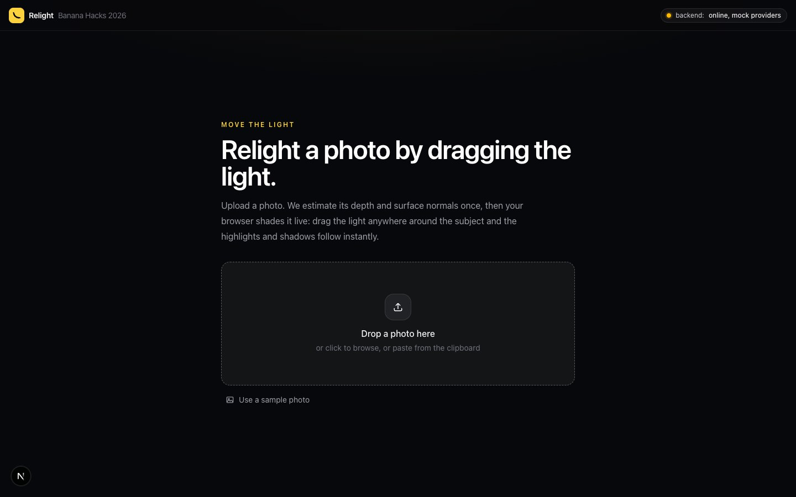

`Result: PASS / FAIL / NOT RUN` Note:

### U-03 Drag and drop a file

1. Open the `testing/photos` folder in Finder or File Explorer. 2. Drag `02-object-coffee.jpg` over the dashed box and hold it there. 3. Let go.

**Expected:** while the file is over the box, the box border turns yellow and its background gets a yellow tint. After dropping, the coffee photo loads in the workspace. (No screenshot exists for the yellow box.)

`Result: PASS / FAIL / NOT RUN` Note:

### U-04 Paste from the clipboard

1. Copy a picture: on any web page right-click a picture and choose "Copy image", or take a screenshot to the clipboard (macOS: Ctrl+Shift+Cmd+4; Windows: Win+Shift+S). 2. Click an empty part of the Relight first page. 3. Press Cmd+V (macOS) or Ctrl+V (Windows).

**Expected:** the pasted picture loads in the workspace, the same as choosing a file. This is also the way that always works for a picture on another web site (U-23). Pasting a picture's **address** is U-24.

`Result: PASS / FAIL / NOT RUN` Note:

### U-05 Sample photo: Portrait

1. Click the **Portrait** thumbnail under "Or try a sample photo:".

**Expected:** the astronaut photo opens at once, already lit. There is **no** "Estimating depth and surface normals…" wait. The sun sits near the left edge of the photo, about a third of the way down, on the flag. Readout x 0.12, y 0.35; Height 0.12, Intensity 1.80, Ambient 0.06, Colour neutral. The left of the face is bright and the right cheek is in shadow. Open GEOMETRY (click its row at the bottom of the sidebar): the size line reads "512 x 512 px, relief 0.3", and under it is the shading line, which starts "shading:" (F-01). This works with or without the backend.

`Result: PASS / FAIL / NOT RUN` Note:

### U-06 A file that is not a picture

1. Drag `testing/photos/not-an-image.txt` onto the dashed box and drop it. (The file chooser may not let you pick it, so drag it.) 2. Click the X at the right end of the red bar.

**Expected:** a red bar under the sample thumbnails reads "That file is not an image." The page stays on the first page. The X removes the bar.

`Result: PASS / FAIL / NOT RUN` Note:

### U-07 New photo starts clean

1. Load the astronaut **file**. Click **Low and warm**. Turn **Cast shadows** off. Type `test` in the ENHANCE text box. Open GEOMETRY and click **Detailed normals** off; wait for loading to finish. 2. Click **New photo** (top right of the stage). 3. Choose `02-object-coffee.jpg`. Open GEOMETRY (it is folded again).

**Expected:** step 2 returns to the first page. After step 3 the coffee photo shows and **every** control is back where a fresh page starts: x 0.12, y 0.35, Height 0.12, Intensity 1.80, Ambient 0.06, Colour neutral with a white dot, **Cast shadows on** (yellow). The ENHANCE text box is **empty** and shows its grey words "Optional: a mood, such as golden hour". **Detailed normals is on** (yellow) and the Normals picture is the detailed kind. Nothing from the first photo is carried over. (Before the Oct 10 evening update Cast shadows, the text and Detailed normals were kept. If any of them is kept now, that is a FAIL.) Without a backend: use the **Portrait** and **Coffee cup** samples and leave out the Detailed normals part. (The screenshot was taken in a tall 1440 x 1300 window so that the whole sidebar shows.)

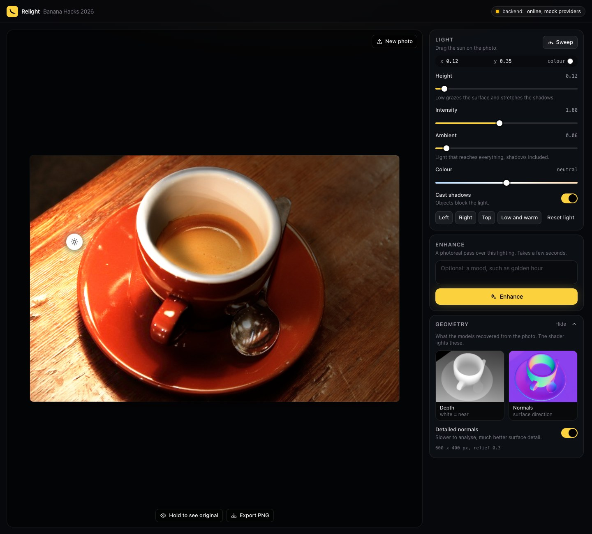

`Result: PASS / FAIL / NOT RUN` Note:

### U-08 The same file twice

1. Load the astronaut. 2. Click **New photo**. 3. Choose the same astronaut file again.

**Expected:** it loads again normally.

`Result: PASS / FAIL / NOT RUN` Note:

### U-09 Dropping a file in the wrong place

1. On the first page, drop a photo on the page **outside** the dashed box. Write down what happens. Use the browser's Back button if the app disappears. 2. Load a photo normally. Drop a different photo onto the **stage**. Write down what happens.

**Expected:** not defined. The app only listens for drops on the dashed box, so the browser will probably open the dropped picture by itself and leave the app. **Write down exactly what happened** and whether you lost your work. This is a likely first move by a judge.

`Result: PASS / FAIL / NOT RUN` Note:

### U-10 A photo from your own phone or camera

1. Load a photo taken on a phone, ideally one taken holding the phone upright. 2. If you have an iPhone photo ending in `.heic`, try that too.

**Expected:** the photo appears the right way up, not on its side. A `.heic` file should now load in every browser (changed in the early morning update of Oct 11; only Chrome on a Mac has been tried, and Chrome, Edge and Firefox need the internet for the first one; before that Chrome refused it with "That file is not an image this browser can read."). While it is read, the dashed box says "Converting your photo…". The full cases are U-26 (the kit's own `.heic` files), **U-27** (a photo sent by AirDrop from an iPhone) and U-28 (Windows). Write down the file type, the browser and what happened.

`Result: PASS / FAIL / NOT RUN` Note:

### U-11 A picture with a see-through background

1. Load a PNG picture that has a transparent background (a logo or sticker), if you have one.

**Expected:** it loads, and the transparent parts are shown white.

`Result: PASS / FAIL / NOT RUN` Note:

### U-12 Keyboard on the first page

1. Reload the page. Do not use the mouse. 2. Press Tab once, a second time, and a third time. 3. Press Enter. Close the file chooser with Escape. 4. Press the Space bar. Close the file chooser again. 5. Press Tab four more times, slowly. 6. Press Shift+Tab three times, then Enter.

**Expected:** step 2: the first Tab selects the "Relight" logo. The second Tab selects "How it works" in the top bar. The third Tab puts a yellow outline round the dashed box. Step 3: Enter opens the file chooser. Step 4: Space opens it too, and the page does not scroll. Step 5: each Tab moves a yellow outline to the next thumbnail: **Portrait**, **Coffee cup**, **Cat**, **Rocket**. Step 6: the outline is back on **Portrait**, and Enter opens the Portrait sample. In Safari the Tab key may skip buttons unless "Press Tab to highlight each item" is on in Safari's settings; say so if it does.

`Result: PASS / FAIL / NOT RUN` Note:

### U-13 Pasting things that are not a picture

1. On the first page: copy some words from anywhere, click an empty part of the page, press Cmd+V or Ctrl+V. 2. In Finder or File Explorer select `not-an-image.txt`, copy it (Cmd+C or Ctrl+C), go back to the page and paste. 3. Load the astronaut. Copy a picture (as in U-04). Click on the top bar of the page and paste. 4. Click in the ENHANCE text box and paste again.

**Expected:** step 1: nothing happens. No photo loads and no red bar appears. (Words that are a web address, starting `http://` or `https://`, are different: the page tries to load a picture from that address. That is U-24.) Step 2: either nothing happens, or a red bar reads "That file is not an image." It depends on whether your browser hands a copied file to the page. Write down the browser and which you got. Step 3: nothing happens; the astronaut stays. Paste only loads a picture on the first page. Step 4: nothing is added to the text box (a picture is not text) and the photo does not change.

`Result: PASS / FAIL / NOT RUN` Note:

### U-14 Dropping several files, a folder, or some words

Do each on the first page, onto the dashed box. Click **New photo** between steps.

1. Select `02-object-coffee.jpg` and `03-animal-cat.jpg` together and drop both at once. 2. Select `not-an-image.txt` and `03-animal-cat.jpg` together and drop both. Try twice, starting the drag from a different file each time. 3. Drop the whole `photos` folder. 4. On any web page or in any document, select a few ordinary words with the mouse and drag them onto the dashed box.

**Expected:** step 1: one photo loads, never both. The app uses only the first file the browser hands over; you cannot choose which. Step 2: the cat loads, both times. The app takes the first file that is a picture. (Before the late night update of Oct 10 it took whichever file the browser listed first, and could show a red bar here.) Step 3: for a moment the box reads "Reading image…", then a red bar reads "That file is not an image this browser can read." (it may read "That file is not an image." in some browsers). Step 4: the yellow tint goes away and a red bar under the thumbnails reads "Nothing in that drop was an image. Right-click the image and choose Copy image, then paste it on this page; or save it and drop the file here." The X removes it. (Before the late night update of Oct 10 a drop with no file in it did nothing at all, with no message. If that still happens, it is a FAIL.) Dragging a **picture** from a web page is U-23.

`Result: PASS / FAIL / NOT RUN` Note:

### U-15 Broken files

Make three files first. Copy `not-an-image.txt` to the Desktop three times and name the copies `broken.jpg`, `mystery` (no ending at all) and `empty.jpg`. Open `empty.jpg` in a text editor, delete everything, save. (If the computer hides file endings: macOS Finder, Settings, Advanced, "Show all filename extensions"; Windows File Explorer, View, Show, "File name extensions".)

1. Drop `broken.jpg` on the dashed box. 2. Click the X on the red bar. Drop `mystery`. 3. Drop `empty.jpg`.

**Expected:** all three: the page stays on the first page and a red bar under the sample thumbnails reads "That file is not an image this browser can read." The box may read "Reading image…" for an instant first. Note the difference from U-06: a file ending in `.txt` gives the shorter "That file is not an image." A new red bar replaces the old one; there are never two. The backend's own message "could not read image" should never appear from the page; if you ever see it, report what file caused it. (A damaged `.heic` file gives a different red bar: U-29.)

`Result: PASS / FAIL / NOT RUN` Note:

### U-16 Unusual picture types and sizes

Use whatever of these you have or can make. Skip the rest and say which you skipped. (a) an animated GIF; (b) a `.webp` file; (c) a `.avif` file; (d) a `.bmp` file; (e) a `.svg` file; (f) a 1 x 1 pixel picture; (g) a very thin strip, for example 4000 x 40 pixels; (h) a very large camera photo, 30 MB or about 50 megapixels. To make (f) and (g): open any picture in Preview (macOS: Tools, Adjust Size, untick "Scale proportionally") or Paint (Windows: Resize, Pixels, untick "Maintain aspect ratio"), set the size, and save under a new name.

1. Load each one in turn. For each, click **Left**, open GEOMETRY and look at its size line (the first of the two grey lines at the bottom).

**Expected:** (a) loads as a still picture: the first frame only. It does not move. (b), (c), (d): load like a normal photo if your browser can open that type (Chrome can open all three). If it cannot: "That file is not an image this browser can read." (e): either loads, or shows "That file is not an image this browser can read." or "That image has no size." (f) and (g): **not known.** The browser accepts them; what the backend's models do with a picture that small or that thin was never tried. For (g) the GEOMETRY line should read "1024 x 10 px". Write down exactly what happened, with the words of any red bar. If the red bar reads "The server hit an unexpected error. See the backend log.", copy the last 30 lines of terminal 1 into the issue. (h): the box may read "Reading image…" for a second or more, then the photo loads at normal speed and GEOMETRY shows 1024 for the longer side.

`Result: PASS / FAIL / NOT RUN` Note:

### U-17 "Reading image…"

1. On the first page choose `08-huge-astronaut-3000px.jpg` and watch the dashed box closely. 2. If you saw nothing, click **New photo** and try again with the largest photo you have.

**Expected:** for a moment (well under a second on a fast computer) the icon and the words in the dashed box are replaced by a spinner and "Reading image…". The four sample thumbnails do not change. Then the workspace appears. If it is too fast to see, mark NOT RUN and say so. (For a `.heic` photo the words are "Converting your photo…": U-26.)

`Result: PASS / FAIL / NOT RUN` Note:

### U-18 Sample photo: Coffee cup

1. On the first page click the **Coffee cup** thumbnail.

**Expected:** the coffee photo opens at once, with no "Estimating…" wait. Sun near the left edge on the table, readout x 0.12, y 0.35. The left side of the cup and saucer is bright; the right of the picture is darker, with a soft shadow to the right of the cup. Open GEOMETRY: the size line reads "600 x 400 px, relief 0.3".

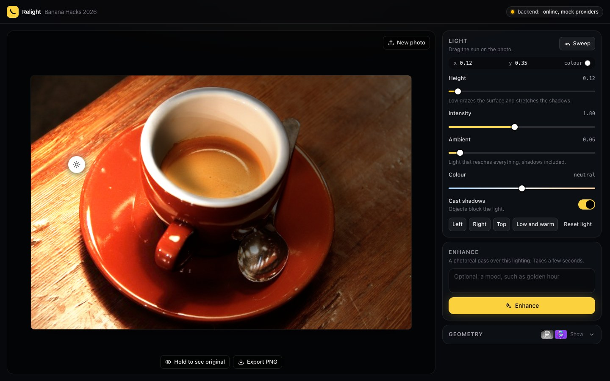

`Result: PASS / FAIL / NOT RUN` Note:

### U-19 Sample photo: Cat

1. On the first page click the **Cat** thumbnail.

**Expected:** the cat photo opens at once. Sun near the left edge, readout x 0.12, y 0.35. The fur on the left and the top of the nose are bright; the right side of the face and the background on the right are clearly darker. Open GEOMETRY: the size line reads "451 x 300 px, relief 0.3".

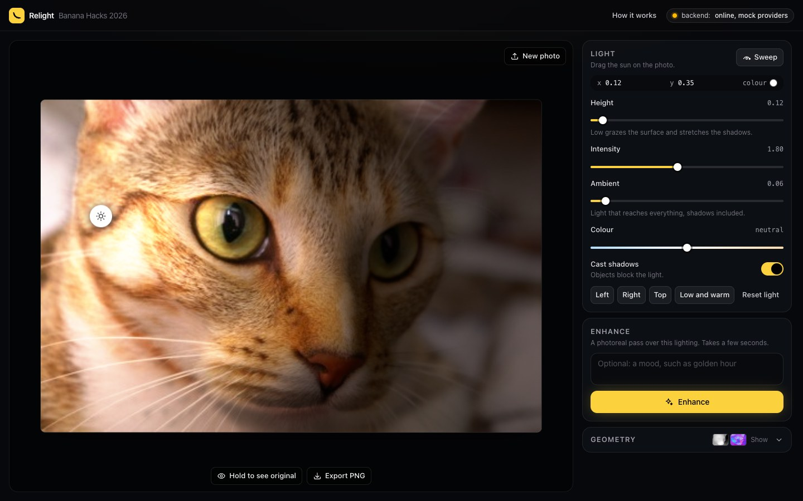

`Result: PASS / FAIL / NOT RUN` Note:

### U-20 Sample photo: Rocket

1. On the first page click the **Rocket** thumbnail.

**Expected:** the night rocket photo opens at once. Sun near the left edge on the left tower, readout x 0.12, y 0.35. The picture stays dark blue. The left tower is a little brighter and the right of the picture a little darker. There are **no** hard black blocks or stripes on the sky. Open GEOMETRY: the size line reads "640 x 427 px, relief 0.3". Known: a soft, blurred darker column on the sky to the right of each tower can be seen (K13 in [PENDING.md](PENDING.md#already-known-no-need-to-report)). Only a column with a sharp, straight edge is a FAIL.

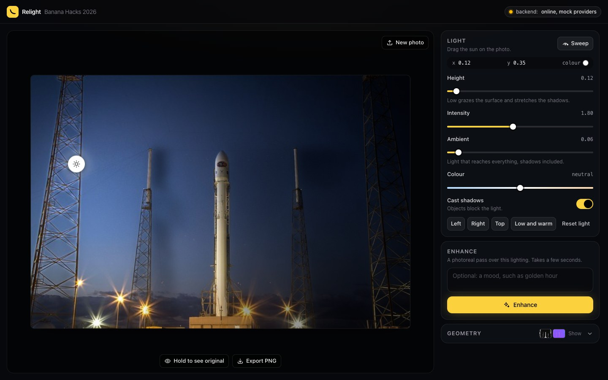

`Result: PASS / FAIL / NOT RUN` Note:

### U-21 The sample thumbnails themselves

1. Look at the row under "Or try a sample photo:". 2. Move the mouse over each thumbnail. 3. Click **Portrait** and watch the other three in the instant before the photo opens. 4. Click **New photo**. Click **Cat**. Click **New photo**. Click **Portrait** again.

**Expected:** step 1: four pictures of the same size in one row, each a small crop of its photo, with its label underneath: Portrait (the astronaut), Coffee cup, Cat, Rocket. No picture is missing, broken or stretched. Step 2: the border of the one under the mouse turns yellow. Step 3: for an instant the other three go dim and none can be clicked. This lasts well under a second; if you cannot see it, that is fine. Step 4: each sample opens every time, always starting at x 0.12, y 0.35.

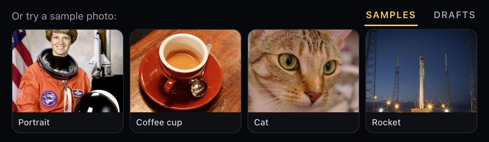
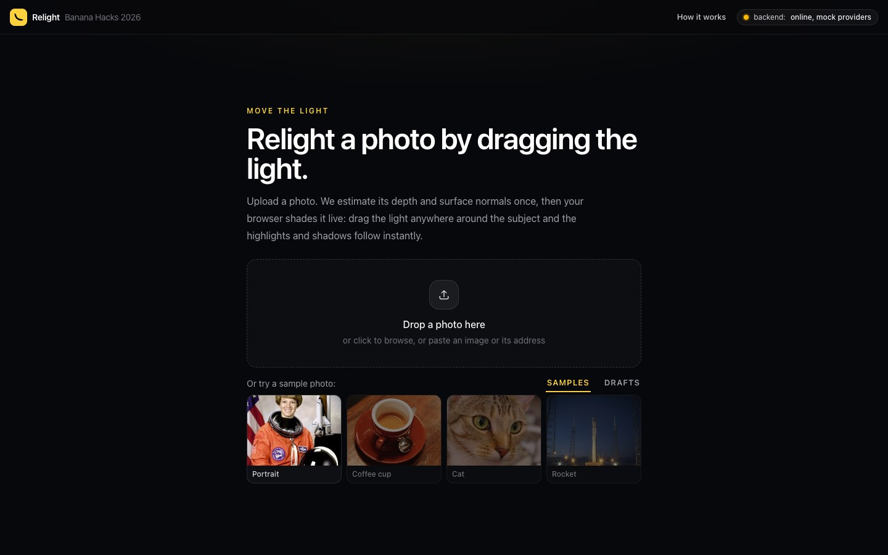

`Result: PASS / FAIL / NOT RUN` Note:

### U-22 A sample that cannot be loaded

1. Open the first page and wait until the four thumbnails show. 2. Stop the **frontend**: click terminal 2 and press Ctrl+C. Do not reload the page. 3. Click the **Coffee cup** thumbnail. 4. Click the X on the red bar. 5. Start the frontend again (SETUP step 6, without `npm ci`) and reload the page.

**Expected:** step 3: the page stays on the first page. A red bar appears under the thumbnails and reads "Could not load the sample photo. Check your connection and try again." in every browser. (Before the Oct 10 evening update it showed the browser's own words, "Failed to fetch". If you still see those, that is a FAIL.) The thumbnails can be clicked again. Step 4: the X removes the bar. Step 5: the page works again. One more wording exists and was never seen: "Could not load the sample photo (404)." (or another number), for a host that answers but does not have the file. If you ever see it, report the number and the address.

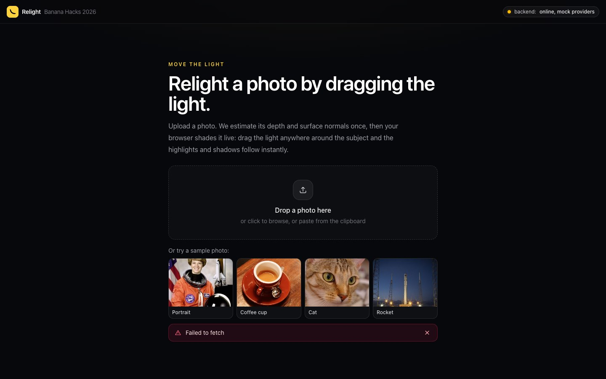

`Result: PASS / FAIL / NOT RUN` Note:

### U-23 Dragging a picture from another web page

New in the late night update of Oct 10. A tester asked for it. It works in every mode: the normal app, Plan B and the demo.

A browser lets one web page read a picture from another site only if that site allows it. Most sites do not. So this case has two right answers, and the page must tell you clearly which one you got.

1. Put two browser windows side by side: the Relight first page in one, and in the other a web page with a photograph on it. 2. Press on the photograph, drag it over the dashed box, hold it there, then let go. 3. If a red bar appeared: go back to the other page, right-click the same photograph and choose "Copy image". Click an empty part of the Relight first page and press Cmd+V (macOS) or Ctrl+V (Windows). 4. Click **New photo** and do steps 2 and 3 with pictures from two more sites. Make one of them a photograph in a Wikipedia article.

**Expected:** step 2: while the picture is over the box, the border turns yellow. After you let go, the box reads "Reading image…" for a moment. Then one of two things:

- (a) **The picture loads**, exactly like a dropped file, and no red bar shows. This happens for sites that allow reading. Pictures in Wikipedia articles usually do.
- (b) **A red bar** under the sample thumbnails: "That image's site does not let other pages read it. This is a browser security rule, not a fault in the image. Right-click the image and choose Copy image, then paste it on this page; or save it and drop the file here." The page stays on the first page. The X removes the bar. This is what most sites give. It is not a bug in the app.

Step 3: the pasted picture loads. Copy, then paste, works for every site.

A FAIL is any of these: nothing happens and no message shows; the browser leaves Relight and opens the picture by itself; the picture loads but is not the one you dragged; or a red bar with other words than the ones here and in U-25. **Write down each site, the browser, and whether you got (a) or (b).** (The developer could not drag by hand. The screenshots were made with a second small web server standing in for "another site".)

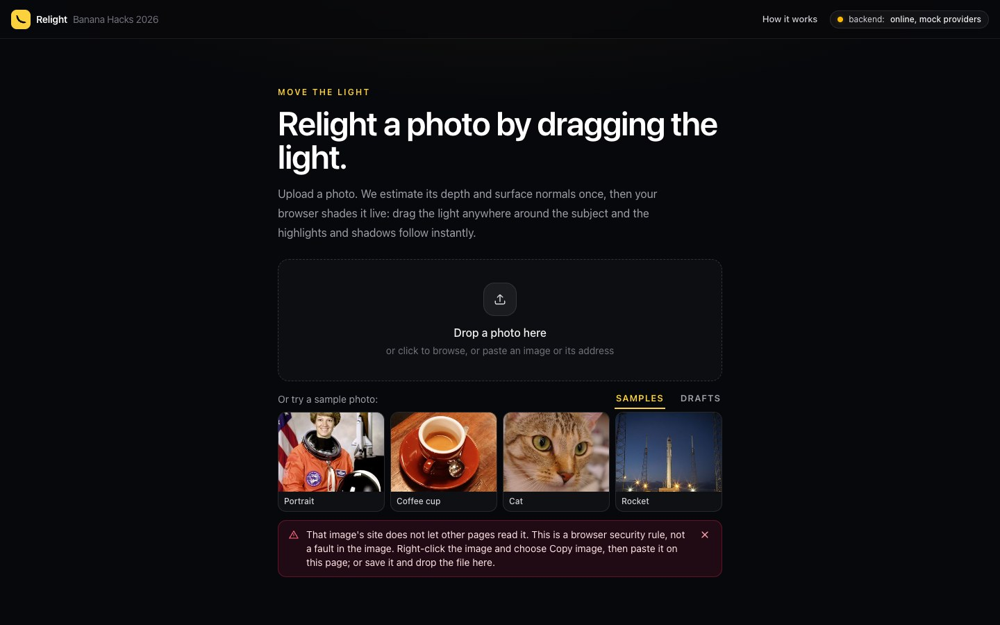
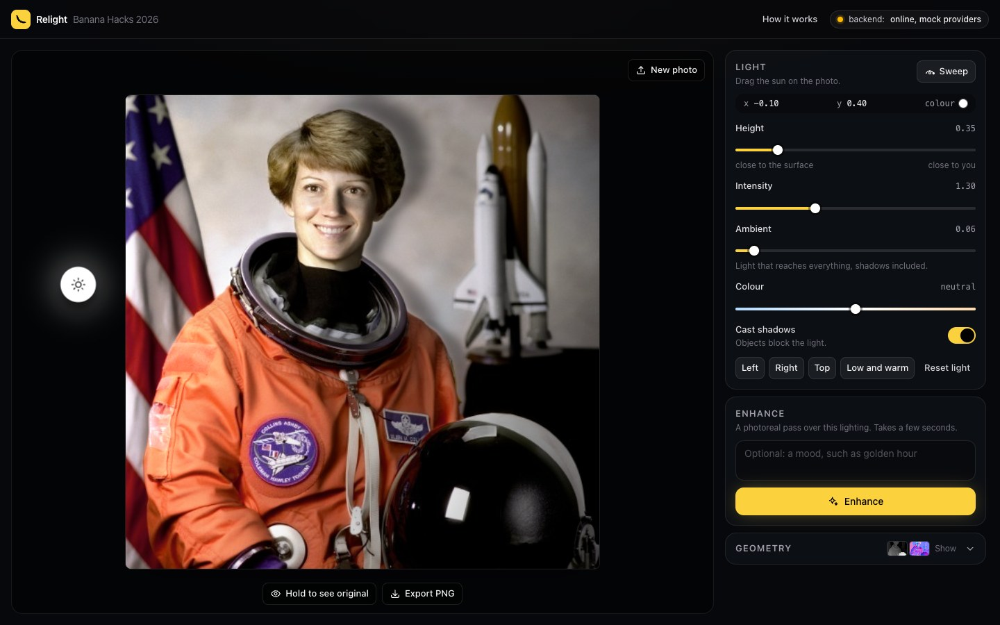

`Result: PASS / FAIL / NOT RUN` Note:

### U-24 Pasting a picture's address

New in the late night update of Oct 10. The hint in the dashed box says "paste an image or its address".

1. On a Wikipedia article, right-click a photograph and choose "Copy image address" (Firefox: "Copy Image Link"). 2. Click an empty part of the Relight first page and press Cmd+V or Ctrl+V. 3. Click **New photo**. Copy the address of an ordinary web page from the browser's address bar, for example `https://en.wikipedia.org`. Click an empty part of the Relight first page and paste. 4. Click the X on the red bar.

**Expected:** step 2: the box reads "Reading image…" for a moment, then the picture loads like a chosen file. If the site does not allow reading, you get the red bar of U-23 (b); try another site and say which sites you tried. Step 3: no photo loads. A red bar under the thumbnails reads either "That address is a web page, not an image. Drag the picture itself, or save it and drop the file here." or "That image's site does not let other pages read it. …" (the second when the site refuses before the app can tell what the address is). Both are right. Write down which you got. Step 4: the X removes the bar. (Written from the code. The developer did not paste by hand.)

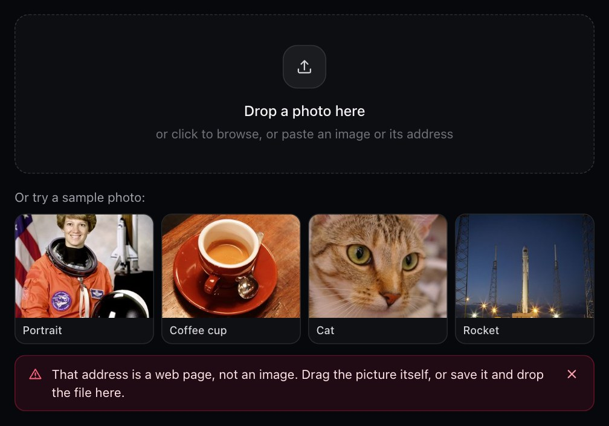

`Result: PASS / FAIL / NOT RUN` Note:

### U-25 The other messages for a picture's address (only if they happen)

You do not have to cause these. If you see one while doing U-23 or U-24, check its words here. To try for the first one: copy a picture's address as in U-24, paste it into a text editor, change a few letters of the file name at its end, copy the changed address and paste it on the Relight first page.

**Expected, if it happens:** always a red bar under the thumbnails, with an X, and the page stays on the first page.

- The site says the picture does not exist: "That image's site answered 404, so it could not be loaded. Right-click the image and choose Copy image, then paste it on this page; or save it and drop the file here." The number is the site's own answer and can be another one, such as 403 or 500.
- The site does not answer: the box shows a spinner and "Reading image…" for **15 seconds**, then: "That image took too long to load. Right-click the image and choose Copy image, then paste it on this page; or save it and drop the file here." Known: there is no way to stop the wait (K50).
- The address is a damaged built-in picture (it starts with `data:`): "That image could not be read. Save it and drop the file here."
- What was dropped holds no picture and no address: "Nothing in that drop was an image. Right-click the image and choose Copy image, then paste it on this page; or save it and drop the file here." (U-14 step 4).

Any other words in the red bar: copy them whole into a bug issue, with the address you used.

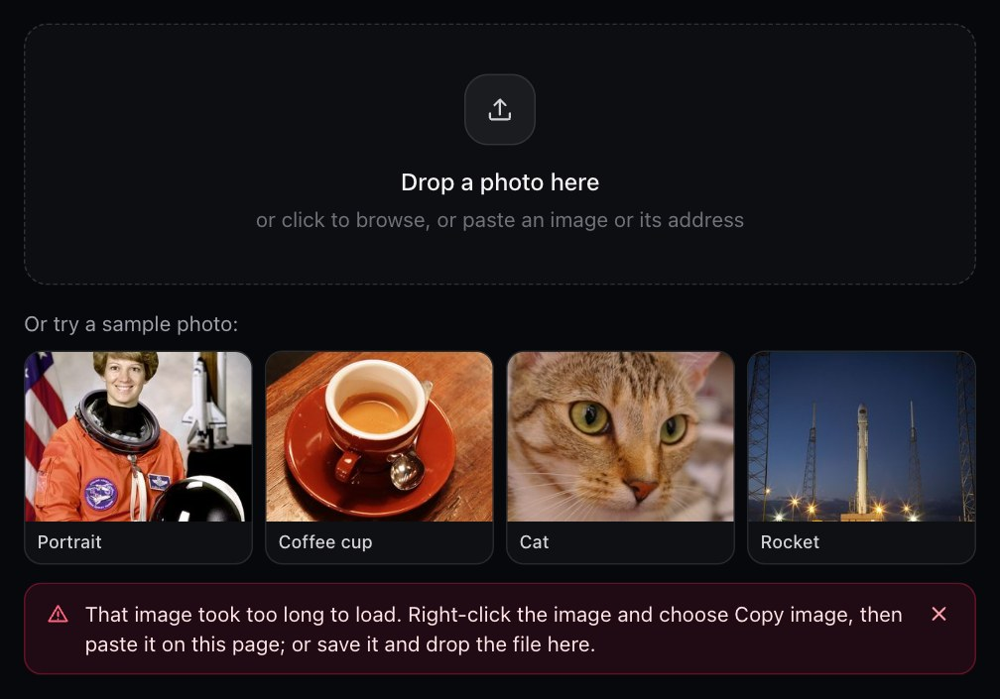
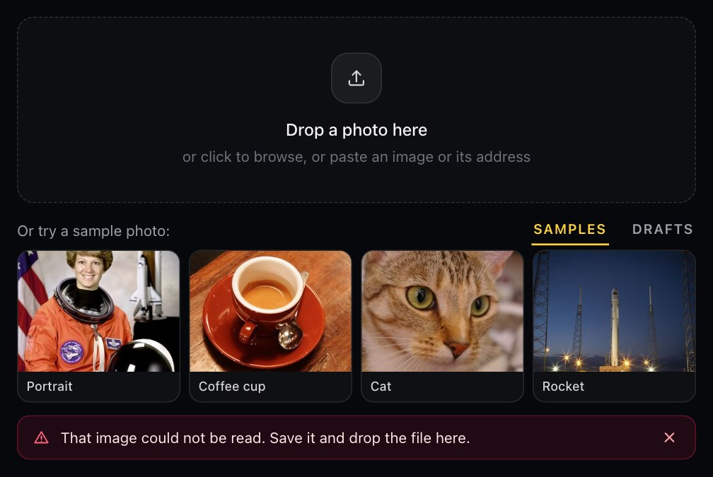

`Result: PASS / FAIL / NOT RUN` Note:

### U-26 The kit's HEIC photos (the kind an iPhone saves)

New in the early morning update of Oct 11. An iPhone saves its photos as HEIC files (the name ends in `.heic`). Chrome, Edge and Firefox cannot open that kind by themselves, so until now the app refused it. Now the page converts it. In those three browsers the first HEIC photo downloads a small converter from `cdn.jsdelivr.net`, so the computer needs the internet that one time. Safari opens HEIC by itself and downloads nothing. The three test files were made on a Mac, not by an iPhone. A real iPhone photo is U-27.

1. Click the dashed box and choose `testing/photos/09-iphone-portrait.heic`. Watch the dashed box. Count the seconds until the sun appears. 2. Click **Left**. 3. Click **New photo**. Drag `10-iphone-sideways.heic` from the folder onto the dashed box. 4. Open GEOMETRY and read the size line. 5. Click **New photo**. Choose `11-iphone-12mp.heic`. Count the seconds again. Open GEOMETRY and read the size line.

**Expected:** step 1: the file chooser lets you pick the `.heic` file. The dashed box shows a spinner and "Converting your photo…" (not "Reading image…"), for a second or two. Then the workspace opens as for any photo: with the backend, the photo is dimmed with "Estimating depth and surface normals…" and then lit. Nothing on the page says that the file was a HEIC. Step 2: it looks the same as `01-portrait-astronaut.jpg` with **Left** (C-05): x -0.10, y 0.40, the left of the face bright. The colours are right (no green, purple or grey cast) and the picture is sharp. Step 3: the tall astronaut comes out **upright**, taller than wide, with her head at the top. The file stores her lying on her side, with a note to turn the picture, as a phone held upright does; the app obeys the note. A sideways astronaut is a FAIL. Step 4: the size line starts "288 x 512 px". Step 5: the coffee cup, a full-size phone photo of 4032 x 3024 pixels, loads sharp and wider than tall. The size line starts "1024 x 768 px". On the developer's Mac it took 2 to 3 seconds from choosing the file to the sun. Write down your times; more than 15 seconds in step 5 is worth a report.

There is no red bar in any step. It is a FAIL if a red bar reads "That file is not an image this browser can read." or "That file is not an image.": that was the old answer.

Without a backend (Plan B, the demo, or **Analyse in this browser**) the same files work. The browser then also works out the photo's shape (P-10), so the first photo takes longer. The demo is H-13.

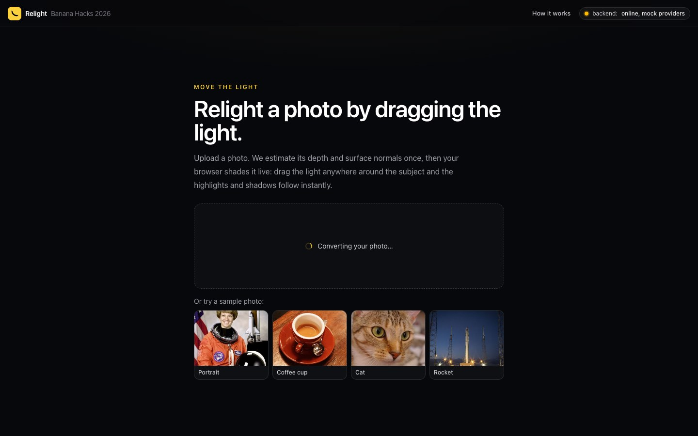

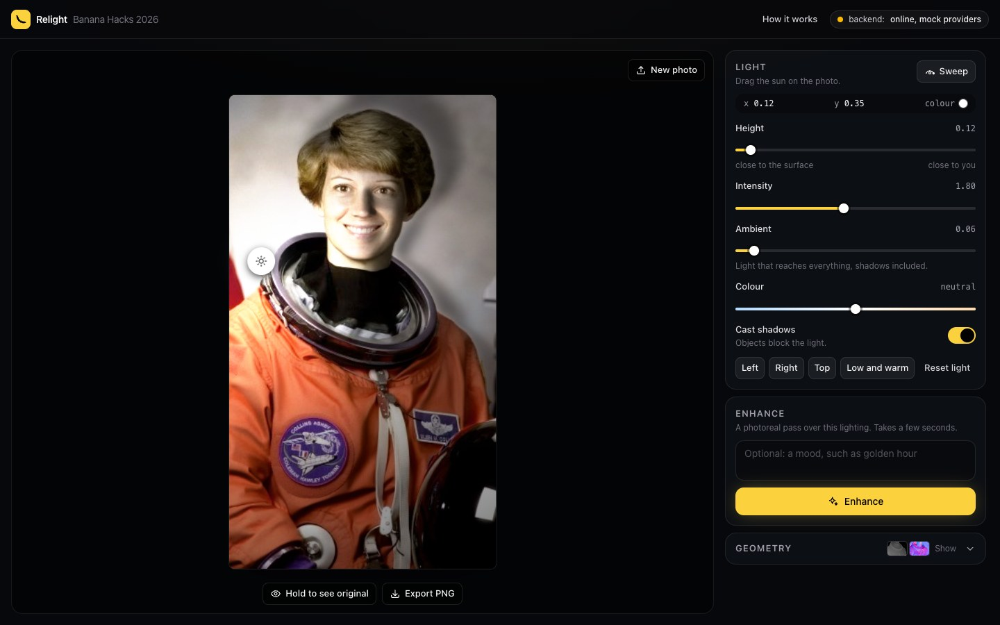
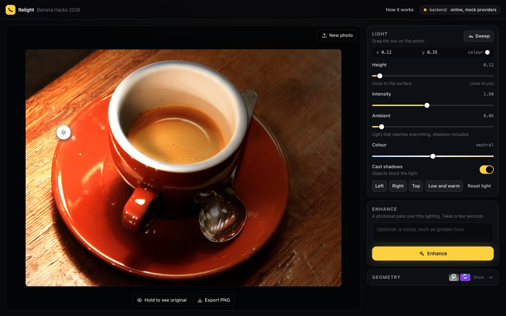

`Result: PASS / FAIL / NOT RUN` Browser, times and note:

### U-27 A HEIC photo sent by AirDrop from an iPhone to a Mac

New in the early morning update of Oct 11. Needs an iPhone and a Mac. This is what the owner asked for, and **nobody has tried it with a real iPhone photo**. The files in U-26 were made on a Mac and may differ from what an iPhone sends.

1. On the iPhone open Photos. Pick a photo taken holding the phone **upright**; a person is best. Tap the share button, tap AirDrop and choose your Mac. The photo lands in the Mac's Downloads folder. Look at its name: it should end in `.HEIC`. (If it ends in `.jpg` or `.jpeg`, the phone is set to save JPEG. On the iPhone: Settings, Camera, Formats, choose "High Efficiency". Take a new photo and send that one.) 2. In **Chrome**, on the Relight first page, click the dashed box and choose the photo. Count the seconds until the sun appears. Click **Left**. Take a screenshot. 3. Click **New photo**. Drag the same file from the Downloads folder onto the dashed box. 4. Click **New photo**. In Finder click the file once and press Cmd+C. Click an empty part of the Relight first page and press Cmd+V. 5. Do steps 2 to 4 again in **Safari**. 6. If you can: send a photo taken holding the phone **sideways**, a Portrait-mode photo and a Live Photo, and choose each one in Chrome. 7. If the iPhone itself can reach the app (a demo address, or W-16 step 8): tap the dashed box on the phone and choose a photo from the library.

**Expected:** step 2: the dashed box shows a spinner and "Converting your photo…" for a few seconds. Then the workspace opens and the photo is lit like any other. It is **the right way up**. Its colours look like the photo on the phone, and it is sharp. With GEOMETRY open, the longer side in the size line is 1024. A made-up full-size file took the developer's Mac 2 to 3 seconds; write down your time. More than 15 seconds is worth a report. Step 3: the same. The box's border turns yellow while the file is over it. Step 4: **not known.** Read from the code, the pasted file should load just like a chosen one. If nothing happens, or a small picture of a file icon loads in place of the photo, write that down with the browser's name. It is a result, not your mistake. Step 5: the same results in Safari. Safari opens the photo by itself, so the wait is shorter and nothing is downloaded. The box may still read "Converting your photo…" for an instant. Step 6: each one loads upright, as one still picture. Step 7: the photo loads upright. The phone may hand the page a HEIC or a JPEG; both should work. Not known: write down what happened.

A FAIL is any of these: a red bar (copy its words; U-29 lists the ones we know); the photo on its side or upside down; wrong colours, or a picture that is mostly green or grey; only a part of the photo, or squares of it in the wrong places; the page frozen for more than a few seconds.

**Report this even if everything works:** the iPhone model, the macOS version, each browser, the seconds, and "upright: yes or no". If something is wrong, the photo itself helps most. The repository is public, so attach it (inside a .zip file) only if you do not mind that; otherwise say so in the issue.

`Result: PASS / FAIL / NOT RUN` iPhone, browsers, times and note:

### U-28 A HEIC photo on Windows

New in the early morning update of Oct 11. Never tried: the developer has no Windows computer. No Windows browser opens HEIC by itself, so there the page always uses its converter, which needs the internet the first time.

1. In Chrome or Edge on Windows, click the dashed box. In the file chooser go to the `testing\photos` folder and choose `09-iphone-portrait.heic`. 2. Click **New photo**. Drag `10-iphone-sideways.heic` from File Explorer onto the dashed box. 3. Click **New photo**. Choose `11-iphone-12mp.heic` and count the seconds until the sun appears. 4. If you have a photo from a real iPhone whose name ends in `.heic`, try it too. 5. If you have Firefox, do step 1 in it.

**Expected:** the same as U-26: "Converting your photo…" in the dashed box, then the photo lit like any other, upright in step 2, and no red bar. File Explorer may show these files with a blank icon and no preview; that is normal on Windows and does not matter. If the file chooser does not list the `.heic` files, change the list at its bottom right to "All files", choose the file anyway, and say so in the note. Write down the browser, the seconds for step 3 and what you saw.

`Result: PASS / FAIL / NOT RUN` Browser, times and note:

### U-29 A HEIC photo that cannot be converted: the red bars

New in the early morning update of Oct 11. Step 1 is for everyone. Steps 2 and 3 are extra. In Safari do step 1 only and write down what happens: Safari opens HEIC by itself, so its words may differ.

1. Choose `testing/photos/broken-photo.heic`. It is the first part of a HEIC file, with the picture itself missing. Then click the X on the red bar. 2. The converter cannot be downloaded. Open a **new private window** (Chrome: Cmd+Shift+N on macOS, Ctrl+Shift+N on Windows), so that the browser has not kept the converter from before. Open http://localhost:3000 in it. Turn the computer's Wi-Fi off. Choose `09-iphone-portrait.heic` and wait up to one minute. Turn Wi-Fi on again and choose the file once more. 3. macOS only: make a HEIC photo that is too large. In Terminal, in the project folder, run `sips -z 8192 8192 -s format heic testing/photos/01-portrait-astronaut.jpg --out ~/Desktop/too-large.heic`. Choose `too-large.heic` from the Desktop. Delete it afterwards.

**Expected:** always a red bar under the sample thumbnails, with an X. The page stays on the first page and the dashed box goes back to "Drop a photo here".

- Step 1: "This HEIC photo could not be converted. Export it as a JPEG (on a Mac: open it in Preview, then File, Export) and use that." The X removes it. (This needs the internet in Chrome, Edge and Firefox: the converter is fetched before the file is tried. Offline you get the step 2 bar instead; that is not a FAIL of step 1.)
- Step 2: "This is a HEIC photo, which this browser cannot read by itself, and the converter for it could not be downloaded from cdn.jsdelivr.net. Check the connection and try again, or export the photo as a JPEG and use that." It may show at once, or after up to 60 seconds of "Converting your photo…". With Wi-Fi back on, the photo loads. (The developer staged this by blocking that one address inside Chrome. The Wi-Fi way was not tried.)
- Step 3: "This HEIC photo is too large to convert in a browser (8192 x 8192 pixels). Export it as a JPEG (on a Mac: open it in Preview, then File, Export) and use that." The two numbers are the photo's own size. The limit is 64 million pixels. An iPhone's largest photo (48 million) is under it and should load.

A FAIL is any of these: no bar and no photo; the old bar "That file is not an image this browser can read."; the box stuck on "Converting your photo…" for more than about a minute; or a damaged file that **loads** and shows a picture that is mostly green or grey, with no error. That last one was found by an automatic check, for a large iPhone-style HEIC file cut short just after its beginning (an interrupted AirDrop or download leaves a file like that). The app now refuses a file that stops before its own contents do, with the step 1 bar; the check was run on the kit's own files and on two cut copies of `11-iphone-12mp.heic`, not in a browser by hand. If you see a green or grey picture all the same, attach the file.

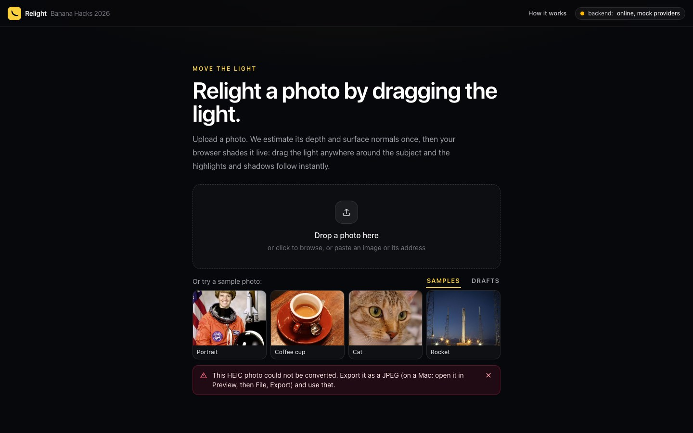

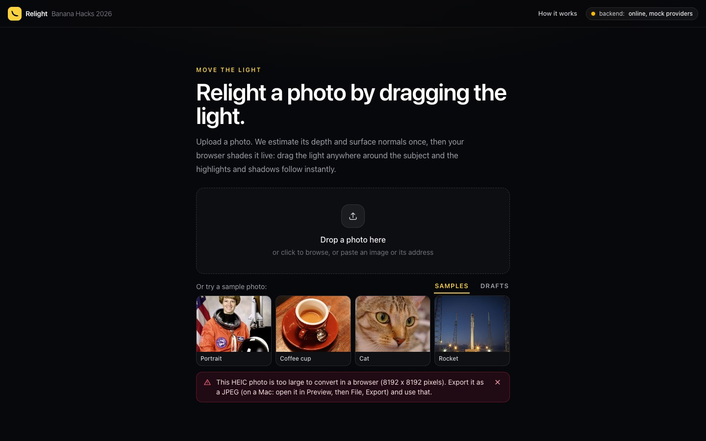

`Result: PASS / FAIL / NOT RUN` Note:

---

## P. Scene preparation

"Scene preparation" is the wait after choosing a photo, while the backend works out the photo's shape. With no backend (Plan B, the static demo, or the **Analyse in this browser** button) your browser works it out by itself: cases P-10 to P-13, new in the late night update of Oct 10.

### P-01 Loading screen

1. From the first page, choose the astronaut file (click the dashed box; do not use the sample) and watch closely.

**Expected:** at once the workspace appears with the photo dimmed, a centred label "Estimating depth and surface normals…" with a spinner, and a faint yellow band moving down the photo. No sun yet. The sidebar is faded. For a moment the label may read "Preparing the shader…". Then the photo brightens and the sun appears near the left edge.

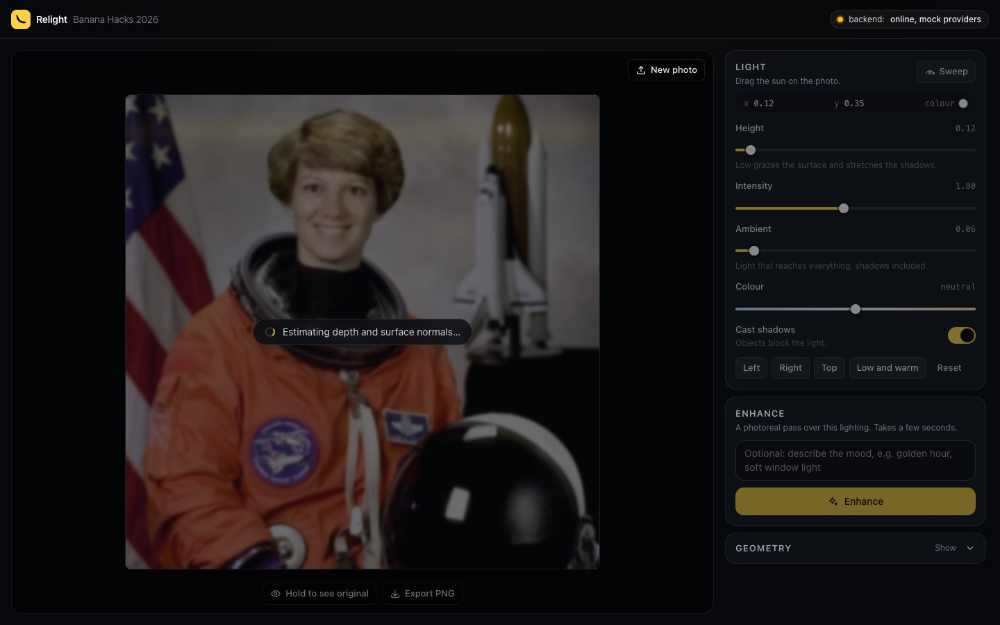

`Result: PASS / FAIL / NOT RUN` Note:

### P-02 Controls are locked while loading

1. Choose a photo file and, while the loading label shows, try to click **Left**, **Sweep**, the **Enhance** button, **Hold to see original** and **Export PNG**.

**Expected:** the sliders and presets in the LIGHT panel are faded and do not react. **Sweep**, **Enhance**, **Hold to see original** and **Export PNG** are faded and do not react. The GEOMETRY row shows "Show" but no two small pictures. **New photo** still works. (If loading is too fast to try this, mark NOT RUN and say so.)

`Result: PASS / FAIL / NOT RUN` Note:

### P-03 Geometry panel: folded, then opened

1. Load the astronaut. Look at the bottom of the sidebar. 2. Click the **GEOMETRY** row. 3. Click the row again.

**Expected:** step 1: GEOMETRY is folded into one row: the word "GEOMETRY", two tiny pictures (a grey one and a purple one), the word "Show" and a down arrow. Step 2: the panel opens and the sidebar scrolls by itself so you can see it. The row now says "Hide" with an up arrow, and the two tiny pictures are gone from the row. Inside: the sentence "What the models recovered from the photo. The shader lights these."; two pictures. "Depth" with "white = near": a grey version of the scene in which the helmet at bottom right is whitest (it is nearest the camera) and the wall is dark. "Normals" with "surface direction": a pink, blue and purple picture in which you can recognise the face and suit. Under them the **Detailed normals** switch (on, yellow) with "Slower to analyse, much better surface detail.", then two small grey lines in typewriter letters: the size line "512 x 512 px, relief 0.3" and the shading line, which on most computers reads "shading: graphics chip, full quality" (F-01). Step 3: the panel folds back to one row.

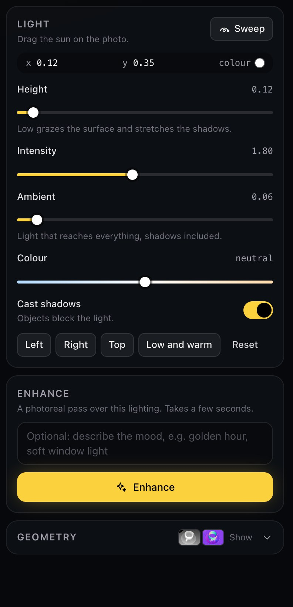
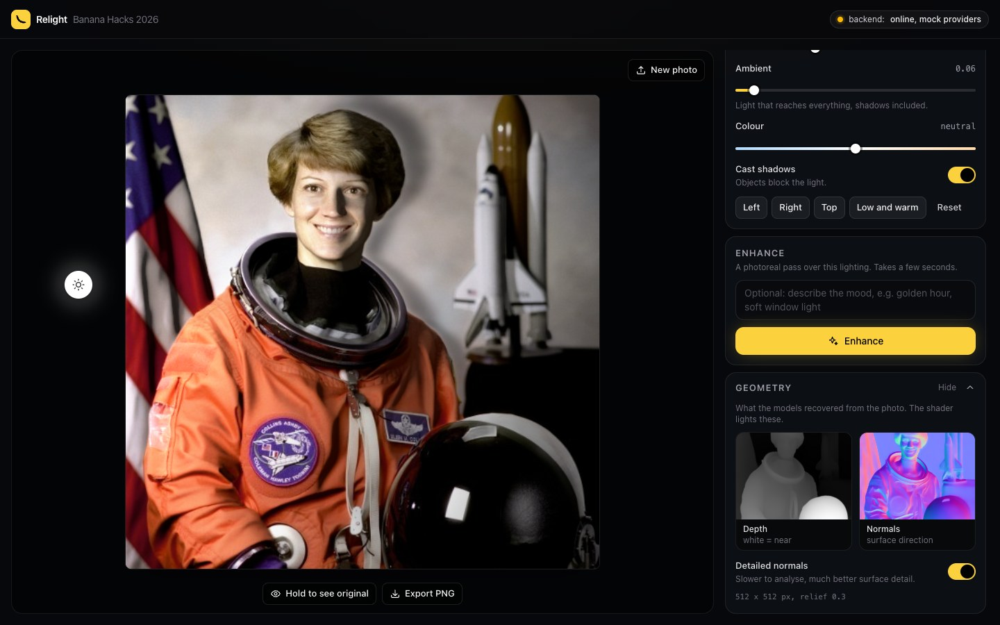

`Result: PASS / FAIL / NOT RUN` Note:

### P-04 Detailed normals switch

1. Load the astronaut file (not the sample). Click **Left**. Open GEOMETRY. 2. Click the **Detailed normals** switch off. Wait for loading to finish. 3. Click it on again.

**Expected:** each click shows the loading label again, straight away, for the same photo. GEOMETRY stays open. With the switch off, the Normals picture is smooth: soft blue and lilac shapes with no fine detail. Depth looks the same. The lighting on the photo is smoother with less surface detail, and a thin light outline may show round the head and shoulders (known issue). With the switch on, Normals is vivid and detailed again. The light position and sliders do not change.

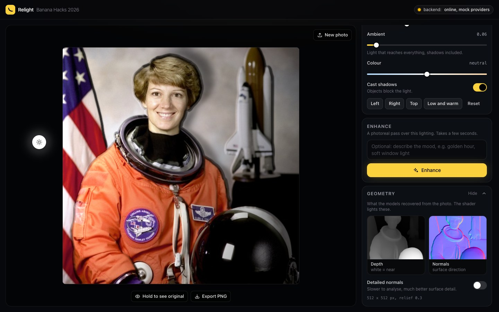

`Result: PASS / FAIL / NOT RUN` Note:

### P-05 Model download and the first photo (do once, during setup)

1. During setup, time the model download (SETUP step 4). 2. Start both programs and load the first photo. Time it.

**Expected:** step 1: progress bars show in the terminal and the last line is `models ready`. It takes 10 to 30 minutes or more on home internet. Step 2: the first photo is ready in well under a minute on an Apple-chip Mac (about 7 seconds was measured), with no download bars in terminal 1. **Write down both times** and your internet speed if you know it. If you skipped step 4, the page shows "Estimating depth and surface normals…" for many minutes while terminal 1 shows download bars; say so in the note.

`Result: PASS / FAIL / NOT RUN` Note:

### P-06 Detailed normals switch while a photo is loading, after Reset light, and after New photo

1. Reload the page. Choose `08-huge-astronaut-3000px.jpg`. 2. At once click the GEOMETRY row to open it and click **Detailed normals** off, while "Estimating depth and surface normals…" still shows. Wait. 3. Click **Reset light** in the LIGHT panel. 4. Click **New photo** and choose the coffee photo file. Open GEOMETRY. 5. Click **Detailed normals** off and wait. Click **New photo** and click the **Cat** sample thumbnail. Open GEOMETRY.

**Expected:** step 2: while loading, the opened panel shows two shimmering grey boxes in place of the pictures. The switch reacts at once and turns grey, although every other control is locked. The loading label stays; loading starts again for the same photo. When it ends, the Normals picture is the smooth kind (as in screenshot 26). The photo does not flicker or load twice, and the detailed Normals picture never appears afterwards. Step 3: **Reset light** does not turn the switch on; it only changes the light. Step 4: the switch is **on** (yellow) again for the new photo, and its Normals picture is the detailed kind. **New photo** puts every control back to its start (U-07). Step 5: the sample opens with the switch on. (If loading is too fast to click during it, do steps 3 to 5 anyway and say so.)

`Result: PASS / FAIL / NOT RUN` Note:

### P-07 Geometry panel on a sample

1. On the first page click the **Coffee cup** thumbnail. 2. Click the **GEOMETRY** row.

**Expected:** step 1: the GEOMETRY row shows two tiny pictures straight away. Step 2: Depth shows the cup and saucer in light grey on a darker table. Normals shows the cup in green, blue and pink on a purple background. **Detailed normals** is on. The size line reads "600 x 400 px, relief 0.3", and the shading line is under it. The sidebar now has more than fits a 1440 x 900 window: it scrolls, and a thin light-grey scrollbar is visible at its right edge without you having to scroll first. (The screenshots do not show the scrollbar; the tool that took them hides it. In your browser it should be there. Say if it is not.)

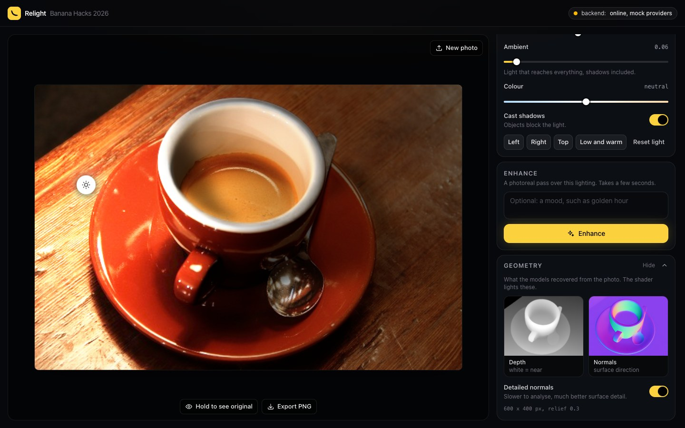

`Result: PASS / FAIL / NOT RUN` Note:

### P-08 Detailed normals on a sample, backend running

Needs the backend (pill "online, mock providers"). The case with the backend stopped is R-18. In Plan B and in the demo the switch is greyed on a sample: that is P-09.

1. Click the **Portrait** thumbnail. Click **Left**. Open GEOMETRY. 2. Click **Detailed normals** off. Wait. 3. Click it on. Wait.

**Expected:** step 2: the sample stays on screen while the backend studies the photo; the label "Estimating depth and surface normals…" may show over it. Then the Normals picture changes to the smooth kind and the lighting gets smoother. No red bar. Step 3: the detailed Normals picture comes back. The light position and sliders do not change in either step. From now on this photo behaves like an uploaded one. (Expected text read from the code; the developer did not run this case.)

`Result: PASS / FAIL / NOT RUN` Note:

### P-09 Detailed normals on a sample with no backend at all (Plan B or the demo)

Needs Plan B (pill "backend: mock") or the static demo (pill "demo: runs in your browser"). With a backend, do P-08.

1. Click the **Cat** sample. Do not move the light. Open GEOMETRY. If the bottom of the sidebar is out of sight, scroll the sidebar down. 2. Look at the **Detailed normals** switch and the grey line under it. 3. Click the switch. Press Tab until you have passed the GEOMETRY row and see where the selection goes.

**Expected:** step 2: the switch is **on** but dull (dark yellow, greyed). The line under it reads "Always on for a sample photo: its maps were made ahead of time with detailed normals." (On a window less than 832 pixels high that line is hover text on the switch.) Step 3: the click does nothing: no loading label, no change to the photo, to the Normals picture or to the light. The mouse pointer over the switch is a "not allowed" sign. Tab skips the switch. (Before the Oct 10 evening update the switch could be clicked in Plan B, and the sample then lost its shape and was lit as a round dome. If the cat ever turns into a dome, that is a FAIL.) On your **own** photo in Plan B or the demo the switch is greyed too, but **off**: P-12.

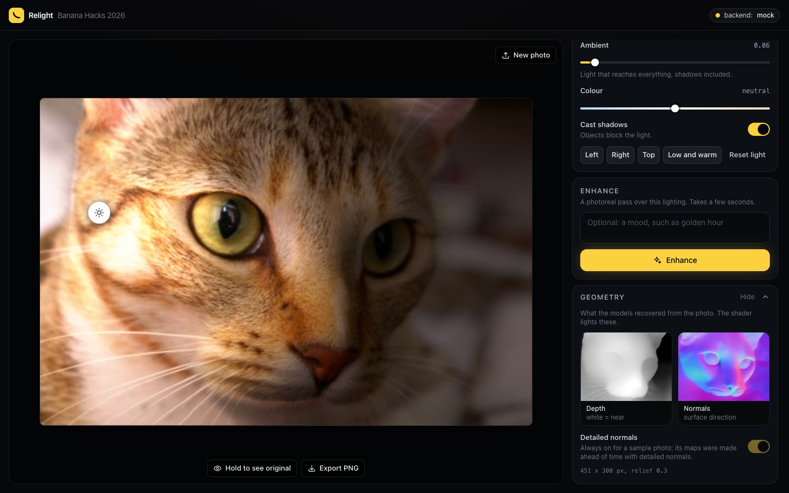

`Result: PASS / FAIL / NOT RUN` Note:

### P-10 Your own photo with no backend: the first time

New in the late night update of Oct 10. Needs Plan B (pill "backend: mock") or the static demo (pill "demo: runs in your browser"). For the normal app with the backend stopped, do R-22.

With no backend, your browser works out the photo's shape by itself. The first time, it downloads a depth model of about 25 MB. To see that first time, use a browser window that has never done this on this address: a new **private** (incognito) window is the easy way. Have a stopwatch ready.

1. Open the page in the new private window. Read the grey line under the dashed box. 2. Click the dashed box. Start the stopwatch as you choose `testing/photos/01-portrait-astronaut.jpg`. Watch the label on the dimmed photo. Stop the stopwatch when the sun appears. 3. Click **Left**. Drag the sun. 4. Open GEOMETRY and copy its three small grey lines.

**Expected:** step 1: "Your photo stays on this device: its shape is worked out in your browser and nothing is uploaded. The first photo downloads a depth model of about 25 MB, once." Step 2: at once the workspace appears with the photo dimmed and a label with a spinner in the middle. Its words change in this order. Some pass too fast to read; that is fine.

- "Preparing your photo…"
- "Downloading the depth model, once…"
- "Downloading the depth model, 19 MB, once… 42%" (the number counts up to 100%)
- "Starting the depth model…"
- "Working out the shape of your photo…"
- for an instant, perhaps, "Preparing the shader…"

It never reads "Estimating depth and surface normals…"; those are the backend's words. Then the photo brightens and the sun appears near the left edge, on the flag. Step 3: the left of the face is bright and the right half darker, and the lighting follows the sun at once. There is no red bar, no card and no round dome. The face is a little flatter than on the Portrait sample; that is known (Q-12). Step 4: see P-12.

**How long is acceptable.** On the developer's Mac with fast internet: about 3 seconds, or about 5 where the depth line says "processor (WebAssembly)". On home internet the download decides. **Up to 1 minute is acceptable.** More than 2 minutes is a FAIL, and so is a label that stops changing for more than a minute: write down the last words you saw. Write down your time, your internet speed if you know it, the device and the browser. (This has run only in Chrome on one Apple-chip Mac. Every other browser and device is new ground.)

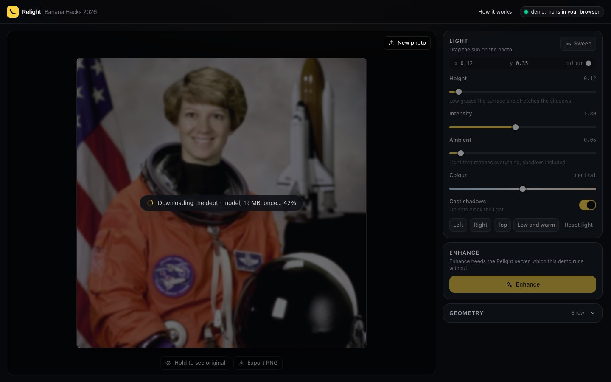
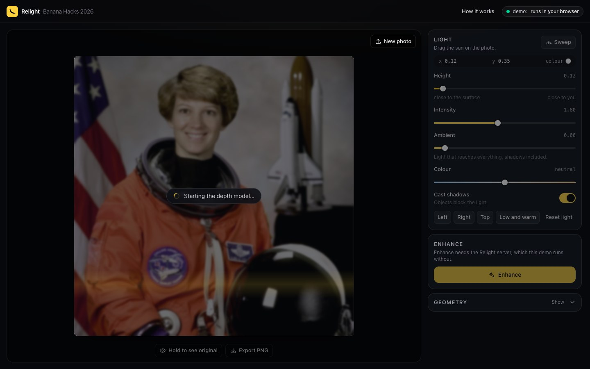
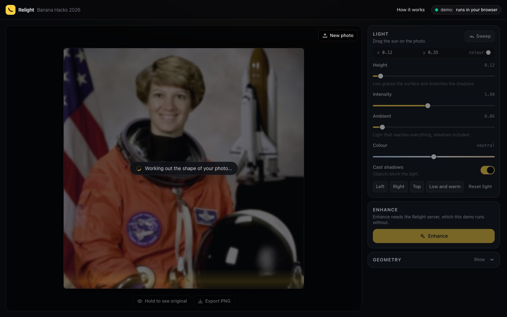
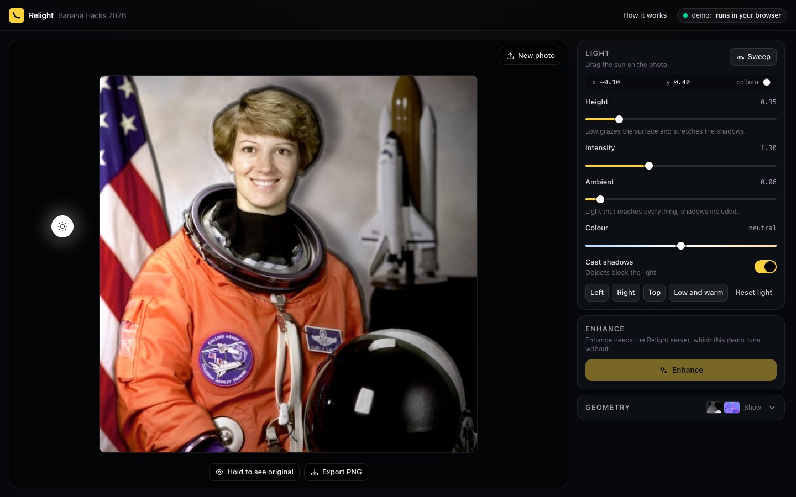

`Result: PASS / FAIL / NOT RUN` Time, device, browser and note:

### P-11 Your own photo with no backend: the second photo, and after a reload

Do this straight after P-10, in the same window. The depth model is now stored in the browser, so nothing should be downloaded again.

1. Click **New photo**. Choose `02-object-coffee.jpg`. Time it and watch the label. 2. Reload the page (do not close the private window). Choose `03-animal-cat.jpg`. Time it and watch the label. 3. Switch the computer's Wi-Fi off. Click **New photo** and choose the astronaut file. Switch Wi-Fi on again.

**Expected:** step 1: no "Downloading…" words. The label reads "Working out the shape of your photo…" for a moment and the cup is lit. On the developer's Mac: under half a second, or 2 to 3 seconds on the processor. Step 2: the label reads "Loading the depth model…" (not "Downloading…"), then "Starting the depth model…", then "Working out the shape of your photo…". On the developer's Mac: about 1 second, or 2.5 to 4 seconds on the processor. Step 3: the photo should still load, because nothing is fetched from another site any more. The developer did not try step 3; write down what happened. (On the hosted demo, do not reload while Wi-Fi is off.)

**How long is acceptable** for steps 1 and 2: up to 15 seconds on a computer and up to 30 seconds on a phone. Longer is a FAIL. "Downloading the depth model" showing again after a reload is also a FAIL, with two exceptions that are known: you closed the private window in between, or you opened the page by a number address such as `http://192.168.1.23:3000` (W-16 step 8), where the browser is not allowed to store the model (K53).

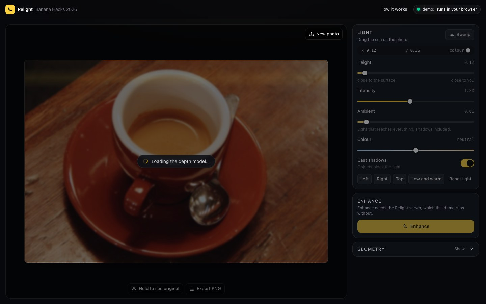

`Result: PASS / FAIL / NOT RUN` Times and note:

### P-12 GEOMETRY and Detailed normals for a photo analysed in the browser

Needs Plan B or the static demo. (In the normal app, after **Analyse in this browser**, the panel reads the same but the switch can be clicked: R-22.)

1. Choose the astronaut **file** (not the sample) and wait for the lit photo. Click **Left**. Open GEOMETRY. If the bottom of the sidebar is out of sight, scroll the sidebar down. 2. Read the panel from top to bottom. 3. Hold the mouse still for two seconds over the small grey line that starts "depth:". 4. Click the **Detailed normals** switch. Press Tab until you have passed the GEOMETRY row.

**Expected:** step 2, in this order:

- The first sentence: "Depth estimated in your browser by Depth Anything V2 Small, the model the Relight server uses. The normals are taken from the slope of that depth map, so they are smoother than the server's detailed normals: a face shades flatter." (For a sample it reads "What the models recovered from the photo. The shader lights these.")
- "Depth", "white = near": a grey picture of the scene; the helmet at bottom right is whitest.
- "Normals", "surface direction": **smooth** lilac and blue, with thin green, pink and red lines along the edges of the head, the collar and the helmet. You cannot make out the eyes, nose or mouth. (On the Portrait sample this picture is vivid and shows the face. The difference is expected.)
- **Detailed normals**: the switch is **off**, dull and greyed. Under it: "Off for your own photo: detailed normals come from a second, much larger model that only the Relight server runs." (On a window less than 832 pixels high that line is hover text on the switch.)
- Three small grey lines in typewriter letters: the size line "512 x 512 px, relief 0.3"; the **depth line**, which is new, "depth: this browser, graphics chip (WebGPU)" or "depth: this browser, processor (WebAssembly)"; and the shading line (F-01).

**Copy the depth line into your report.** The developer has only ever seen "graphics chip (WebGPU)"; if yours says "processor (WebAssembly)", that is a result we want, with your time from P-10. Step 3: the hover text reads "The depth model ran in this browser. The photo was not sent anywhere." Step 4: the click does nothing: no loading label, no change to the photo. The mouse pointer over the switch is a "not allowed" sign. Tab skips the switch.

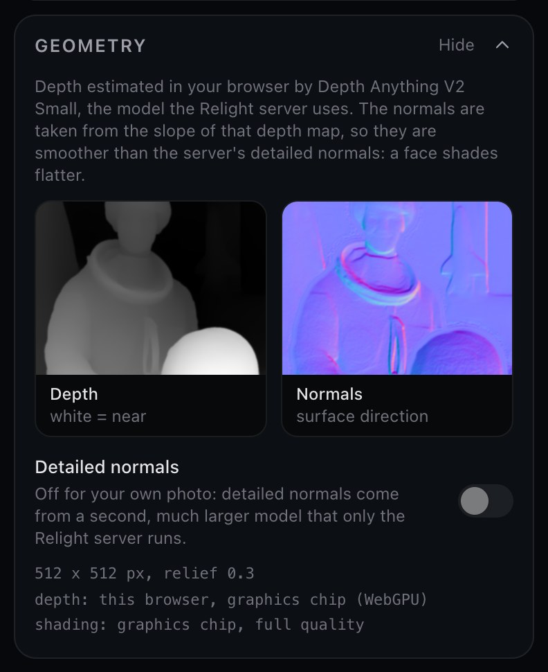
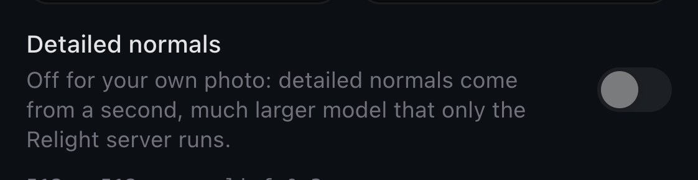

`Result: PASS / FAIL / NOT RUN` Depth line and note:

### P-13 When the browser cannot analyse the photo

Needs Plan B or the static demo. The easy way to cause it: the depth model cannot be downloaded.

1. Open the page in a **new private window**, so that no depth model is stored. Wait until the four thumbnails show. 2. Switch the computer's Wi-Fi off. (Plan B still works: the page comes from your own computer. On the hosted demo, do not reload.) 3. Choose the astronaut **file**. Wait up to a minute. 4. Switch Wi-Fi on. Wait ten seconds. Click **Retry**. 5. Cause the card again (steps 1 to 3), then click **Choose another photo** and click the **Portrait** sample.

**Expected:** step 3: the photo turns grey and dim. On top of it (on a phone: under the stage) sits a card with a red border: a warning sign, "This photo could not be analysed", and the line "The depth model could not be downloaded. Check your connection and try again. The sample photos work without it." On the demo the card has two buttons: a yellow **Retry** and **Choose another photo**. In Plan B there is a third between them, **Use a stand-in dome** (R-23). There is no red bar above the stage and no sun; the LIGHT panel and the buttons are faded, as in R-02. Step 4: the card goes, the label shows the download words of P-10, and the photo is lit. Step 5: the app returns to the first page and the sample opens at once: samples never need the model.

The card can show five other lines. The developer has never seen any of them on screen. **If you see one, copy it whole, with the device, the browser and the size of the photo.** On a phone, any of the last three is among the most important things you can report.

- "The depth model stopped downloading. Check your connection and try again. The sample photos work without it." (nothing arrived for 60 seconds while the percentage was counting up, or the label stayed on "Starting the depth model…" for three minutes. That stage, in which the last part of the download arrives with no percentage, was given three minutes in version `2b385ef`; before, it too stopped after 60 seconds. On very slow internet the line can still show although the download was still going: K52)
- "That file is not an image this browser can read."
- "Working out the shape took too long on this device, so it was stopped. The sample photos work without it." (after 90 seconds)
- "This device ran out of memory running the depth model. Close other tabs and try again, or try a smaller photo. The sample photos work without it."
- "This browser could not run the depth model. Try a current Chrome, Edge, Firefox or Safari. The sample photos work without it."

(The screenshot was made by blocking the model's web address, not by switching Wi-Fi off. On the hosted demo, with Wi-Fi off, another of the lines above may show, because a part of the page itself is fetched late. Write down which.)

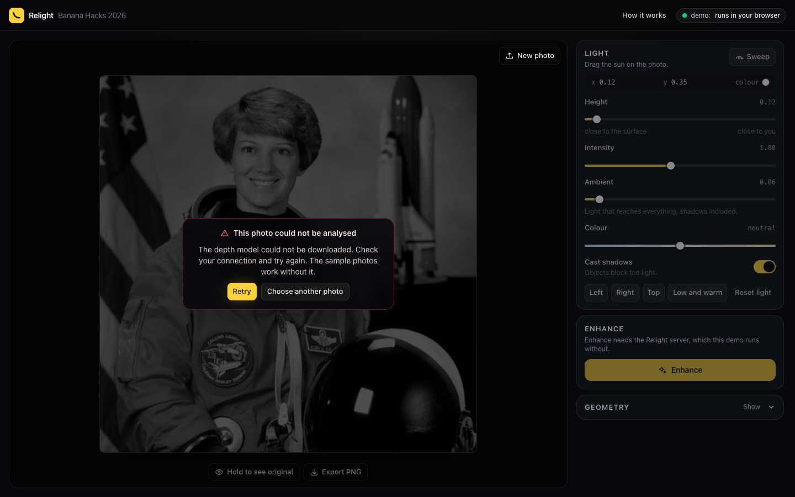

`Result: PASS / FAIL / NOT RUN` Note:

---

## L. Moving the light

### L-01 Starting position

1. Standard start.

**Expected:** a round white button with a sun icon and a soft glow, near the left edge of the photo about a third of the way down, on the flag. The white disc is 40 pixels across here; since Oct 11 its size follows **Height** (C-12). Readout "x 0.12", "y 0.35", "colour" with a white dot. Height 0.12, Intensity 1.80, Ambient 0.06. The left of the face is clearly bright and the right cheek is in shadow. Every photo and every sample starts with this light.

`Result: PASS / FAIL / NOT RUN` Note:

### L-02 Drag the sun to each side

1. Drag the sun to the left edge of the photo, half way down. 2. Drag it to the right edge, half way down. 3. Drag it to the top edge, in the middle. 4. Drag it to the middle of the photo, onto the metal neck ring of the suit.

**Expected:** the bright side follows the sun each time: (1) left side of the face bright, about x 0.03, y 0.50; (2) right side bright and the left half of the face dark, about x 0.97; (3) hair and forehead brightest, about y 0.03; (4) about x 0.50, y 0.45: the neck ring and chest are brightest and the face is lit from below, with no bright side. The mouse pointer is a grab hand over the sun.

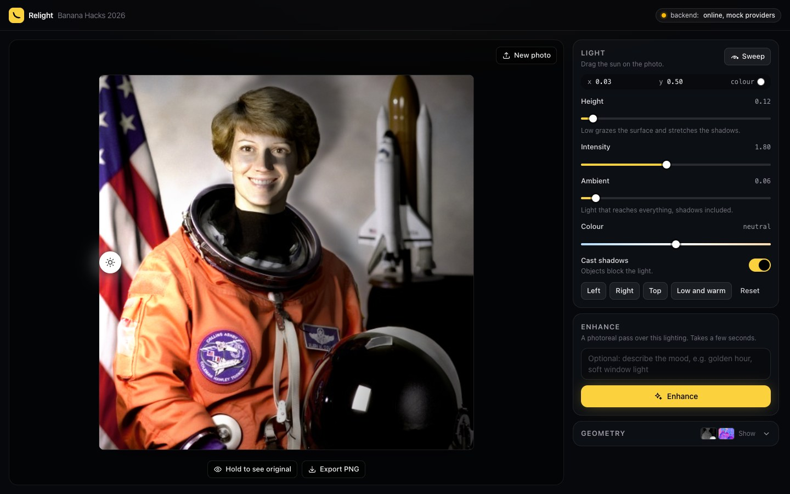
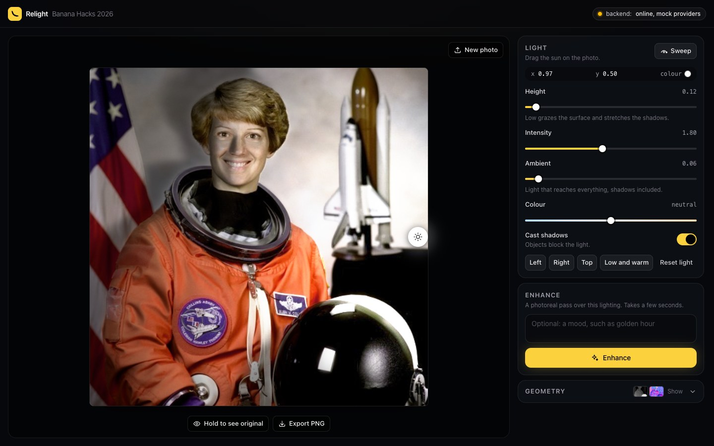
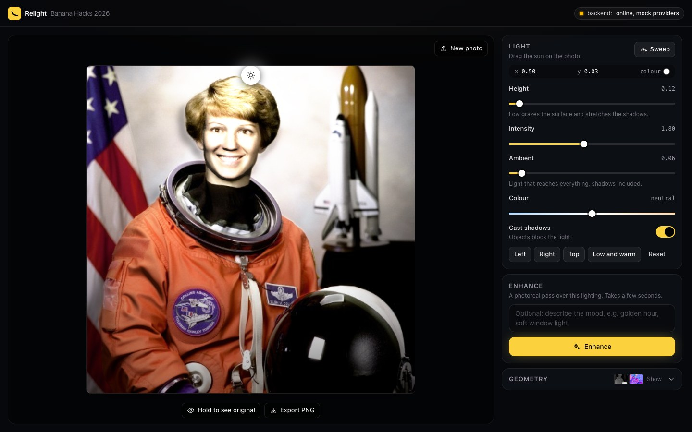
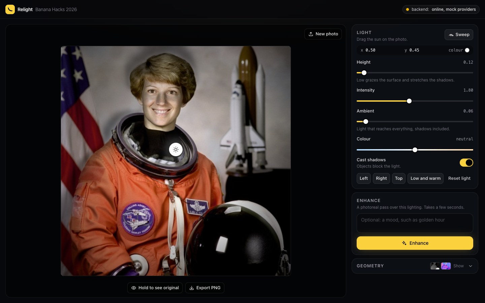

`Result: PASS / FAIL / NOT RUN` Note:

### L-03 Click anywhere to move the light

1. Without touching the sun, click once on the photo near the bottom right. 2. Click on the black area beside the photo.

**Expected:** the sun jumps to where you clicked each time and the lighting changes to match. The mouse pointer over the stage is a crosshair (a thin plus sign).

`Result: PASS / FAIL / NOT RUN` Note:

### L-04 Drag the sun outside the photo

1. Drag the sun to the right, past the edge of the photo, as far as it goes. 2. Keep the mouse button down and move the mouse over the sidebar and even outside the browser window. 3. Release.

**Expected:** the sun stops at the edge of the stage and never goes under the sidebar or disappears. The x readout is above 1 (about 1.21 on a 1440-wide window). The right side of the face is bright, the left clearly darker; the dark side fades in gradually, with no hard straight line across the forehead or cheek (see Q-11). A drag never goes further out than x 1.50 / -0.50 or y 1.50 / -0.50.

`Result: PASS / FAIL / NOT RUN` Note:

### L-05 Move the light with the keyboard

1. Reload the page and load the astronaut. Do not click anything else. 2. Press the Tab key three times: the first Tab selects the "Relight" logo, the second selects "How it works", the third puts a white ring round the sun. 3. Press the Right arrow key five times. 4. Hold Shift and press the Down arrow once. 5. Press the Up arrow once and the Left arrow once. 6. In Chrome only: click the sun with the mouse, then press the Right arrow.

**Expected:** step 2: a white ring shows the sun is selected. Step 3: x goes up by 0.02 each press (0.12 to 0.22). Step 4: y goes up by 0.10 (0.35 to 0.45). Step 5: y goes down by 0.02 and x goes down by 0.02. The lighting updates each time. The page itself does not scroll. Step 6: the sun moves in Chrome. In Safari step 6 is known not to work, because in Safari a mouse click does not select a button: use the Tab key there.

`Result: PASS / FAIL / NOT RUN` Note:

### L-06 Readout matches the sun

1. Drag the sun to the top-left corner of the photo, then to the bottom-right corner.

**Expected:** at the top-left corner the readout is close to x 0.00, y 0.00; at the bottom-right corner close to x 1.00, y 1.00.

`Result: PASS / FAIL / NOT RUN` Note:

### L-07 Other mouse buttons

1. Right-click on the photo. 2. Scroll the mouse wheel over the photo, with the pointer **not** on the sun.

**Expected:** the sun does not move for either, and the **Height** number does not change. (A browser menu may open on right-click; that is fine. Scrolling with the pointer **on** the sun is different since Oct 11: it changes Height. That is L-13.)

`Result: PASS / FAIL / NOT RUN` Note:

### L-08 Arrow keys at the limits

1. Load `05-tall-astronaut-crop.jpg`. Press Tab three times so the sun has a white ring. 2. Hold Shift and press the Left arrow ten times. 3. Hold Shift and press the Right arrow twenty-five times. 4. Hold Shift and press the Up arrow ten times. 5. Hold Shift and press the Down arrow twenty times.

**Expected:** step 2: x goes down by 0.10 each press and stops at **-0.50**. More presses change nothing. Step 3: x stops at **1.50**. Steps 4 and 5: y stops when the sun reaches the top or bottom edge of the stage (a number a little below 0 or a little above 1; it depends on your window height). (On a window narrower than about 1300 pixels x may stop earlier, at the edge of the stage. Say so in the note.) In every case the sun stays fully visible inside the stage. It never jumps back, wraps round to the other side or disappears, and the readout never shows a number below -0.50 or above 1.50.

`Result: PASS / FAIL / NOT RUN` Note:

### L-09 Sweep: once round and back

1. Click the **Portrait** sample (or do a standard start). Do not move the light. Move the mouse over **Sweep** (top right of the LIGHT panel) and wait two seconds. 2. Click **Sweep**. Start a stopwatch. Watch the sun, the x and y numbers and the button. Do not touch anything until it ends.

**Expected:** step 1: the hover text reads "Moves the light once around the subject in about six seconds, then gives it back. Handy for recording a demo." Step 2: the button now reads **Stop sweep**, in **yellow letters with a thin yellow outline**. The sun glides from its place out to the edge of the photo and travels once round, clockwise: over the top, down the right side, along the bottom, back up the left side. Its path is a rounded loop that touches the photo's edge in the middle of each side and cuts inside the corners. The lighting follows the whole way: when the sun is on the right, the right of the face is bright and the left half is dark, fading in gradually (no hard straight line; see Q-11). The x and y numbers change all the time. After about 6 seconds the sun is back exactly where it started (x 0.12, y 0.35), the button reads **Sweep** again in its normal grey, and the picture looks as before. The movement is smooth, with no jumps at the start or the end, and the sun keeps **one steady speed** the whole way round: it only speeds up for about half a second at the start and slows down for about half a second at the end. (Changed in version `53e2c26`. Before that the sun moved almost twice as fast in the first and last second as in between; a tester saw it as a sweep that slows down in the middle.) The path is the same on every window size.

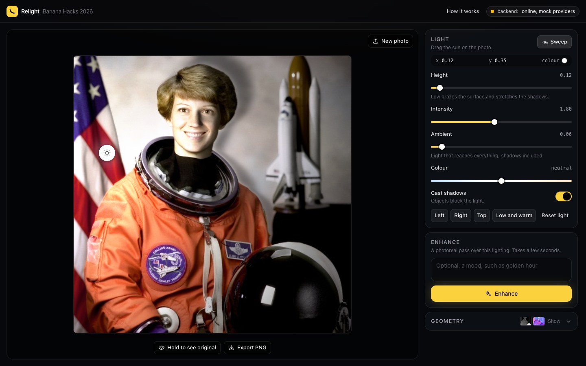

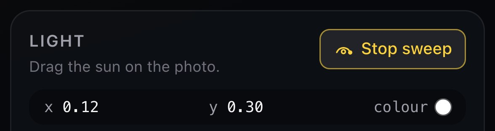

`Result: PASS / FAIL / NOT RUN` Time:

### L-10 Sweep stops when you take the light

Start each step by clicking **Reset light**, then **Sweep**. Do the action about two seconds later, while the sun is moving.

1. Click **Stop sweep**. 2. Press the mouse on the photo. 3. After clicking **Sweep**, press Shift+Tab four times so the sun has a white ring (it keeps moving meanwhile), then press the Right arrow key. (In Safari press Tab from the top of the page until the sun has the ring.) 4. Click **Right**. 5. Click **Reset light**. 6. Click **New photo**, then load a photo again.

**Expected:** in every step the sweep ends at once and the button reads **Sweep** again. The sun does **not** go back to where the sweep started. Step 1: the sun stays where it was when you clicked. Step 2: the sun jumps to the mouse and stays there. Step 3: the sun stops and moves 0.02 to the right. Step 4: the light goes to the Right preset (x 1.10, y 0.40). Step 5: the sun goes to x 0.12, y 0.35. Step 6: the first page shows; the new photo starts still, at x 0.12, y 0.35, with the button reading **Sweep**. The sun never keeps moving after any of these.

`Result: PASS / FAIL / NOT RUN` Note:

### L-11 Sweep with other controls

1. Click **Sweep**. While it runs, drag **Height** to about 0.40, drag **Colour** to the right, and click **Cast shadows** off and on. 2. Move the sun to the far right outside the photo (about x 1.20), then click **Sweep** and let it finish. 3. Click **Enhance** and wait for the split picture. Look at **Sweep**. Click the **Live preview** tab. 4. Load `06-wide-coffee-crop.jpg`, click **Sweep** and let it finish.

**Expected:** step 1: the sweep keeps going; none of these stops it. The picture takes on each change at once while the sun moves. Step 2: the sun glides in from outside the photo, goes once round, and returns to exactly the x and y it started from. Step 3: on the **Enhanced** tab the **Sweep** button is greyed and cannot be clicked. Back on **Live preview** it works again. Step 4: the sun goes once round the wide photo, touching the middle of each of its edges, and stays inside the stage the whole time; it never disappears or goes under the sidebar.

`Result: PASS / FAIL / NOT RUN` Note:

### L-12 Arrow keys after a preset has put the light beyond the stage

A preset can put the light further out than the stage reaches. The sun is then drawn at the stage's edge while the readout shows the true numbers. An arrow key moves the light by hand, and a hand move stops at the stage's edge.

1. Use a window about 1440 x 900. Standard start. Click **Top**. 2. Press Shift+Tab until the sun has a white ring (12 presses from the **Top** button; do not click the sun, a click would move the light). 3. Press the Down arrow once. 4. Press the Down arrow once more. 5. Click **Top** again, bring the white ring back to the sun as in step 2, and press the Up arrow once.

**Expected:** step 1: readout x 0.50, y -0.15. The sun sits at the very top of the stage. Step 3: y **jumps** from -0.15 to the stage's edge (about -0.07 in this window), not to -0.13. The sun does not visibly move, and the lighting changes only a little. Step 4: y goes up by 0.02 and the sun moves down a little. Step 5: the Up arrow asks for a point even further out: y stays -0.15 and nothing changes. The sun never disappears.

Developer note: possible bug (step 3: the first press towards the photo is a jump to the stage's edge, not one step of 0.02). It is listed as known. Say in the note whether you noticed it or it confused you.

`Result: PASS / FAIL / NOT RUN` Note:

### L-13 Scroll on the sun: bring the light nearer, push it back

New in the early morning update of Oct 11. **Height** is how far in front of the photo the light floats. You can now change it on the photo itself: put the pointer on the sun and scroll. Use a real mouse wheel or a real trackpad, and say which in the note. **Nobody has done this by hand**: the developer's scrolls were made by a program.

1. Standard start (Height 0.12). Move the mouse onto the sun and hold it still for one second. Do not press. 2. Turn the mouse wheel **up** (away from you), one notch at a time, five notches. On a trackpad: slide two fingers slowly, a short way, in the direction that scrolls a web page back towards its top. Watch the sun, the **Height** number and the Height slider. 3. Scroll the other way until Height stops changing. 4. Scroll up until Height stops changing. 5. Trackpad only, in Chrome or Firefox: with the pointer on the sun, spread two fingers apart, then pinch them together. 6. Press on the sun and drag it a little.

**Expected:** step 1: after about half a second a small dark label appears under the sun: "Scroll to bring the light nearer or push it back". It goes when the mouse leaves the sun. Step 2: each notch up brings the light **nearer to you**. The Height number rises, the slider's knob moves right, the sun gets **larger**, and the picture gets more evenly lit. With an ordinary mouse wheel each notch adds about a quarter: about 0.15, 0.19, 0.23, 0.29, 0.36. Some mice, and every trackpad, move in other step sizes; the direction is what matters. x and y do **not** change, and the page does not scroll. Step 3: scrolling down pushes the light back: the number falls, the sun shrinks, and the shadows stretch. It stops at **0.03**. Step 4: it stops at **2.00**. Step 5: spreading the fingers brings the light nearer (Height rises), pinching pushes it back, and the page does not zoom. (Read from the code; never run. In Safari on a Mac the trackpad pinch on the sun is known not to work, K61; two-finger scrolling does.) Step 6: the label is hidden while you drag, and the drag works as always.

A scroll on the sun during a **Sweep** should change Height without stopping the sweep. (Read from the code. It is hard to do by hand, because the sun moves; not required.)

**Write down:** mouse or trackpad, and the browser. Was the direction the one you expected (up = nearer)? Was it too fast, too slow or about right? On a Mac trackpad the light may go on moving for a moment after your fingers lift (K60): did that bother you? Did you find the label by yourself, and did it tell you enough? Was the label cut off anywhere (K59)?

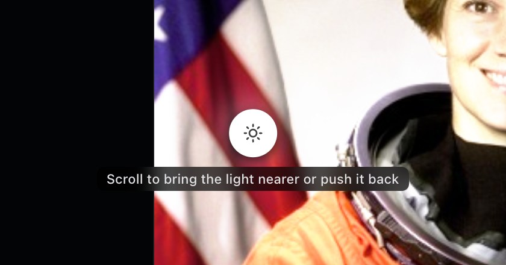
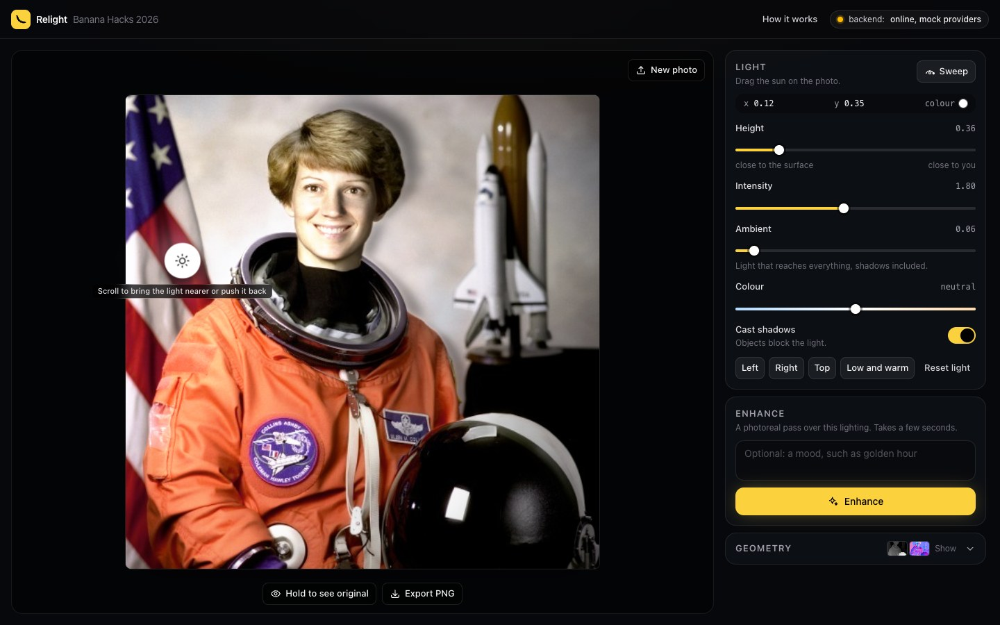

`Result: PASS / FAIL / NOT RUN` Mouse or trackpad, browser and note:

### L-14 Scrolling on the sun does not scroll the page

New in the early morning update of Oct 11. The wheel belongs to the light only while the pointer is on the sun. Anywhere else it scrolls the page as before. For this case the page must be long enough to scroll.

1. Make the browser window about 900 pixels wide and 600 high. (Narrower than 1024, so the sidebar moves under the photo and the page gets long.) Click the **Portrait** sample. 2. Put the mouse on the photo, **not** on the sun. Scroll down a little, then back up to the top. 3. Put the mouse on the sun. Scroll down until Height reads 0.03, then keep scrolling down for two more seconds. 4. Scroll up until Height reads 2.00, then keep scrolling up for two more seconds. 5. Move the mouse off the sun, onto the photo, and scroll down. 6. Scroll back to the top. Put the mouse on the sun again, hold Ctrl and turn the wheel.

**Expected:** step 2: the page scrolls down and up as any web page does. The sun does not move and Height does not change. Step 3: Height falls to 0.03 and the page stays exactly where it is, also while you keep scrolling at 0.03. Step 4: the same at 2.00: the page never starts to move. Step 5: the page scrolls again, and Height stays 2.00. Step 6: the page does **not** zoom. Height changes, a little faster than without Ctrl (read from the code; never run).

A FAIL is any of these: the page moves while the pointer is on the sun; Height changes while the pointer is somewhere else; or the page can no longer be scrolled at all.

At Height 2.00 the sun is 69 pixels across and covers more of the photo, so it is easier to be on it without meaning to. Say in the note if you ever changed Height by accident while trying to scroll the page.

`Result: PASS / FAIL / NOT RUN` Note:

### L-15 Nearer and further with the + and - keys

New in the early morning update of Oct 11.

1. Reload the page, load the astronaut, and press Tab three times so that the sun has a white ring (as in L-05). 2. Press the **+** key three times. (On most keyboards that is Shift with =. The = key alone works too.) 3. Press the **-** key three times. 4. Press - again and again until Height stops changing. Then press + twice. 5. Hold Cmd (macOS) or Ctrl (Windows) and press +. Then hold Cmd or Ctrl and press 0.

**Expected:** step 1: as soon as the sun has the white ring, the label "Scroll to bring the light nearer or push it back" shows under it; there is no half-second wait. Step 2: Height goes 0.12, 0.13, 0.15, 0.17. The sun grows a little each time and the Height slider follows. Step 3: back down: 0.15, 0.13, 0.12. Step 4: it stops at **0.03**. The two + presses give 0.04 and 0.05: every press changes the number, at the low end too. (Each press changes Height by about one eighth, and never by less than 0.01.) x and y never change. The arrow keys still move the light as in L-05. Step 5: with Cmd or Ctrl held, the keys do what they do in every browser: the whole page zooms in, then goes back to normal size. Height does not change.

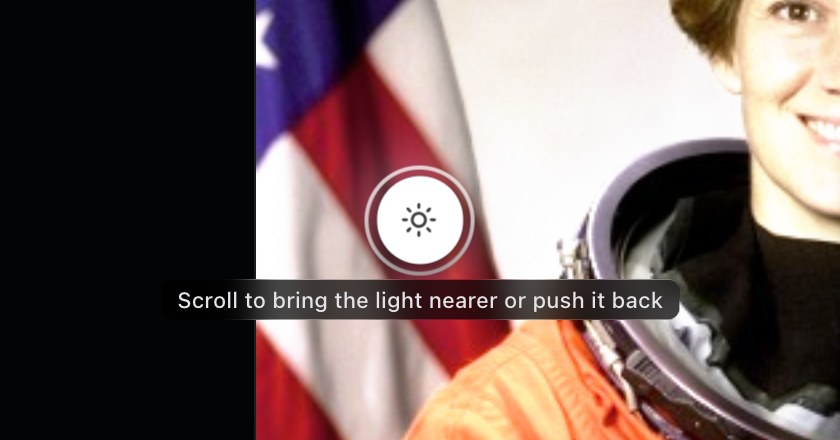

`Result: PASS / FAIL / NOT RUN` Note:

### L-16 Pinch on a phone or a touch screen: nearer and further

New in the early morning update of Oct 11. Needs a real touch screen: a phone, a tablet or a touch laptop. Chrome's phone imitation has only one finger. The developer made the two fingers with a program; **no real hand has tried this.**

1. On the phone, load the **Portrait** sample (use the demo address, or W-16 step 8). The light starts at Height 0.12. Notice how big the sun is. 2. Put two fingers close together on the photo, both at the same moment, and spread them to about twice as far apart. Lift both. Scroll down and read the **Height** number. 3. Scroll back up. Put two fingers far apart on the photo and pinch them together. Lift both. 4. Put **one** finger on the photo, wait a full second, then add a second finger and spread. 5. After a spread, lift only one finger and move the other one about. 6. Drag the sun with one finger.

**Expected:** step 2: the light comes **nearer**: the sun grows, and Height rises. Twice as far apart takes 0.12 to about 0.68. (The developer's program got exactly 0.68 going from 80 to 160 pixels apart.) The light does **not** move sideways: x 0.12 and y 0.35 stay. The page does not zoom and does not scroll. Step 3: the light is pushed back: the sun shrinks and Height falls, to 0.03 at the lowest. Step 4: the first finger moves the light to where it touched, as a tap always did. The second finger then changes only the Height. (The light is put back where it was only if the second finger lands within about a third of a second. Known, K64.) Step 5: the finger left on the screen does not drag the light. Step 6: a one-finger drag works as before (W-05).

Under the Height slider a phone shows grey words: "close to the surface" at the left and "close to you" at the right, and under them "Scroll or pinch on the sun to change it. Low grazes the surface and stretches the shadows." The words say "on the sun", but the two fingers may be anywhere on the photo or on the dark area round it, and "Scroll" is for a mouse. Say in the note if that wording confused you.

**Write down:** the phone and the browser. Did the direction feel right (spread = nearer)? Was it too fast? (One spread can go from one end of Height to the other.) Did the light jump sideways? Did the page zoom?

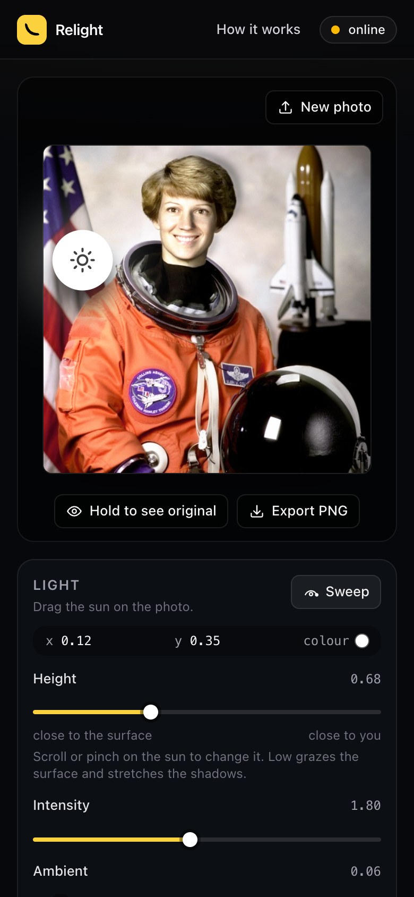
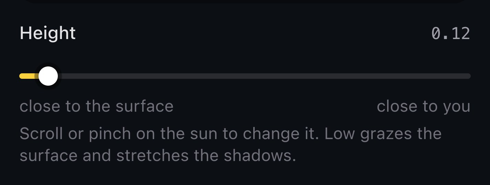

`Result: PASS / FAIL / NOT RUN` Phone, browser and note:

---

## C. Controls

All in the LIGHT panel. Each case begins: standard start, then click **Left**, so that results match the screenshots.

### C-01 Height

1. Drag **Height** all the way left. 2. Drag it all the way right.

**Expected:** the value goes from 0.03 to 2.00. At 0.03 the light skims the surface: the picture is darker, with strong shadows, and only the left edge and left-facing surfaces stay bright. At 2.00 the picture is evenly and brightly lit with almost no shadows, close to the original photo. The sun changes with it (new on Oct 11): at 0.03 it is at its smallest, about two thirds of its usual size, with almost no glow; at 2.00 it is at its largest, not quite twice its usual size, with a wide soft glow (C-12). Under the slider's track are two grey labels: "close to the surface" at the left end and "close to you" at the right end. (On a window less than 832 pixels high they are not shown.) The sentence "Scroll or pinch on the sun to change it. Low grazes the surface and stretches the shadows." is hover text on the slider; on a phone it is printed under the two labels. See W-14. (Before Oct 11 the line under the slider read "Low grazes the surface and stretches the shadows.")

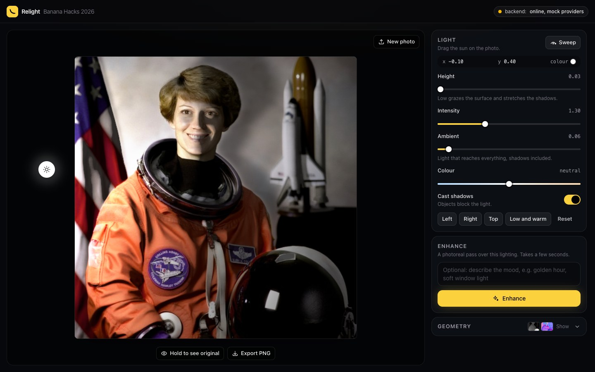
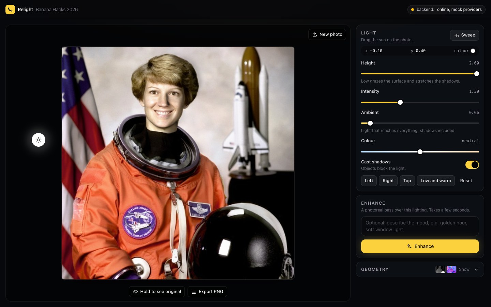

`Result: PASS / FAIL / NOT RUN` Note:

### C-02 Intensity

1. Drag **Intensity** all the way left. 2. All the way right.

**Expected:** value 0.00 to 4.00. There is no helper line under this slider. At 0.00 the photo is very dark and flat but you can still make out everything (the Ambient light still reaches it; this is known), and the sun has less glow. At 4.00 the left of the face, the flag and the wall are nearly white, with dark shadows on the right of the face.

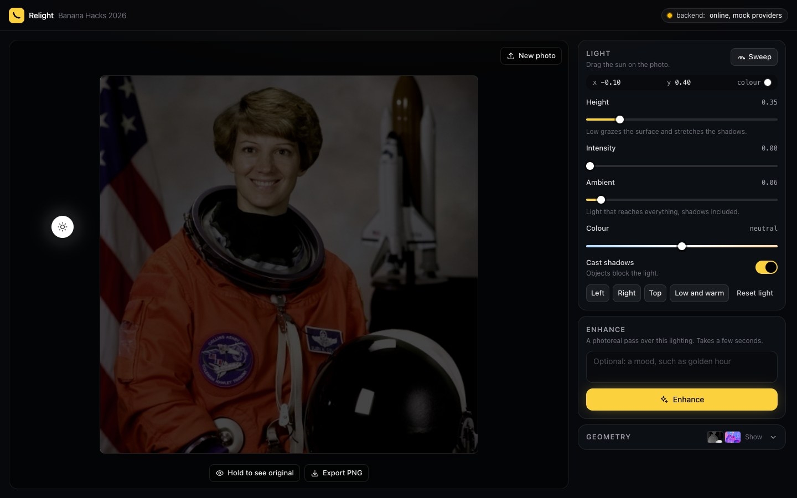
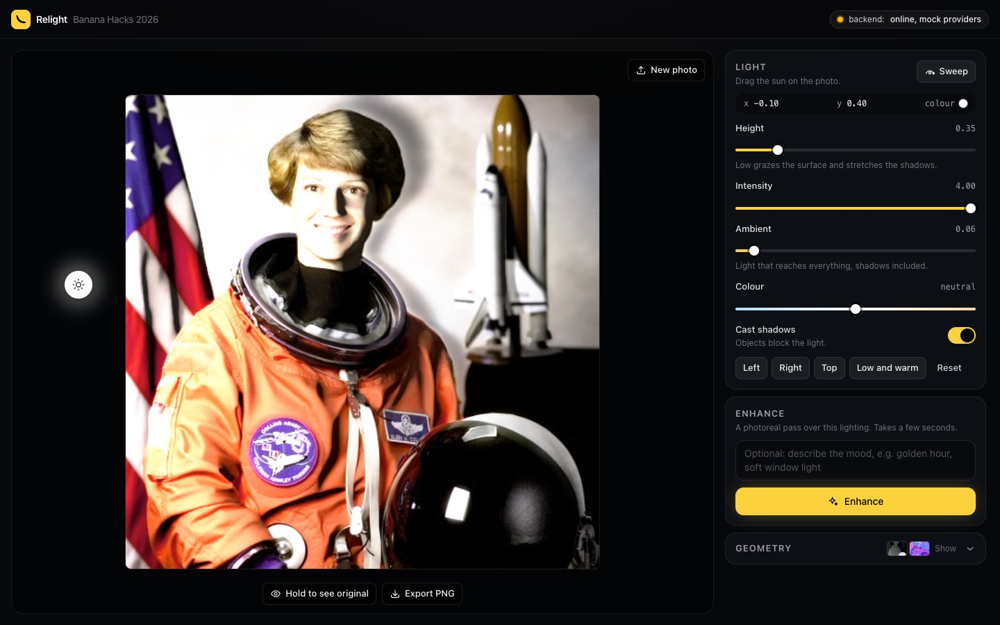

`Result: PASS / FAIL / NOT RUN` Note:

### C-03 Ambient

1. Drag **Ambient** all the way left. 2. All the way right.

**Expected:** value 0.00 to 1.00. At 0.00 the shadows turn black (right side of the face, the area right of the head) while the lit left side stays the same. At 1.00 everything is bright and flat and shadows are almost gone. Helper line: "Light that reaches everything, shadows included."

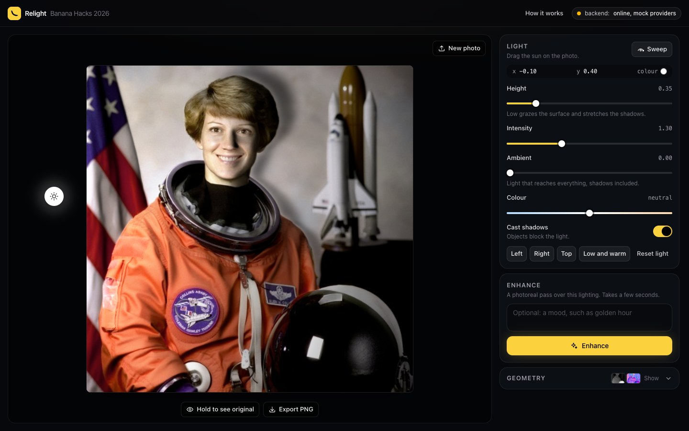
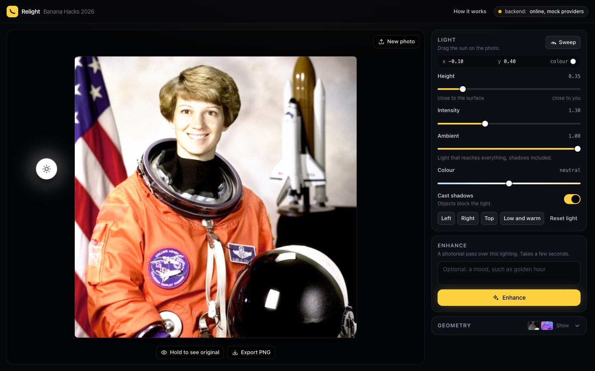

`Result: PASS / FAIL / NOT RUN` Note:

### C-04 Colour

1. Drag **Colour** all the way right. 2. All the way left. 3. Back to the middle.

**Expected:** the slider track is blue on the left, white in the middle, orange on the right. Right end: value "warm 100", the sun and the colour dot turn pale orange, the photo gets a yellow-orange tint. Left end: "cool 100", pale blue sun and dot, blue tint. Middle: "neutral", white. The pattern of bright and dark does not change, only the tint.

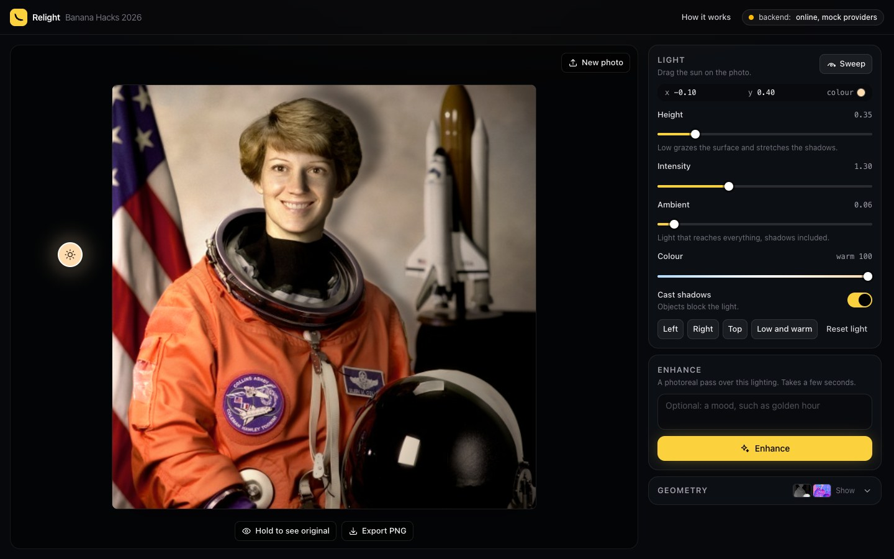

`Result: PASS / FAIL / NOT RUN` Note:

### C-05 Presets Left, Right, Top

1. Click **Left**. 2. Click **Right**. 3. Click **Top**. 4. Set Colour to warm, set Ambient to 0.50, turn **Cast shadows** off, then click **Left** again.

**Expected:** every one sets Height 0.35, Intensity 1.30 and Colour "neutral". The sun is therefore a little larger than at the start (about 51 pixels across, not 40: C-12). The five buttons Left, Right, Top, Low and warm, Reset light sit in one row that fills the panel from edge to edge.
Left: readout x -0.10, y 0.40. Sun just left of the photo; left of face bright, the right half darker.
Right: readout x 1.10, y 0.40. Sun just right of the photo; right of face bright and the left half of the face dark.
Top: readout x 0.50, y -0.15. Sun above the photo in the middle, at the very top of the stage; hair and forehead brightest, under the chin darker.
Step 4: Colour goes back to "neutral"; Ambient **stays** at 0.50 and **Cast shadows stays off**.
These numbers are the same on every window and every photo (C-11). With **Top** on the astronaut the true point is a little above the stage, so the sun is drawn at the stage's top edge, where the top of its disc is cut off by a few pixels (known, K56); the readout still says y -0.15. In all three, the dark side of the face fades in gradually: there is no hard, straight line between bright and dark (Q-11).

`Result: PASS / FAIL / NOT RUN` Note:

### C-06 Preset Low and warm

1. Click **Low and warm**.

**Expected:** sun at the bottom-left corner of the photo, coloured cream/orange. Readout x 0.00, y 0.90; Height 0.12; Intensity 1.60; Ambient 0.20; Colour "warm 100". The picture has a yellow-orange tint and is darker; the bottom left is brightest and the face is dim.

`Result: PASS / FAIL / NOT RUN` Note:

### C-07 Reset light

1. Click **Low and warm**. Turn **Cast shadows** off. Type `test` in the ENHANCE text box. 2. Hold the mouse still over **Reset light** (the last button in the preset row) for two seconds. 3. Click **Reset light**.

**Expected:** step 2: the button has no box until the mouse is on it; then it gets a faint grey background. The hover text reads "Puts the light, its colour and Cast shadows back to how they started. The photo and the Enhance text are left alone." Step 3: x 0.12, y 0.35, Height 0.12, Intensity 1.80, Ambient 0.06, Colour neutral, **Cast shadows on**. This is the same light a photo starts with. The ENHANCE text box still says `test`, the photo stays, and the **Detailed normals** switch is not changed. That is as the hover text says. (The button was named "Reset" before the Oct 10 evening update. The developer could not photograph the hover text; its words were read from the page.)

`Result: PASS / FAIL / NOT RUN` Note:

### C-08 Sliders with the keyboard

1. Click the **Height** slider knob. 2. Press the Right arrow key three times.

**Expected:** the value goes up by 0.01 each press and the lighting updates. (Intensity steps by 0.05, Ambient by 0.01, Colour by 2.)

`Result: PASS / FAIL / NOT RUN` Note:

### C-09 The sun's look follows the light

1. Drag **Intensity** slowly from 0 to 4 while watching the sun. 2. Drag **Colour** from one end to the other.

**Expected:** the glow around the sun gets brighter as Intensity rises (it stops changing above 3). Its size does not change with Intensity or Colour; only **Height** changes it (C-12). The sun's fill colour and the colour dot in the readout match the Colour slider.

`Result: PASS / FAIL / NOT RUN` Note:

### C-10 Every control with the keyboard

Do not use the mouse except where a step says so.

1. Standard start. Press Tab again and again, right through the page, and watch where the selection ring goes. 2. Stop on the **Height** slider. Press End, then Home. Press Page Up once. 3. Tab to the **Cast shadows** switch. Press Space twice. Press Enter twice. 4. Tab to **Hold to see original**. Hold Enter for two seconds, then let go. 5. Tab to the **GEOMETRY** row. Press Enter. Press Tab once more. Press Space. 6. With the mouse click **Enhance**, then quickly press Tab until you reach the tabs at the top left of the stage.

**Expected:** step 1: the order is: "Relight" logo, "How it works", the sun, **New photo**, **Hold to see original**, **Export PNG**, then down the sidebar: **Sweep**, Height, Intensity, Ambient, Colour, **Cast shadows**, Left, Right, Top, Low and warm, Reset light, the ENHANCE text box, **Enhance**, the **GEOMETRY** row. Every one shows a ring or outline when selected: white on the sun, yellow on the others (the logo gets the browser's own ring). Nothing is skipped and the selection never disappears. Step 2: End sets Height to 2.00, Home sets it to 0.03. Page Up raises it by a bigger step than an arrow key (how big depends on the browser). Step 3: each press of Space or Enter flips the switch, and the shadows on the photo follow. The page does not scroll. Step 4: the original photo shows while Enter is held, and the relit photo returns on release. Step 5: Enter opens GEOMETRY. The next Tab lands on **Detailed normals**, and Space flips it (the photo loads again). (On a sample in Plan B or in the demo the switch is greyed and Tab skips it; see P-09.) Step 6: Tab stops on **Live preview** but skips the greyed "Enhancing…" tab.

`Result: PASS / FAIL / NOT RUN` Note:

### C-11 A preset gives the same numbers on every window and photo

Before the Oct 10 evening update **Left** could read x -0.10 on one photo and -0.04 on another. Now a preset always gives the same light.

1. Window about 1440 x 900. Astronaut. Click **Left**, **Right**, **Top**, **Low and warm** in turn and write down x and y each time. 2. Make the window smaller (for example 1280 x 720, as in W-13) and click the four again. 3. Click **New photo**, load `02-object-coffee.jpg` or click the **Coffee cup** sample, and click the four again. 4. Load `06-wide-coffee-crop.jpg` (needs the backend) and click **Top**. 5. Imitate a phone (group W) with any photo and click the four again.

**Expected:** always exactly: Left x -0.10, y 0.40. Right x 1.10, y 0.40. Top x 0.50, y -0.15. Low and warm x 0.00, y 0.90. Where that point lies beyond the edge of the stage, the sun is drawn at the stage's edge, and the readout still shows the numbers above. With **Left**, **Right** and **Top** the sun is larger than at the start (Height 0.35), and about 7 pixels of its disc are cut off by the stage's edge there (known, K56); most of it stays visible and it can still be grabbed. You see that with **Top** on the astronaut (sun at the very top edge of the stage, just under the top bar) and with **Left** and **Right** on the coffee photo (sun at the left or right edge of the stage). On the wide photo the sun sits in the black band above the photo. The lighting for a preset looks the same whatever the window size. Any other number is a FAIL: write down the window size, the photo and the readout.

`Result: PASS / FAIL / NOT RUN` Note:

### C-12 The sun's size follows Height

New in the early morning update of Oct 11. The sun now shows how far in front of the photo the light is. For this case do **not** click **Left** first: after a standard start the sun is on the flag, as in the picture.

1. Standard start. Look at the sun. 2. Drag **Height** all the way left (0.03). 3. Drag it slowly all the way right (2.00) and watch the sun. 4. Click **Left**. 5. Drag **Intensity** and **Colour** from end to end.

**Expected:** step 1: at Height 0.12 the white disc is 40 pixels across, the size it always was, with a soft shadow just under it. Step 2: the disc is small, 26 pixels across, with its dark shadow tight round it and almost no glow. The light lies close to the photo's surface. It is still easy to grab: the part that answers the mouse stays 40 pixels across. Step 3: the sun grows smoothly, with no jumps. At 2.00 the disc is 69 pixels across, with a wide soft glow, and its shadow has dropped well below it (about 30 pixels), as if the disc floats above the photo, close to you. The icon inside grows with the disc. x and y do not change. Step 4: **Left** sets Height 0.35; the disc is about 51 pixels across, clearly larger than at the start. Step 5: the size does not change; only the glow's brightness and the tint do (C-09).

| Height | White disc, pixels across |
| --- | --- |
| 0.03 | 26 |
| 0.12 (a new photo) | 40 |
| 0.35 (**Left**, **Right**, **Top**) | 51 |
| 0.68 | 58 |
| 2.00 | 69 |

Known: the white glow hardly shows where the photo is pale, such as the flag (K57); look at the disc and its shadow there. A large sun at the stage's edge is partly cut off (K56). With "reduce motion" switched on in the computer's settings (J-10), the sun changes size at once, without its short animation.

`Result: PASS / FAIL / NOT RUN` Note:

---

## S. Shadows

A "cast shadow" is the dark patch one thing throws onto another, like a cup's shadow on a table. "Shading" is a surface getting darker because it faces away from the light. The **Cast shadows** switch controls only the first.

### S-01 Cast shadows on and off

1. Load `02-object-coffee.jpg` (or click the **Coffee cup** sample). Click **Left**. Set **Height** to 0.10. 2. Click **Cast shadows** off. 3. Click it on.

**Expected:** on (yellow): a soft dark shadow from the cup, across the saucer and the table to the right. Its edges are blurred, not sharp. Off (grey): that shadow is gone and the right side of the saucer and table is lighter; surfaces facing away from the light are still a little darker. Helper line under the switch: "Objects block the light." Known: the cup's shadow on the saucer is fainter than it should be. Report it only if you cannot see any difference between on and off.

`Result: PASS / FAIL / NOT RUN` Note:

### S-02 Shadows fall away from the light

1. Coffee photo, **Cast shadows** on, Height 0.10. 2. Click **Left**, then **Right**, then **Top**. 3. Drag the sun slowly all the way round the cup.

**Expected:** the cup's shadow is always on the side opposite the sun: sun left, shadow right; sun right, shadow left; sun above, shadow below. As you drag, the shadow swings round smoothly, like the hand of a clock, with no jumps or flicker.

(This picture was taken at Height 0.35. At Height 0.10 your shadow is longer and darker.)

`Result: PASS / FAIL / NOT RUN` Note:

### S-03 Height changes shadow length

1. Coffee photo, **Left**, **Cast shadows** on. 2. Move **Height** slowly from 0.03 to 1.00.

**Expected:** at low Height the shadow is longest and darkest (soft-edged, never black). As Height rises it gets shorter and fainter, and is nearly gone by 1.00.

`Result: PASS / FAIL / NOT RUN` Note:

### S-04 Removed

Removed: the drawn sample ball no longer exists. The four sample photos are covered by U-05 and U-18 to U-20, and shadows on them by S-06 and S-07.

### S-05 Shadows switch with the portrait

1. Astronaut, **Left**, Height 0.10. 2. Switch **Cast shadows** off and on a few times.

**Expected:** with shadows on there is extra darkness on the side away from the sun: a darker patch on the cheek beside the nose, and a soft, faint darkening on the wall right of the head. With shadows off both go but the right side of the face stays somewhat darker, fading in gradually. Write down which looks more natural to you.

`Result: PASS / FAIL / NOT RUN` Note:

### S-06 Near shadows are defined, far shadows are faint

A shadow that falls on something close behind the object (a nose on a cheek) should be clear. A shadow that falls on something far behind (a head on a back wall, a cup on the table beyond the saucer) should be wide, blurred and faint.

1. Astronaut (file or **Portrait** sample). Click **Left**. Set **Height** to 0.10. Look at the cheek beside the nose, then at the wall to the right of the head. 2. Switch **Cast shadows** off and on while looking at each of the two places. 3. Coffee cup (file or sample). Click **Left**, Height 0.10. Look at the shadow inside the cup, on the saucer, and on the table. Switch **Cast shadows** off and on.

**Expected:** step 1 and 2: beside the nose there is a fairly dark, well-defined shadow. On the wall to the right of the head and shoulder there is only a soft, wide darkening with no edge you could trace with a finger. Both go away with the switch off. Step 3: the shadow of the cup on the saucer and table is soft and clearly visible but not black. It gets fainter and more blurred the further it is from the cup. Nowhere is there a shadow with a jagged, stair-step or perfectly straight hard edge. Known: the cup's shadow on the saucer is fainter than it should be. Known: a faint dark fringe can show beside a far shadow. The hard, straight line down the face with the light on the **right** was fixed in the Oct 10 evening update; check it in Q-11 and report it if you still see it.

`Result: PASS / FAIL / NOT RUN` Note:

### S-07 No hard shadow blocks on the night sky

1. Click the **Rocket** sample (or load `04-dark-rocket.jpg`). Click **Left**. 2. Drag the sun slowly up and down the left side, then to the right side. 3. Set **Height** to 0.10. 4. Switch **Cast shadows** off and on.

**Expected:** the sky to the right of the rocket and of each tower gets a little darker, as a soft, blurred column. There are **no** hard-edged black blocks, bands or stripes on the sky, at any sun position. Known: the soft darker columns are still there and can be seen; the one on the right may have a fairly definite top edge. With the switch off they disappear. If you see anything with a hard edge on the sky, that is a FAIL: attach a screenshot showing the x, y and Height.

`Result: PASS / FAIL / NOT RUN` Note:

---

## K. Compare with the original

### K-01 Hold to see original, with the mouse

1. Click **Left**. 2. Press and hold **Hold to see original** under the photo. 3. Release.

**Expected:** while held, the plain photo shows (evenly lit face, no added shadow) with a small dark tag "Original" at its top-left corner. The button itself turns **yellow** while held: yellow letters, a yellow eye icon and a thin yellow outline. **Export PNG** beside it stays white. The sun stays where it was. On release the relit picture returns at once and the button goes back to white. (Before the Oct 10 evening update the button did not change colour. If it stays white while held, that is a FAIL.)

`Result: PASS / FAIL / NOT RUN` Note:

### K-02 Hold, then slide off the button

1. Press and hold **Hold to see original**. 2. Still holding, move the mouse off the button. 3. Release.

**Expected:** the relit picture returns as soon as the mouse leaves the button. It never stays stuck on the original.

`Result: PASS / FAIL / NOT RUN` Note:

### K-03 Hold with the keyboard

1. Press Tab until **Hold to see original** has a ring around it. 2. Hold the Space bar. 3. Release.

**Expected:** same as K-01: the original while Space is down, the relit picture when released.

`Result: PASS / FAIL / NOT RUN` Note:

### K-04 Hold to see original: unusual cases

1. Touch (touch screen, or Chrome's phone imitation from group W): press a finger on **Hold to see original** for three seconds, then lift it. 2. Keyboard: Tab to **Hold to see original**, hold the Space bar, and while holding it press Tab. 3. Keyboard and mouse: Tab to the button, hold Space, and while holding it press the mouse button on the photo and drag. 4. Click **Enhance**. At once press and hold **Hold to see original** with the mouse (it has moved to the bottom right of the stage). Keep holding until the split picture appears. Let go. Click the **Live preview** tab. Do not move the mouse over the buttons under the photo yet. Look. Then move the mouse over **Hold to see original** and away again.

**Expected:** step 1: the original shows while the finger is down and the relit photo returns when it lifts. No menu pops up and no text gets selected. Step 2: the relit photo returns the moment Tab moves the selection away, although Space is still down. Step 3: the relit photo returns the moment you press on the photo, and the sun follows the mouse. Step 4: while you hold, the original shows and Enhance keeps running. When the result arrives the stage switches to the Enhanced tab. Back on **Live preview**, the photo is **stuck on the original**: the "Original" tag is there, and dragging the sun changes nothing you can see. It stays like that until the mouse passes over **Hold to see original** and leaves it, or you press that button once. If instead the relit photo shows normally after you click **Live preview**, say so in the note: that is the better behaviour.

Developer note: possible bug (step 4: the app misses the release because the button is taken away while it is held).

`Result: PASS / FAIL / NOT RUN` Note:

---

## E. Enhance

Cases E-01 to E-09 use the normal setup (pill "online, mock providers"). There, Enhance is a **stand-in**: the result is the same lighting drawn by the backend instead of the browser, so the two halves look almost the same. Tiny differences in shadow softness between the halves are expected.

**In the normal setup the text box is ignored.** Typing in it changes nothing in the result. That is expected. The words only matter with real Enhance (E-10).

### E-01 Before Enhance

1. Standard start, click **Left**. Look at the ENHANCE panel. 2. Type `golden hour` in the text box.

**Expected:** under the title, the line "A photoreal pass over this lighting. Takes a few seconds." Before step 2 the two-line text box is empty and shows the grey words "Optional: a mood, such as golden hour", in full, on one line. After step 2 it shows your words in white, as in the screenshot. A bright yellow **Enhance** button with a sparkle icon. No tabs at the top left of the stage. Delete the words again before the next case. (On a window less than 771 pixels high the line under the title is not shown and the box is one line tall. See W-13.)

`Result: PASS / FAIL / NOT RUN` Note:

### E-02 While Enhance runs

1. Click **Enhance** and look quickly.

**Expected:** the button dims, shows a spinner and reads "Enhancing…". Top left of the stage: two tabs, "Live preview" (selected) and a greyed "Enhancing…" that cannot be clicked. Bottom left of the stage: "Enhancing in the background, keep dragging". The two buttons under the photo (**Hold to see original** and **Export PNG**) move to the bottom right while this message shows, and move back to the centre afterwards. (In this mode it lasts only 1 to 3 seconds. If you miss it, try again.)

`Result: PASS / FAIL / NOT RUN` Note:

### E-03 Enhance result

1. Wait for Enhance to finish.

**Expected:** the stage switches by itself to the **Enhanced** tab. The photo has a white vertical line down the middle with a round handle showing two arrows. Tag "Live preview" at top left of the photo and "Enhanced" at top right. No sun. Under the photo: **Download enhanced**. In the sidebar the button now reads **Enhance again**, with a small square download button beside it. **Sweep** is greyed while this tab shows.

`Result: PASS / FAIL / NOT RUN` Note:

### E-04 Before/after divider

1. Drag the round handle to the left, then to the right. 2. Click somewhere else on the photo. 3. Click the round handle, then press the Left and Right arrow keys.

**Expected:** the white line follows the mouse; left of the line is "Live preview", right is "Enhanced". Clicking on the photo moves the line there. Each arrow key press moves it a small step (4% of the width). The line can reach both edges. The light does **not** move when you click on this tab.

`Result: PASS / FAIL / NOT RUN` Note:

### E-05 Back to Live preview

1. Click the **Live preview** tab. 2. Drag the sun. 3. Click the **Enhanced** tab.

**Expected:** step 1: the sun is back, the buttons under the photo are "Hold to see original" and "Export PNG", both tabs stay visible, the sidebar still shows **Enhance again**. Step 2: the light moves as normal. Step 3: the earlier Enhanced comparison is still there, unchanged (it does not follow the new light until you enhance again).

`Result: PASS / FAIL / NOT RUN` Note:

### E-06 Keep dragging while it runs

1. Click **Enhance** and immediately drag the sun around.

**Expected:** the light keeps moving smoothly while "Enhancing…" shows. When the result arrives the stage switches to the Enhanced tab. The "Live preview" half shows the lighting from the moment you clicked Enhance, not from where you dragged afterwards.

`Result: PASS / FAIL / NOT RUN` Note:

### E-07 Enhance again

1. After a result, click **Live preview**, click **Right**, then click **Enhance again**.

**Expected:** the stage goes back to the Live preview tab with "Enhancing…" as in E-02, then switches to a new comparison lit from the right.

`Result: PASS / FAIL / NOT RUN` Note:

### E-08 What clears an Enhance result

1. Get an Enhance result. Click **Live preview**. Open GEOMETRY and click **Detailed normals** off. 2. Get another result. Click **New photo** and load any photo.

**Expected:** in both cases the two tabs disappear, the sidebar button reads **Enhance** again and the small download button is gone.

`Result: PASS / FAIL / NOT RUN` Note:

### E-09 Sliders while on the Enhanced tab

1. Get an Enhance result and stay on the **Enhanced** tab. 2. Move the **Intensity** slider and click **Top**.

**Expected:** the comparison picture does **not** change (it is a saved result). Click **Live preview**: the changes you made are there. Write down whether this was confusing.

`Result: PASS / FAIL / NOT RUN` Note:

### E-10 Real Enhance (only with a key, only if asked)

Needs the real-Enhance setup in [SETUP.md](SETUP.md#enhance-mock_mode-and-keys). Pill: green "online". Each run costs money, so do this case once per photo, not repeatedly. With a Gemini key the backend stops after 10 calls per computer. With a fal.ai key there is **no** limit: every click on **Enhance** costs money, so count your clicks. (Hover over the pill to see which service says `ready`.)

1. Load the astronaut. Click **Left**. Leave the text box empty. Click **Enhance**. Time it. 2. Drag the divider across. 3. Repeat once with the coffee photo, **Left**, Height 0.10, and the words `golden hour` in the text box.

**Expected:** it takes from a few seconds up to about a minute. The "Enhanced" half should be the same person or object, the same framing, **lit from the same side** as the "Live preview" half, but looking more like a real photograph (softer, more natural shadows). Write down, and attach a screenshot: how many seconds; is the light still on the same side; did the face, text or colours change; did the typed words have a visible effect; which half would you show a judge. Note: in the developer's one saved real result ([proofs/live/relight_enhance.jpg](../proofs/live/relight_enhance.jpg)) the enhanced picture kept much less of the side lighting than the preview. Say whether you see the same.

`Result: PASS / FAIL / NOT RUN` Note:

### E-11 Real mode with no key

Only if you have **no** `.env` file in the project folder. Costs nothing.

1. Stop the backend. Start it with `MOCK_MODE=0` in place of `MOCK_MODE=1` in the step 5 command of SETUP ("Start the backend") (Windows: `$env:MOCK_MODE = "0"`). 2. Reload the page. 3. Load a photo and click **Enhance**. 4. Click the X on the red bar. 5. Stop the backend and start it normally again.

**Expected:** pill turns green, "backend: online"; hovering over it shows "fal: no key, gemini: no key". Enhance fails within a couple of seconds with a red bar above the photo that ends "FAL_KEY is not set in .env" (it may begin "GenerationError:"). The button goes back to **Enhance**. The photo still relights normally. The X removes the red bar.

`Result: PASS / FAIL / NOT RUN` Note:

### E-12 Same request twice is free (only with a key)

1. Right after E-10 step 1, without moving anything, click **Enhance again**.

**Expected:** the result comes back much faster than the first time and is the identical picture (the backend saved it). With a Gemini key it does not use up one of the 10 calls. With either key the repeat costs nothing.

`Result: PASS / FAIL / NOT RUN` Note:

### E-13 Spending limit (only with a key; do not force it)

Gemini key only. A fal.ai key has no limit, so this message never appears with it. Do not use up calls on purpose. Only if it happens to you:

**Expected:** after 10 Gemini calls on one computer, Enhance fails with a red bar containing "spending cap reached: 10 gemini_image calls already made." A call that failed also counts as one of the 10. Report that you reached it. Do not raise the limit without asking Aaroosh.

`Result: PASS / FAIL / NOT RUN` Note:

### E-14 A very long Enhance (only with a key)

You cannot cause this on purpose. Only if it happens to you:

**Expected, if it happens:** after about 3 minutes the red bar above the photo reads "GenerationError: Gemini gemini-3.1-flash-image did not answer within 180 s" (with a fal.ai key: "GenerationError: fal fal-ai/iclight-v2 did not answer within 180 s"). That is the correct behaviour for a stalled service. Only if nothing at all has appeared after 5 minutes should you see "The job is taking too long. Try again." Report either one, with the time. Anything over 1 minute is worth reporting with the time.

`Result: PASS / FAIL / NOT RUN` Note:

### E-15 A failed "Enhance again" throws away the earlier result

1. Get an Enhance result (E-03). 2. Stop the backend (click terminal 1, press Ctrl+C). 3. Click **Enhance again** in the sidebar. 4. Start the backend again and wait for "Uvicorn running".

**Expected:** step 3: the stage goes back to the Live preview tab. Within a second or two a red bar above the photo reads "Cannot reach the backend at http://localhost:8000. Is it running?". The button reads **Enhance**, not "Enhance again". The two tabs at the top left of the stage are gone. The small square download button and **Download enhanced** are gone. **The earlier enhanced picture is lost** and cannot be brought back or downloaded. The light still moves. Write down whether losing the picture surprised you. After step 4, reload the page before the next case (the restarted backend has forgotten the photo).

Developer note: possible bug (a failed second try destroys a good first result).

`Result: PASS / FAIL / NOT RUN` Note:

### E-16 Enhance with other settings

Standard start, once. After each step, drag the divider across the photo and compare the halves, then click **Live preview**.

1. Click **Left**, set Height to 0.10, turn **Cast shadows** off, click **Enhance**. 2. Click **Low and warm**, click **Enhance again**. 3. Set Colour to "cool 100", click **Enhance again**. 4. Drag the sun as far right as it goes (outside the photo), click **Enhance again**. 5. Click **Left**, set Height to 0.03, click **Enhance again**. 6. In the text box type each of these in turn, clicking **Enhance again** after each: only five spaces; a smiley or other emoji; two lines of words (press Enter between them); one sentence pasted 50 times.

**Expected:** every run finishes in 1 to 3 seconds with no red bar. In every result the "Enhanced" half matches the "Live preview" half: step 1: **no** cast shadow in either half; step 2: both halves orange; step 3: both halves blue; step 4: both lit from the right; step 5: both mostly dark with only the left edges bright. Step 6: the text box accepts all of them and stays two lines tall (long text scrolls inside it). The results look the same as without words, because the normal setup ignores the words.

`Result: PASS / FAIL / NOT RUN` Note:

### E-17 Enhance on photos of other shapes

1. Do this for each of: `05-tall-astronaut-crop.jpg`, `06-wide-coffee-crop.jpg`, `07-tiny-cat-200px.jpg`, `08-huge-astronaut-3000px.jpg`. Load it, click **Left**, click **Enhance**. 2. Drag the divider slowly from one edge to the other. 3. Click **Download enhanced** and check the file's size in pixels (as in X-02).

**Expected:** the split picture sits exactly where the photo sat, with the same shape and size on screen. The two halves line up: an edge that crosses the white line (the cup rim, the helmet, the cat's ear) continues straight through, not shifted or stretched, wherever the line is. The tags "Live preview" and "Enhanced" stay inside the photo's top corners. The downloaded `relit-enhanced.png` has the size shown on the size line of the opened GEOMETRY panel: 288 x 512, 600 x 200, 200 x 133 and 1024 x 1024.

`Result: PASS / FAIL / NOT RUN` Note:

### E-18 Real mode: other failure messages (only with a key, only if asked)

Only if Aaroosh asked you to test real Enhance. **With a Gemini key each failed try below uses up one of the 10 calls**, so do each step once.

1. Wrong key: open `.env` and type the word `wrong` directly in front of the key, so the line reads `GEMINI_API_KEY=wrong` followed by the key. Save. Restart the backend as in the real-Enhance steps of SETUP. Load a photo and click **Enhance**. 2. Delete the word `wrong` again, save, and restart the backend. Reload the page and load the photo again (a restarted backend has forgotten it). Click **Top**, a light you have not enhanced before; a repeated request is answered from a saved copy and shows no error. Now turn off the computer's Wi-Fi (the app itself still works, because it runs on your computer). Click **Enhance**. Turn Wi-Fi on again.

**Expected:** step 1: after a few seconds a red bar above the photo begins "GenerationError: Gemini gemini-3.1-flash-image failed (" followed by a number and the service's own explanation that the key is not valid. With a fal.ai key it begins "GenerationError: fal fal-ai/iclight-v2 failed". Step 2: the red bar reads "GenerationError: could not reach Gemini gemini-3.1-flash-image". (With a fal.ai key the words for step 2 are not known. Copy them into your report.) In both steps the button returns to **Enhance**, the light still moves, and the X removes the bar. Two more messages cannot be caused on purpose: "… returned no image" and "… did not answer within 180 s" (see E-14). If you ever see them, or a red bar that shows part of a key, report it at once. Copy the exact words, but never the key.

`Result: PASS / FAIL / NOT RUN` Note:

### E-19 Enhance on a sample photo

Needs the backend (pill "online, mock providers"). The case with the backend stopped is R-17.

1. On the first page click the **Coffee cup** thumbnail. Click **Right**. Click **Enhance**. Time it. 2. Drag the divider. Click **Live preview**, click **Left**, click **Enhance again**. Time it. 3. Stop the backend (terminal 1, Ctrl+C) and start it again. Wait until the pill reads "online, mock providers". Click **Enhance again**.

**Expected:** step 1: the same as E-02 and E-03: "Enhancing…", then the stage switches to the **Enhanced** tab with the split picture. The first Enhance on a sample takes a little longer than on an uploaded photo, because the sample is sent to the backend first (about 3 seconds was measured). No red bar. Step 2: the second result is lit from the left and arrives a little faster. Step 3: Enhance works again with **no** red bar: the app sends the sample to the restarted backend by itself. (Step 3 was read from the code and not run. If you get a red bar reading "unknown scene id; upload the photo again", that is a FAIL.)

`Result: PASS / FAIL / NOT RUN` Times:

---

## X. Export

### X-01 Export PNG

1. Standard start, click **Left**. 2. Click **Export PNG** under the photo. 3. Open the downloaded file.

**Expected:** a file named `relit.png` downloads (a second one may be named `relit (1).png`). It shows the photo lit from the left exactly as on screen. It does **not** contain the sun, the buttons or the black surround.

`Result: PASS / FAIL / NOT RUN` Note:

### X-02 Export size

1. Export the astronaut (512 x 512), then `08-huge-astronaut-3000px.jpg`. 2. Check each file's size in pixels (macOS: select the file, press Cmd+I; Windows: right-click, Properties, Details).

**Expected:** the first is 512 x 512 pixels. The second is 1024 x 1024 (the app shrinks big photos). The size always equals the size line of the opened GEOMETRY panel. In Plan B and on the demo the second file is 1024 x 1024 too. (Before the late night update of Oct 10 it was 1536 x 1536 in Plan B. Now only a photo lit with **Use a stand-in dome**, R-23, is that size.)

`Result: PASS / FAIL / NOT RUN` Note:

### X-03 Export follows the controls

1. Click **Low and warm**. Export. 2. Turn **Cast shadows** off. Export. 3. Open both files.

**Expected:** file 1 has the orange tint and shadows; file 2 has the tint and no cast shadows. Each matches what was on screen when you clicked.

`Result: PASS / FAIL / NOT RUN` Note:

### X-04 Download the enhanced picture

1. Get an Enhance result. 2. Click **Download enhanced** under the photo. 3. Click the small square download button beside **Enhance again** in the sidebar (hover over it first).

**Expected:** each click downloads `relit-enhanced.png`. Both files are the same picture: the full "Enhanced" image, without the white line or tags. Hovering over the small button shows "Download the enhanced image".

`Result: PASS / FAIL / NOT RUN` Note:

### X-05 Export many times

1. Click **Export PNG** five times quickly while moving the light between clicks.

**Expected:** five files, each a complete picture (none blank, black or half-drawn).

`Result: PASS / FAIL / NOT RUN` Note:

### X-06 Export fails

You cannot cause this on purpose. If **Export PNG** ever fails, it is a result:

**Expected, if it happens:** no file is downloaded. A red bar appears above the stage with the reason (for example "Could not export the canvas."). It has an X and **no** Retry. The photo, the sun and all controls keep working. The X removes the bar. Report the exact words, your browser and the photo size from GEOMETRY. If you click **Export PNG** and get no file **and** no red bar, report that too (first check that the browser did not block the download: look for a small icon at the right end of the address bar).

`Result: PASS / FAIL / NOT RUN` Note:

---

## W. Layout and window sizes

To imitate a phone on a computer: in Chrome press F12, then click the small phone/tablet icon at the top left of the panel that opens (or press Cmd+Shift+M on macOS, Ctrl+Shift+M on Windows) and choose a phone from the list at the top. Press F12 again to close.

### W-01 Normal laptop window

1. Use a page area about 1440 x 900 (or any laptop window with a page area at least 771 pixels high). Load the astronaut. 2. Click the **GEOMETRY** row. Scroll the sidebar with the mouse wheel. 3. Click the **GEOMETRY** row again.

**Expected:** step 1: stage on the left, sidebar on the right. All three panels (LIGHT, ENHANCE and the folded GEOMETRY row) fit in the window. Nothing scrolls. The five preset buttons are in one row. Nothing overlaps or is cut off. The helper lines may be missing; see the note at the top ("Sizes mean the page area"). Step 2: with GEOMETRY open the sidebar holds more than fits, so the sidebar scrolls (the page itself still does not). A thin light-grey scrollbar shows at the sidebar's right edge all the time, not only while you scroll. (The screenshots do not show the scrollbar; the tool that took them hides it. In your browser it should be there. Say if it is not.) Step 3: everything fits again.

`Result: PASS / FAIL / NOT RUN` Note:

### W-02 Tall or large window

1. Make the window as tall as your screen allows (or use an external monitor). 2. Open GEOMETRY.

**Expected:** the photo grows to fill the stage and stays centred. The sidebar keeps its width, with empty space under the GEOMETRY row. When the window is about 1130 pixels tall or more, everything still fits without scrolling with GEOMETRY open.

`Result: PASS / FAIL / NOT RUN` Note:

### W-03 Narrow window

1. With a photo loaded, drag the window's edge to make it narrower, slowly, down to its smallest width. 2. Widen it again.

**Expected:** below about 1024 pixels wide the sidebar moves **under** the stage and the page scrolls as one column. Below about 640 pixels the grey "Banana Hacks 2026" and the word "backend:" disappear from the top bar, and the pill "online, mock providers" shortens to "online" ("offline" and "mock" stay as they are). "How it works" stays in the bar at every width (G-06). The photo never stretches out of shape. The sun stays on the same spot of the photo. Nothing overlaps. Widening restores the two-column layout. The loaded photo and settings are kept throughout.

`Result: PASS / FAIL / NOT RUN` Note:

### W-04 Phone size

1. Imitate a phone (see above), reload, and look at the first page. 2. Load the astronaut. 3. Scroll down the whole page.

**Expected:** first page: the title wraps to two lines, the dashed box is as wide as the screen, the four sample thumbnails sit in one row with their labels readable, nothing is cut off at the sides. Workspace: the top bar shows the logo, "Relight", the words "How it works" and a short pill that reads only "online" (no "backend:", no "mock providers"), all on one line. The stage is on top and is only as tall as it needs to be: **New photo** top right, the photo, then **Hold to see original** and **Export PNG**. There are no big black bands above and below the photo. The LIGHT panel starts straight under the stage, so its title, the x and y readout and the first sliders are on the first screen. Below: ENHANCE, then the folded GEOMETRY row. Under the Height slider are the grey labels "close to the surface" (left) and "close to you" (right), and under them the line "Scroll or pinch on the sun to change it. Low grazes the surface and stretches the shadows." (two lines of text on a phone 360 or 390 wide, three at 320, one on a tablet). The helper lines under Ambient and Cast shadows are shown. The five buttons Left, Right, Top, Low and warm, Reset light are on **one line** (on a phone 360 pixels wide or more; see W-17). The ENHANCE box shows the grey words "Optional: a mood, such as golden hour" in full.

`Result: PASS / FAIL / NOT RUN` Note:

### W-05 Touch

Only if your computer has a touch screen, or with the phone imitation on (it turns the mouse into a finger).

1. Drag the sun with a finger. 2. Try to scroll the page by swiping on the stage. 3. Swipe on the sidebar area.

**Expected:** (1) the sun follows the finger. (2) swiping on the stage moves the light and does **not** scroll the page. (3) swiping below the stage scrolls. Write down whether getting past the stage to the controls was awkward. On a phone the sun stops 48 pixels short of the screen's left and right sides (since version `04c9b28`), so that reaching for it does not set off the browser's own Back or Forward swipe; if a drag on the sun still makes the browser leave the page, report it with the phone and the browser (K65). (Two fingers on the stage change the Height since Oct 11: L-16.)

`Result: PASS / FAIL / NOT RUN` Note:

### W-06 Browser zoom

1. With a photo loaded press Cmd/Ctrl and `+` three times, then Cmd/Ctrl and `-` six times, then Cmd/Ctrl and `0`.

**Expected:** the layout stays usable at each step; the sun stays on the same spot of the photo; it may switch to the one-column layout when zoomed in.

`Result: PASS / FAIL / NOT RUN` Note:

### W-07 Top bar and the two addresses

1. Open http://localhost:3000/relight. Load a photo. 2. Scroll the page if it scrolls. 3. Click the "Relight" logo in the top bar. 4. Press the browser's Back button.

**Expected:** `/relight` shows the same app as `/`. The top bar stays at the top when scrolling. Clicking the logo goes to `/`, which shows the empty first page (each address keeps its own photo). For step 4, write down whether the photo on `/relight` was still there. Also: clicking the logo while already on `/` does nothing, and does not clear your photo.

`Result: PASS / FAIL / NOT RUN` Note:

### W-08 Old addresses

1. Open http://localhost:3000/autocomplete and http://localhost:3000/turnaround.

**Expected:** both show a black page with "404 | This page could not be found." The Relight top bar is still there.

`Result: PASS / FAIL / NOT RUN` Note:

### W-09 Other browsers

The developer used only Chrome. Do W-16 first: it is shorter and matters most. Then repeat the smoke test from [README.md](README.md#10-minute-smoke-test) in every other browser you have: Safari (macOS), Firefox, Edge.

**Expected:** identical behaviour. Write down the browser and version for each, and the shading line from the opened GEOMETRY panel, and any difference at all: missing sun, wrong colours, sliders that look different, a grey note or a red bar above the photo, downloads that do not start.

`Result: PASS / FAIL / NOT RUN` Note:

### W-10 Sun outside the photo, then a smaller window

1. Use a wide window (about 1440 pixels). Standard start. Drag the sun as far right as it goes and write down x (about 1.21). 2. Slowly make the window narrower, but keep the sidebar on the right (stay above about 1024 pixels wide). Watch the sun and the x number. 3. Press Tab until the sun is selected (three times from a fresh page) and press the Left arrow once. 4. Widen the window, drag the sun far right again, then press Cmd/Ctrl and `+` once, and once more. Press Cmd/Ctrl and `0` when done.

**Expected:** the x and y numbers do **not** change while the window changes or zooms, and neither does the lighting. Step 2: the stage gets narrower, and the sun stays **fully visible at the right edge of the stage** the whole time. It is never cut off, never hidden, and never drawn on top of the sidebar. (Before the Oct 10 evening update it could slide out of view. If it is cut off or lost, that is a FAIL: write down the window width.) Step 3: one arrow press drops x to the largest value that fits the stage now; the sun hardly moves (the same jump as in L-12). Step 4: the same when zooming in: the sun stays at the stage's edge.

`Result: PASS / FAIL / NOT RUN` Note:

### W-11 Changing the window while on the Enhanced tab

1. Get an Enhance result. Drag the divider to about one quarter from the left. 2. Make the window narrower, slowly, until the sidebar moves under the stage. Then widen it again. 3. Switch on the phone imitation (see the top of this group) without reloading. Scroll. Switch it off. 4. Click **Live preview**, then **Enhanced**.

**Expected:** steps 2 and 3: the split picture shrinks and grows with the stage and keeps its shape. The white line stays at the same share of the picture (one quarter from the left). The tags stay in the picture's top corners. The two tabs stay at the top left of the stage, **New photo** at the top right, and **Download enhanced** centred under the picture. Nothing overlaps. The result is not lost. Step 4: the white line is back in the **middle**. The app does not remember where you left it.

`Result: PASS / FAIL / NOT RUN` Note:

### W-12 Sharp screens and Windows display scaling

For a Retina MacBook, a 4K monitor, or Windows with Settings, System, Display, Scale set to 125% or 150%. Say which you have.

1. Standard start. Look closely at the hair and the badge on the suit, then hold **Hold to see original** and compare. 2. Click once on the tip of the nose. 3. Drag the sun slowly and watch the mouse pointer.

**Expected:** step 1: the relit photo is as sharp as the original, not blurrier or blockier. The words on the page are sharp. Step 2: the centre of the sun lands exactly on the point you clicked. Step 3: the sun stays centred under the pointer the whole time, with no gap that grows as you move away from the top-left corner.

`Result: PASS / FAIL / NOT RUN` Note:

### W-13 Small laptop windows: 1280 x 720 and 1366 x 768

To get an exact size: in Chrome press F12, click the phone/tablet icon, choose **Responsive** in the list at the top, and type the two numbers into the boxes beside it. On a real small laptop, press F11 (Windows) or Ctrl+Cmd+F (macOS) for true full screen first. Without that the page area is shorter than 720 and the sidebar scrolls a little: write down your screen size and say so; it is not a FAIL.

1. Set 1280 x 720. Reload and look at the first page. 2. Click the **Portrait** sample. 3. Set 1366 x 768 and look again.

**Expected:** step 1: the whole first page fits with no scrolling: title, dashed box and all four thumbnails with their labels. Step 2: stage left, sidebar right. LIGHT, ENHANCE and the folded GEOMETRY row all fit; nothing scrolls. To make room, three things are left out: there is nothing under the Height slider (no "close to the surface" and "close to you") and there are no helper lines under Ambient and Cast shadows; there is no line under the ENHANCE title; and the ENHANCE text box is one line tall. The five preset buttons are in one row. The grey words in the one-line text box read "Optional: a mood, such as golden hour" **in full**; nothing is cut off at the right edge. Step 3: the same, and it still fits. (The 1366 x 768 screenshot shows the coffee photo with **Right**, not the Portrait sample. Compare the sidebar only.)

`Result: PASS / FAIL / NOT RUN` Note:

### W-14 Helper lines turn into hover text on a short window

Use a real browser window for this, not the phone imitation (hover text does not show there).

1. With a photo loaded and the sidebar on the right, make the window about 820 pixels high (drag its bottom edge up until the grey words "close to the surface" and "close to you" under the **Height** slider disappear). 2. Hold the mouse still over the **Height** slider for two seconds. Do the same over **Ambient** and over **Cast shadows**. 3. Hold the mouse still over the **Enhance** button. 4. Make the window tall again.

**Expected:** step 1: the two grey labels under Height and the lines under Ambient and Cast shadows are gone, and everything fits without scrolling. The line under the ENHANCE title is still there (it only goes below 771 pixels high). Step 2: a small hover text appears: over Height "Scroll or pinch on the sun to change it. Low grazes the surface and stretches the shadows.", over Ambient "Light that reaches everything, shadows included.", over Cast shadows "Objects block the light." (Changed on Oct 11: the sentence about Height is never printed beside the stage any more, at any window height. There it is always hover text, and the two labels have its place. It is printed only where the sidebar sits under the photo: W-04.) Step 3: "A photoreal pass over this lighting. Takes a few seconds." Step 4: at 832 pixels high or more the two labels under Height and the lines under Ambient and Cast shadows are back on the page. (The developer could not photograph hover texts; their words were read from the page.)

`Result: PASS / FAIL / NOT RUN` Note:

### W-15 Phone and tablet size with sample photos

1. Imitate a phone (390 x 844, for example "iPhone 12 Pro"). Click the **Coffee cup** sample. 2. Scroll down. Open GEOMETRY. 3. Click **New photo**, then load `05-tall-astronaut-crop.jpg` (needs the backend; skip this step without it). 4. Imitate a tablet (768 x 1024, for example "iPad Mini"). Click the **Cat** sample.

**Expected:** step 1: the stage is short, just tall enough for the wide photo and its buttons, and the LIGHT panel starts about half way down the first screen. Step 2: one column: LIGHT, ENHANCE, GEOMETRY. The opened GEOMETRY panel shows the two pictures side by side the size line "600 x 400 px, relief 0.3" and the shading line under it. Nothing is cut off at the sides and the page does not scroll sideways. Step 3: the stage stops growing at a little under two thirds of the screen height. The tall photo is shown smaller inside it, with dark bands left and right, and part of the LIGHT panel is still on the first screen. Step 4: one column, as wide as the screen. The cat photo fills the stage width, the LIGHT panel starts under it, and "Banana Hacks 2026", "How it works" and the full pill "backend: online, mock providers" are shown in the top bar.

`Result: PASS / FAIL / NOT RUN` Note:

### W-16 Which shading path does your device use, and does the light work?

**This is the most wanted result in the whole plan. Do it on every device you own, your phone included.** The app can draw the lit picture in several ways and picks the best one your device can do. The table at the top of [group F](#f-shading-paths) lists them. Only the first way has ever run on real hardware: Chrome on one Apple-chip Mac. The others were tried only by switching features off in that same Chrome. Nobody has seen what a real phone, an older laptop, Windows, Firefox or Safari does. So we need two things from every device: **which path the page reports**, and **whether the picture follows the light**.

It needs no backend: the samples are enough. Plan B in [SETUP.md](SETUP.md#plan-b-no-backend-mock-mode) will do, and so will the hosted demo if you were given its address. The hosted demo is the easy way to try a real phone.

1. Open the page. Click the **Portrait** sample. Look just above the photo: is there a grey note or a red bar? If so, copy its words.
2. Go to the bottom of the sidebar (on a phone: scroll down the page). Click the **GEOMETRY** row. Read the last small grey line. It starts "shading:". Copy it exactly. On a computer, hold the mouse still over that line for two seconds and copy the hover text as well.
3. Click **Left**, then **Right**. Drag the sun in a circle.
4. Click **Sweep** and watch it to the end.
5. Switch **Cast shadows** off and on.
6. Click **New photo**, click the **Rocket** sample, click **Left**. Compare with the screenshot below.
7. Click **Export PNG** and open the file.
8. Optional, only if you have a phone or tablet on the same Wi-Fi as the computer and no demo address. Find the computer's address: macOS, in a new Terminal window type `ipconfig getifaddr en0`; Windows, type `ipconfig` and read the "IPv4 Address" line. On the phone open `http://` + that address + `:3000` (for example `http://192.168.1.23:3000`). Then do steps 1 to 6 with a finger. On the phone the pill reads "offline" (in Plan B: "mock"). That is expected: the phone cannot reach the backend on your computer. The samples work. Your own photo works too: in Plan B choose it; with the pill "offline" choose it and tap **Analyse in this browser** on the card. Known: at a number address the depth model is downloaded again on every page load and runs on the processor (K53). Write down the depth line and the time. This needs version `378919a` or later: with an older one the page opens on the phone but nothing reacts to a tap. Get the update first ("Getting fixes" in [SETUP.md](SETUP.md#what-to-expect)) and start the frontend again. One tester has used the app on a real phone this way. If the page does not open at all, the Wi-Fi is probably keeping its devices apart, as many campus and café networks do: write that down and stop; it is not a bug in the app.

**Expected on most devices:** no grey note and no red bar. The shading line reads "shading: graphics chip, full quality". The photo responds to the light: the bright side follows the sun at once, with no delay. Cast shadows are soft. The rocket looks like the screenshot: soft, faint shading on the sky and no hard black stripes. Known: a soft, blurred darker column on the sky to the right of each tower can be seen (K13 in [PENDING.md](PENDING.md#already-known-no-need-to-report)). Only a column with a sharp, straight edge is a FAIL. The exported file matches the screen.

**On other devices** the shading line has another wording, and there may be a grey note above the photo. That is **not** a failure by itself. Look the wording up in the table at the top of [group F](#f-shading-paths): mark PASS if the picture behaves as its row says, and report it all the same.

**Write down for each browser and device, even when everything simply works:**
- the device (model; and the graphics chip if you know it: in Chrome the address `chrome://gpu` shows it near the top) and the browser with its version;
- the shading line, word for word, and its hover text (the hover text names the graphics chip, or says why the chip was not used);
- the words of any grey note or red bar above the photo;
- and one of these four results:
  - (a) **Follows at once**: the bright side moves with the sun, with no delay you can see.
  - (b) **Follows, but late or jerky**: the picture is right, but it trails the sun or stutters. Say roughly how late (a quarter of a second, a second, more).
  - (c) **Wrong picture**: the photo is black, blank or does not change when the sun moves; or the shadows are missing, blocky or striped; or the picture flickers; or the page freezes. Attach a screenshot. This is the worst case, because the app does not know it is broken.
  - (d) **No shading line at all**, or a red bar that begins "Live shading is unavailable". Copy the bar's words (F-04, and H-11 on the demo).

`Result: PASS / FAIL / NOT RUN` Devices, browsers, shading lines and results:

*Devices reported so far, all "graphics chip, full quality":* an Apple M5 MacBook in Chrome 153 and in Safari; a Dell XPS 15 with Intel UHD graphics in Chrome 154 on Windows 11; and an iPhone 11 in Chrome, over Wi-Fi. **Every other device is still wanted.**

### W-17 The preset row on narrow phones

To get an exact width: in Chrome press F12, click the phone/tablet icon, choose **Responsive** in the list at the top, and type the width into the first box.

1. Set the width to 390. Click the **Coffee cup** sample and scroll to the LIGHT panel. 2. Set the width to 360. 3. Set the width to 320. 4. At each width click each of the five buttons once.

**Expected:** step 1 and 2: Left, Right, Top, Low and warm and Reset light are on **one line** that reaches from edge to edge of the panel. At 360 the buttons have less space inside them, but no word is cut off. Step 3: at 320 the first four fill one line and **Reset light** drops to a second line of its own, as wide as the panel, with its words centred. That is known. At every width: nothing is cut off, the page does not scroll sideways, and every button works. (Before the Oct 10 evening update the last button wrapped on every phone.)

`Result: PASS / FAIL / NOT RUN` Note:

---

## T. Kinds of photos

For each: load the file, wait, click the preset named, and compare with the screenshot.

### T-01 Portrait

`01-portrait-astronaut.jpg`, **Left**. **Expected:** as screenshot 06 in C-05: left of face and suit bright, right darker.

`Result: PASS / FAIL / NOT RUN` Note:

### T-02 Object

`02-object-coffee.jpg`, **Right**. **Expected:** readout x 1.10, y 0.40. The sun is drawn at the right edge of the stage, because the photo nearly fills the stage width. The right side of the cup rim and the right of the table are bright; a shadow falls to the left of the cup; the left of the picture is darker.

`Result: PASS / FAIL / NOT RUN` Note:

### T-03 Animal

`03-animal-cat.jpg`, **Left**. **Expected:** readout x -0.10, y 0.40. The sun is drawn at the left edge of the stage. The fur on the left and the left side of the face are brighter; the right side and the blurred background on the right are darker, fading in gradually. There is no hard dark wedge across the face, and the fur does not look blotchy.

`Result: PASS / FAIL / NOT RUN` Note:

### T-04 Dark photo

`04-dark-rocket.jpg`, **Left**. **Expected:** the picture stays dark; the left tower and the left side of the rocket are lit a little. On the sky to the right of the rocket and towers there is only faint, soft shading. There are **no** wide, jagged dark blocks on the sky (they were a known problem and should be gone). Known: a soft darker column beside each tower can still be seen. See S-07 and Q-06.

`Result: PASS / FAIL / NOT RUN` Note:

### T-05 Tall photo

`05-tall-astronaut-crop.jpg`, **Left**. **Expected:** the photo is centred with wide black bands left and right and fills the height between the top and bottom buttons. The sun sits in the black band just left of the photo (x -0.10, y 0.40). Nothing overlaps the buttons.

`Result: PASS / FAIL / NOT RUN` Note:

### T-06 Wide photo

`06-wide-coffee-crop.jpg`, **Top**. **Expected:** the photo fills the stage width with black bands above and below. The sun sits above the photo in the black band (readout x 0.50, y -0.15). The top of the cup and saucer is bright. The opened GEOMETRY panel reads "600 x 200 px".

`Result: PASS / FAIL / NOT RUN` Note:

### T-07 Tiny photo

`07-tiny-cat-200px.jpg`, **Left**. **Expected:** the photo is stretched to fill the stage, so it looks soft and blurry. That is expected. Layout and lighting are like T-03. The opened GEOMETRY panel reads "200 x 133 px".

`Result: PASS / FAIL / NOT RUN` Note:

### T-08 Huge photo

`08-huge-astronaut-3000px.jpg`, **Left**. **Expected:** it loads about as fast as the normal astronaut and looks the same as T-01. The opened GEOMETRY panel reads "1024 x 1024 px". Dragging the light is still smooth.

`Result: PASS / FAIL / NOT RUN` Note:

### T-09 Your own photos

Load at least four of your own, one of each kind if you can: (a) a selfie or portrait; (b) two or more people; (c) an outdoor landscape with sky; (d) a flat thing: a screenshot, a page of text or a drawing; (e) a pet; (f) a product on a table. For each try **Left**, **Right** and **Top** and drag the sun around.

**Expected:** no errors for any of them. Portraits and single objects should look convincingly relit. Landscapes and flat things are expected to look odd, because there is little shape to light. For each photo write one line: what it was, whether the relighting looked believable (yes / partly / no), and the worst thing you saw. Attach screenshots of the best and the worst. Only use photos you are happy to share in a public GitHub issue.

`Result: PASS / FAIL / NOT RUN` Note:

### T-10 A completely flat picture

1. Make a one-colour picture: open a blank page in the browser (type `about:blank` in the address bar) and take a screenshot of part of the empty white area to the clipboard (macOS: Ctrl+Shift+Cmd+4; Windows: Win+Shift+S). 2. Go to the Relight first page and paste (Cmd+V or Ctrl+V). 3. Click **Left**, then drag the sun across the picture. 4. Open GEOMETRY.

**Expected:** it loads with no red bar. There is nothing in the picture to give it shape, so one of two things shows. Write down which. (a) Truly flat: the Depth picture is completely black, the Normals picture is one even pale blue (with **Detailed normals** on it may show very faint shapes), and the light is a smooth, soft bright patch under the sun that fades evenly outwards, with no shadows anywhere. (b) Invented shape: the Depth picture shows grey blotches or a gradient, and the lighting shows soft blotches or bands that are not in the picture. Result (b) is the model inventing shape from nothing; the app stretches even tiny differences to full strength. Attach a screenshot showing GEOMETRY.

Developer note: possible bug (only if you get result (b)).

`Result: PASS / FAIL / NOT RUN` Note:

---

## R. Error handling

### R-01 Backend not running

1. Stop the backend (click terminal 1, press Ctrl+C). 2. Reload the page.

**Expected:** the first page looks normal, with all four sample thumbnails, except the pill: a red dot that does not pulse and "backend: offline". It turns red within a second of the page opening. Hovering over it shows "Cannot reach the backend at http://localhost:8000".

`Result: PASS / FAIL / NOT RUN` Note:

### R-02 Loading a photo with no backend, then Retry

1. With the backend still stopped, choose the astronaut **file** (click the dashed box; a sample would work without the backend). 2. Look at the whole page. Click **Retry** once while the backend is still stopped. 3. Start the backend again (SETUP step 5) and wait for "Uvicorn running". 4. Click **Retry**.

**Expected:** step 1: after a moment the photo turns grey and dim. On top of it sits a card with a red border: a warning sign, "This photo could not be analysed", the line "Cannot reach the backend at http://localhost:8000. Is it running?", then a grey line "Or analyse it in this browser: a depth model of about 25 MB downloads once, and the photo stays on this device. Surfaces shade a little flatter than with the server's detailed normals.", then a yellow **Analyse in this browser** button with a plain **Retry** beside it, and **Choose another photo** on a line of its own. (The grey line and **Analyse in this browser** are new in the late night update of Oct 10. Do not click that button here; it is case R-22.) (On a window narrower than 1024 pixels the card is under the stage, not on the photo: R-19.) There is **no** red bar above the stage. No sun. The LIGHT panel is faded; **Sweep**, **Enhance**, **Hold to see original** and **Export PNG** are faded and do not react; the GEOMETRY row has no small pictures. Nobody could mistake this for a loaded photo. Step 2: the loading label shows for an instant, then the same card comes back. Step 4: the card goes, loading runs, the photo gets its colour back and the sun appears. (The screenshot shows port 8123; yours says 8000.)

`Result: PASS / FAIL / NOT RUN` Note:

### R-03 Backend stops after the photo loaded

1. Use a window at least 1024 pixels wide. Load the astronaut file, click **Left**. 2. Stop the backend. 3. Drag the sun. 4. Click **Enhance**. Look at the pill at once. 5. Click the X on the red bar.

**Expected:** step 3: the light still moves normally (it does not need the backend). Step 4: a red bar appears **above the photo**: "Cannot reach the backend at http://localhost:8000. Is it running?" with an X. There is **nothing red in the sidebar**, and the sidebar does not get longer or start to scroll. The button returns to **Enhance**. The pill turns to red "offline" at the same moment, not up to 10 seconds later. Known: the photo gets a little smaller while the bar shows, to make room for it. Step 5: the bar goes and the photo grows back. On a window narrower than 1024 pixels the message is inside the ENHANCE panel; see R-21. (The screenshot shows port 8123; yours says 8000.)

`Result: PASS / FAIL / NOT RUN` Note:

### R-04 Backend restarted (it forgets photos)

1. Load the astronaut. 2. Stop the backend and start it again. Wait until the pill says "online, mock providers". 3. Click **Enhance**. 4. Open GEOMETRY, click the **Detailed normals** switch off and on, then click **Enhance** again.

**Expected:** step 3: a red bar above the photo: "unknown scene id; upload the photo again". Dragging the light still works. Step 4: toggling the switch sends the photo again, and Enhance then works. Write down whether the message told you clearly enough what to do.

`Result: PASS / FAIL / NOT RUN` Note:

### R-05 Status pill states

1. Reload the page and watch the pill in the first instant. 2. Hover over the pill for two seconds.

**Expected:** for a fraction of a second: a grey dot that does not pulse and "backend: checking". Then an amber pulsing dot and "backend: online, mock providers". The hover text reads "Backend at http://localhost:8000 (fal: no key, gemini: no key)" (it says "ready" for a service only if a key is set).

`Result: PASS / FAIL / NOT RUN` Note:

### R-06 The graphics chip cannot be used: the processor shades the photo

When the page cannot use the graphics chip, it now draws the lit picture on the processor and says so in a quiet grey note. (Before the Oct 10 night update it showed a red bar and asked the backend for every picture. That no longer happens.) **If you see the grey note without causing it yourself, it is an important result: report it as in W-16.**

To cause it on purpose, use one of these. The developer did not run this case in either way: the screenshots were made with a test tool that hides the graphics chip from Chrome.

- **Firefox:** type `about:config` in the address bar and accept the warning. Search for `webgl.disabled` and switch it to `true`. Reload the Relight page. Switch it back to `false` when you are done.
- **Chrome on macOS:** in a new Terminal window run `open -na "Google Chrome" --args --disable-3d-apis --user-data-dir=/tmp/relight-no-gpu`. A separate, empty Chrome window opens, without your bookmarks. Use that window. Close it when you are done; your normal Chrome is not changed.
- **Chrome on Windows:** in a new PowerShell window run `& "C:\Program Files\Google\Chrome\Application\chrome.exe" --disable-3d-apis --user-data-dir="$env:TEMP\relight-no-gpu"`. (Written from knowledge, not run.)
- Turning off "Use graphics acceleration when available" in `chrome://settings/system` usually does **not** cause it: Chrome then imitates a graphics chip in software, and the shading line still reads "graphics chip". If you try it, copy the shading line and its hover text.

1. In that browser open the app and load the astronaut file (without a backend: click the **Portrait** sample). 2. Look above the stage. 3. Click **Left**. Drag the sun. 4. Open GEOMETRY. Read the shading line. Hold the mouse still over it for two seconds. 5. Imitate a phone (group W) in the same window and click the **Coffee cup** sample.

**Expected:** step 2: **no red bar.** Above the stage is a grey note: "Shading on this device's processor, not its graphics chip (WebGL2 is not available in this browser). The picture is a quick preview while the light moves and sharpens when it stops." It is a rounded box with a thin grey outline and light grey words, two lines long in a 1440-wide window. It has no warning sign, no X and no **Retry**, and it cannot be closed (known). The stage starts a little lower and the photo is a little smaller, to make room for it. Step 3: the photo is lit exactly as in screenshot 06 (C-05). The sun, the sliders, the presets, **Sweep**, **Enhance**, **Hold to see original** and **Export PNG** all work. While the sun moves the picture is a quick preview; it sharpens when the sun stops (R-11). The backend is not asked to draw anything: in terminal 1 there is one line with `POST /relight/scene` for the upload and **no** lines with `/relight/render`. (One exception: if the note changes to "This device's processor is slow at shading…", the backend is drawing the picture, so `/relight/render` lines are expected. Then go to F-03.) Step 4: the shading line reads "shading: processor, in the background". Its hover text reads "The photo is shaded by the processor, in a background thread, because the graphics chip could not be used: WebGL2 is not available in this browser." Step 5: on a phone the note is four lines long and sits between the top bar and the stage; the photo starts lower by that much.

The words in the brackets say why the graphics chip was not used. Other reasons exist, for example "the shader did not compile on this graphics chip" (last screenshot below) and "the graphics chip stopped responding" (R-12). The full list is at the top of [group F](#f-shading-paths). Always copy them exactly.

`Result: PASS / FAIL / NOT RUN` Note:

### R-07 Fast clicking between photos

1. Choose the huge astronaut file and, while it is still loading, click **New photo** and choose the coffee photo file.

**Expected:** only the coffee photo ends up on screen, with coffee-shaped Depth and Normals pictures (open GEOMETRY to see them). The first photo never appears late.

`Result: PASS / FAIL / NOT RUN` Note:

### R-08 Frontend mock mode

Needs the frontend started as in [SETUP.md Plan B](SETUP.md#plan-b-no-backend-mock-mode). No backend needed.

1. Open the page. 2. Click the **Cat** sample. Click **Left**. 3. Click **New photo**. Choose the astronaut **file**. Click **Left**. 4. Open GEOMETRY. Click the **Detailed normals** switch. 5. Click **Enhance** and wait.

**Expected:** pill: yellow pulsing dot, "backend: mock". Step 1: the paragraph under the title reads "Upload a photo or pick a sample. Its depth is estimated once, right here in your browser, which then shades it live: drag the light anywhere around the subject and the highlights and shadows follow instantly." The dashed box reads "Drop a photo here" and "or click to browse, or paste an image or its address". Under it a grey line reads "Your photo stays on this device: its shape is worked out in your browser and nothing is uploaded. The first photo downloads a depth model of about 25 MB, once." Then the same four sample thumbnails. Step 2: the sample opens at once and is lit **correctly**: the shading follows the cat's face, because a sample carries its own real shape. Step 3: your browser works out the real shape of the photo. The first time this downloads a depth model and can take up to a minute; later photos take a few seconds (P-10, P-11). The astronaut is then lit from the left like the sample, only a little flatter on the face (Q-12). There is **no round dome**, no circle outline and **no grey note** above the photo. Step 4: GEOMETRY is as in P-12: the first sentence starts "Depth estimated in your browser", Depth shows the astronaut with the helmet whitest, Normals is smooth lilac with thin coloured lines along the edges, and there is a line "depth: this browser, …". The **Detailed normals** switch is **off** and greyed; clicking it does nothing. Step 5: Enhance takes about 4 seconds and ends on the **Enhanced** tab, with the button reading **Enhance again** and a small download button beside it. The "Enhanced" half has a little more contrast and a faint soft glow. The difference is small. Report only if the two halves show different pictures.

(Before the late night update of Oct 10 an uploaded photo in this mode was lit as a made-up round dome, with a grey note saying so; a tester reported that as a bug. If you see a dome now without having clicked **Use a stand-in dome**, that is a FAIL. That button exists only on the card shown when the browser cannot analyse the photo: R-23.)

`Result: PASS / FAIL / NOT RUN` Note:

### R-09 Backend stops while Enhance is running

You must be quick: in the normal setup Enhance lasts only 1 to 3 seconds. Put the browser and terminal 1 side by side. Use `08-huge-astronaut-3000px.jpg` (its Enhance is slowest).

1. Click **Enhance**, then at once click terminal 1 and press Ctrl+C. 2. Start the backend again. Reload the page, load the photo. Click **Enhance**, at once press Ctrl+C in terminal 1, and at once start the backend again (press the Up arrow, then Enter).

**Expected:** step 1: a red bar above the photo reads "Cannot reach the backend at http://localhost:8000. Is it running?". Step 2: either the same message, or "unknown job id (jobs are lost when the server restarts)". In both: the button returns to **Enhance**, "Enhancing…" does not stay stuck on the button or on a tab, the "Enhancing in the background" label goes, and the light still moves. If Enhance finished before you could stop the backend, mark NOT RUN.

`Result: PASS / FAIL / NOT RUN` Note:

### R-10 The backend remembers only 16 photos

1. Open the app in two browser tabs, A and B. In tab A load the astronaut. 2. In tab B load the coffee photo. Open GEOMETRY and click **Detailed normals** 16 times, waiting each time for loading to finish. (Each click makes the backend study the photo again and remember it as a new one.) 3. Go back to tab A. Drag the sun. Click **Enhance**. 4. In tab A click **Detailed normals** off and on, wait, and click **Enhance** again.

**Expected:** step 3: the light in tab A still moves normally. Enhance fails: a red bar above the photo reads "unknown scene id; upload the photo again", although the backend was never stopped. Step 4: the switch sends the photo again, and Enhance then works. Tab B works normally throughout. Write down whether the message made sense to you in this situation. (A single tab never meets this: its current photo is always among the newest 16.)

`Result: PASS / FAIL / NOT RUN` Note:

### R-11 On the processor: the quick preview, and the rest of the app

Only if the grey note of R-06 shows ("Shading on this device's processor…"), by itself or because you caused it as R-06 describes.

1. Click the **Portrait** sample. Drag the sun slowly across the photo for several seconds. Watch the stitching on the round mission patch and the edge of the helmet. Let go and keep watching for one second. 2. Click **Sweep**. Watch until it ends, and one second longer. 3. Drag the **Height** slider back and forth, then stop. 4. Hold **Hold to see original**. 5. Drag the sun and, the moment you let go, click **Export PNG**. Open the file. 6. Click **Enhance** (needs the backend). Look at the note above the stage. Click **Live preview**. 7. Stop the backend (Ctrl+C in terminal 1). Click **Right**. Drag the sun. 8. Click **New photo** and click another sample. Open GEOMETRY.

**Expected:** step 1: the sun follows the mouse at once. While it moves, the picture is a **quick preview**: fine detail is slightly blurred and shadows have softer edges. About a quarter of a second after you stop, the picture **sharpens** to full quality. Known: on a sample at desktop size the difference is small, and you may not see it at all. What matters is that the light on the photo keeps up with the sun. Step 2: the button reads **Stop sweep** in yellow. The picture stays the soft preview the whole way round and sharpens when the sweep ends, with the light back where it started. It still takes about 6 seconds. Step 3: the same: a preview while the slider moves, sharp when it stops. Step 4: the plain photo with the "Original" tag, as normal. Step 5: `relit.png` is the **sharp** picture for the place where you let go, not the soft preview (the app waits for the sharp picture before it saves). Its size is the size line of GEOMETRY. Step 6: Enhance works as in E-02 and E-03. On the **Enhanced** tab the grey note is still above the stage. Step 7: nothing changes except the pill, which turns "offline" within 10 seconds. The light still moves and there is no red bar, because this path asks nothing of the backend. Step 8: the next photo is shaded on the processor too: the same note, and the shading line "shading: processor, in the background". (If the reason in the note's brackets was "the graphics chip stopped responding", the next photo may be back on the graphics chip, with no note. That is expected: see R-12.)

If your shading line reads only "shading: processor" (without "in the background"), the browser could not start a background thread. Everything above still holds, but the sun and the sliders may stutter while each picture is drawn. Say how bad it is.

Write down the device and browser, and how long the picture took to sharpen if it was clearly more than half a second. (Steps 1, 2 and 6 match the screenshots. Steps 3, 4, 5, 7 and 8 were written from the developer's notes.)

`Result: PASS / FAIL / NOT RUN` Note:

### R-12 The graphics chip is interrupted

1. Standard start, click **Left**. 2. Either: close the laptop lid (or choose Sleep), wait one minute, wake the computer and return to the tab. Or, in Chrome: open a new tab, type `chrome://gpucrash` in the address bar and press Enter, then return to the Relight tab at once. Do the Chrome way once only. Start counting seconds. 3. Watch the photo. 4. Drag the sun. Open GEOMETRY and read the shading line. 5. Click **New photo** and load a photo again. Read the shading line again.

**Expected:** after sleep, usually nothing changes at all. After `chrome://gpucrash` one of two things happens. Write down which, and the seconds.
- (a) **The chip comes back within about 2.5 seconds.** The photo may show plain (no lighting) for a moment, then the relit picture returns by itself. No note. The shading line still says "graphics chip".
- (b) **The chip does not come back in time.** For about 2.5 seconds the photo is the plain original with even lighting. (On Oct 11, in Chrome 155, the developer saw a plain **white box** with a small broken-picture mark in its place for those seconds; either one is the known K39.) The sun, the sliders and the buttons look normal, but the picture does not answer them, and there is no message (known, K39). Then a grey note appears above the stage: "Shading on this device's processor, not its graphics chip (the graphics chip stopped responding). The picture is a quick preview while the light moves and sharpens when it stops." The photo is lit again, with the light where you left it, and everything works as in R-11. The shading line now reads "shading: processor, in the background". Step 5: the next photo tries the graphics chip again. Usually the grey note is gone and the shading line reads "shading: graphics chip, full quality" again. If the chip still cannot be used, the note comes back. Write down which.

In both cases there is no red bar, no reload is needed, and the photo, the sliders and any Enhance result are kept. It is a FAIL if the photo stays plain or black for more than about five seconds, or if a red bar "Live shading is unavailable (…)" appears: report the browser, the computer and the bar's words. (The developer imitated (b) only, and measured 2.6 seconds. Outcome (a) was never seen.)

`Result: PASS / FAIL / NOT RUN` Outcome (a or b), seconds and note:

### R-13 Removed

Removed: a failed load no longer shows a red bar with an X. It shows a card on the photo that cannot be closed by accident. See R-02 and R-19.

### R-14 Messages that come straight from the backend

The page cannot cause these, so ask the backend directly. Needs internet.

1. In the browser open http://localhost:8000/jobs/abc. 2. Open http://localhost:8000/docs. Click the row **POST /relight/render**, click **Try it out**, replace everything in the big text box with `{"scene_id": "x", "light": {"intensity": 9}}` and click **Execute**. Scroll down to "Server response". 3. Replace the text with `{"scene_id": "x"}` and click **Execute** again.

**Expected:** step 1: the page shows `{"detail":"unknown job id (jobs are lost when the server restarts)"}`. Step 2: code **422**, and the response text contains "Input should be less than or equal to 4". (If this ever reached the app's page it would show as a red bar reading "light.intensity: Input should be less than or equal to 4". The sliders stop at the allowed values, so it should never appear there. If it does, report it.) Step 3: code **404** and `"unknown scene id; upload the photo again"`. One message cannot be caused on purpose: "The server hit an unexpected error. See the backend log." If you ever see it in a red bar, copy the last 30 lines of terminal 1 into an issue with what you did just before.

`Result: PASS / FAIL / NOT RUN` Note:

### R-15 The pill recovers by itself

1. Stop the backend. Reload the page. Wait for the pill to read "backend: offline". 2. Start the backend. From the moment terminal 1 prints "Uvicorn running", count the seconds and watch the pill. Do not reload. 3. Only if you have **no** `.env` file in the project folder (this costs nothing as long as you do not click Enhance): stop the backend and start it with `MOCK_MODE=0` as in E-11 step 1. Watch the pill. Do not reload. Do not click **Enhance**. 4. Stop it and start it normally again. Watch the pill.

**Expected:** step 2: within 10 seconds the pill turns from red "offline" to an amber pulsing dot and "online, mock providers", without a reload. Step 3: while the backend is down the pill turns red "offline" (it can take up to 10 seconds); within 10 seconds of the restart it turns **green** and reads "online". Step 4: it returns to amber "online, mock providers" in the same way. The hover text follows each change.

`Result: PASS / FAIL / NOT RUN` Note:

### R-16 Sample photos with the backend stopped

The samples need no backend. This is also how a tester without a working backend can test most of the app.

1. Stop the backend (terminal 1, Ctrl+C). Reload the page. Wait for the pill to read "backend: offline". 2. Click the **Portrait** thumbnail. 3. Drag the sun. Click **Right**. Click **Sweep** and let it finish. Switch **Cast shadows** off and on. Hold **Hold to see original**. 4. Click **Export PNG** and open the file. 5. Click **New photo** and repeat steps 2 and 3 quickly with **Coffee cup**, **Cat** and **Rocket**.

**Expected:** every sample opens at once, with no "Estimating…" label, no card and no red bar anywhere. The pill stays red "offline" the whole time; that is correct. Everything in step 3 works exactly as with the backend running. Step 4: `relit.png` downloads and shows the photo as lit on screen, 512 x 512 pixels for Portrait (600 x 400 for Coffee cup, 451 x 300 for Cat, 640 x 427 for Rocket). Only two things need the backend: **Enhance** (R-17) and detailed normals (R-18). Your own photo no longer needs it: choose the file and click **Analyse in this browser** on the card (R-22).

`Result: PASS / FAIL / NOT RUN` Note:

### R-17 Enhance on a sample with the backend stopped

1. Use a window at least 1024 pixels wide. Backend stopped, pill "offline". Click the **Coffee cup** sample. Click **Right**. 2. Click **Enhance**. 3. Drag the sun. Click **Export PNG**. 4. Click the X on the red bar. 5. Start the backend, wait for the pill to read "online, mock providers", click **Enhance**.

**Expected:** step 2: within a second a red bar **above the photo** reads "Enhance needs the backend, which cannot be reached at http://localhost:8000. The live preview and Export PNG still work without it." The button returns to **Enhance**. There is nothing red in the sidebar and the sidebar does not scroll. The two tabs may flash at the top left of the stage for an instant; they are gone once the red bar shows. Known: the photo is a little smaller while the bar shows. Step 3: the light still moves and the export still downloads, as the message says. Step 4: the bar goes. Step 5: Enhance now works and ends on the **Enhanced** tab. (The screenshot shows port 8123; yours says 8000.)

`Result: PASS / FAIL / NOT RUN` Note:

### R-18 Detailed normals on a sample with the backend stopped

1. Backend stopped, pill "offline". Click the **Portrait** sample. Click **Low and warm**. Open GEOMETRY. 2. Click the **Detailed normals** switch. 3. Click the X on the red bar.

**Expected:** step 2: the sample stays on screen, still lit, with the sun where it was. The label "Estimating depth and surface normals…" may flash over it. The switch goes grey for an instant and then returns to **on** (yellow) by itself. A red bar appears **above the stage**: "Cannot reach the backend at http://localhost:8000. Is it running? The sample keeps the geometry it came with." The Depth and Normals pictures do not change. The light keeps the Low and warm settings and still moves. Step 3: the X removes the bar. (The screenshot was taken at the starting light; yours is orange, with the sun at the bottom left. It also shows port 8123; yours says 8000.)

`Result: PASS / FAIL / NOT RUN` Note:

### R-19 The failed-load card: ways out, and on a phone

1. Backend stopped. Choose the astronaut **file**. Wait for the card "This photo could not be analysed" (as in R-02). 2. Try to drag on the grey photo. Click **Left**. 3. Click **Choose another photo**. 4. Choose the file again, wait for the card, then click **New photo**. 5. Imitate a phone (see group W). Choose `06-wide-coffee-crop.jpg`.

**Expected:** step 2: nothing reacts and no sun appears. Step 3: the app returns to the first page, with every control back at its start. Step 4: **New photo** does the same. Step 5: on the phone (and on any window narrower than 1024 pixels) the card is **under** the stage, not on the photo. The stage is short, only as tall as the wide photo needs: **New photo**, the grey dimmed photo, and the two greyed buttons. The whole photo can be seen. Under the stage sits the red-bordered card with the same words and the same three buttons as in R-02: **Analyse in this browser** (yellow), **Retry** and **Choose another photo**. All three can be tapped. Under the card the LIGHT panel is faded. (Before the Oct 10 evening update the card covered the photo on a phone. The screenshot shows port 8123; yours says 8000.)

`Result: PASS / FAIL / NOT RUN` Note:

### R-20 On the processor, on a sample, with the backend stopped

Only if the grey note of R-06 shows ("Shading on this device's processor…"), by itself or because you caused it as R-06 describes.

1. Stop the backend. Reload. Wait for the pill to read "backend: offline". Click the **Portrait** sample. 2. Click **Right**. Drag the sun. Click **Sweep** and let it finish. Hold **Hold to see original**. Click **Export PNG**. 3. Click **Enhance**.

**Expected:** steps 1 and 2: everything works exactly as in R-16. The grey note is above the stage and there is **no red bar**. The sun is on the photo, the LIGHT panel is at full brightness, and **Sweep**, **Enhance**, **Hold to see original** and **Export PNG** can all be clicked. With **Right** the readout says x 1.10, y 0.40 and the right side of the face is bright. The pill stays red "offline". Step 3: Enhance is the one thing that needs the backend: the red bar of R-17 appears ("Enhance needs the backend, which cannot be reached at http://localhost:8000. The live preview and Export PNG still work without it."). Click its X.

(Before the Oct 10 night update this state was a dead end: a red bar with **Retry**, no sun, and all the light controls switched off. If you see that now, look at the words in the bar's brackets. Only if they contain "and shading on the processor failed too" is it correct: that is F-04. Otherwise it is a FAIL.)

`Result: PASS / FAIL / NOT RUN` Note:

### R-21 Where the Enhance error shows: small laptop and phone

Needs the full setup with the backend **stopped** (pill "offline"). R-03 and R-17 cover a 1440-wide window.

1. Set the page size to 1280 x 720 (as in W-13). Click the **Portrait** sample. Click **Enhance**. 2. Look at the sidebar. Try to scroll it. Click the X. 3. Imitate a phone (390 x 844). Click the **Coffee cup** sample. Scroll down to the ENHANCE panel and click **Enhance**. 4. Scroll back to the top, then down again. Click the X.

**Expected:** step 1: a red bar above the photo, two lines long: "Enhance needs the backend, which cannot be reached at http://localhost:8000. The live preview and Export PNG still work without it." The photo is a little smaller to make room (known). Step 2: the sidebar looks exactly as before the click: LIGHT, ENHANCE and the GEOMETRY row all fit, with nothing red in it, and it does not scroll. The X removes the bar. Step 3: on the phone the message is a red box **inside the ENHANCE panel**, under the yellow button, with the same words and an X. Step 4: there is **no** red bar above the photo on a phone. The X removes the box. The rule: 1024 pixels wide or more, above the photo; narrower, inside the ENHANCE panel. There is never a message in both places at once. (The screenshots show port 8123; yours says 8000.)

`Result: PASS / FAIL / NOT RUN` Note:

### R-22 Backend stopped: "Analyse in this browser", then Detailed normals

New in the late night update of Oct 10. Normal app only (not Plan B, not the demo). An uploaded photo with the backend stopped used to be a dead end; now the browser can do the work.

1. Stop the backend (terminal 1, Ctrl+C). Reload the page. Wait for the pill to read "backend: offline". Choose the astronaut **file**. Wait for the card (R-02). 2. Click **Analyse in this browser**. Watch the label on the photo. 3. Click **Left**. Drag the sun. Open GEOMETRY. 4. With the backend still stopped, click the **Detailed normals** switch. 5. Click the X on the red bar. Start the backend again (SETUP step 5). Wait until the pill reads "online, mock providers". 6. Click the **Detailed normals** switch again and wait.

**Expected:** step 2: the card goes. The label shows the words of P-10 (the download the first time, "Loading the depth model…" on later visits), never "Estimating depth and surface normals…". Then the photo brightens and the sun appears. The first time this can take up to a minute. Step 3: the photo is lit from the left and follows the sun. The pill still reads "backend: offline"; that is correct. The **Enhance** button is bright (do not click it now; without a backend it gives the red bar of R-17). GEOMETRY reads as in P-12, with one difference: the **Detailed normals** switch is **off but not greyed**, and the line under it reads "Off: this photo was analysed in your browser. Turn on to ask the Relight server for detailed normals." The depth line is there: "depth: this browser, graphics chip (WebGPU)" or "…processor (WebAssembly)". Step 4: the photo stays on screen, still lit; the loading label may flash over it. A red bar appears **above the stage**: "Cannot reach the backend at http://localhost:8000. Is it running? The photo keeps the shape worked out in this browser." The switch goes back to **off** by itself. Depth, Normals and the light do not change, and the light still moves. Step 5: the X removes the bar. Known: the pill can go on reading "offline" for up to 10 seconds after the backend is up (K49). Step 6: the photo stays on screen while the label "Estimating depth and surface normals…" shows over it. Then the backend's result replaces the browser's: the Normals picture turns vivid and shows the face, the face on the photo gets more shape, the first sentence of GEOMETRY is "What the models recovered from the photo. The shader lights these.", the switch is **on** (yellow) with "Slower to analyse, much better surface detail.", and the "depth:" line is **gone**. The light stays where it was. (The screenshots show port 8123; yours says 8000.)

`Result: PASS / FAIL / NOT RUN` Note:

### R-23 Plan B: the stand-in dome, only when you ask for it

Needs Plan B (pill "backend: mock"). Before the late night update of Oct 10, Plan B lit every uploaded photo as a made-up round dome. Now the browser works out the real shape (R-08). The dome is left only as a button on the failure card, for someone working on the page itself.

1. Cause the failure card as in P-13 steps 1 to 3 (new private window, Wi-Fi off, choose the astronaut file). 2. Hold the mouse still over **Use a stand-in dome** for two seconds. Click it. 3. Click **Left**. Open GEOMETRY. 4. Switch Wi-Fi on. Wait ten seconds. Click **New photo** and choose the astronaut file again.

**Expected:** step 1: the card of P-13 with three buttons: a yellow **Retry**, **Use a stand-in dome**, and **Choose another photo** on a line of its own. Step 2: the hover text reads "Mock mode only: lights the photo as a made-up dome, not its real shape." After the click the photo loads in about a second, lit as a **round dome** in the middle of the picture: a large circle outline with soft shading inside it, not the real face. A grey note above the stage reads "No backend is running (mock mode), so this photo is lit as a made-up dome, not its real shape. The round edge you see is that dome. Use a sample photo, or click New photo and try again once the depth model can be downloaded." (The screenshot below was taken before the last sentence was reworded: it still ends "…or start the backend to light your own photo properly.") Step 3: in GEOMETRY, Depth is a white round blob and Normals a rainbow circle; the first sentence is "What the models recovered from the photo. The shader lights these."; there is **no** "depth:" line; the **Detailed normals** switch is off and greyed. Step 4: the photo is analysed for real this time (download words on the label): no dome and no grey note. The demo never offers this button.

`Result: PASS / FAIL / NOT RUN` Note:

---

## F. Shading paths

"Shading" is drawing the lit picture. The page has several ways to do it and picks the best one your device can manage. **Where the page says which one is in use:** open the **GEOMETRY** panel at the bottom of the sidebar. Its last small grey line starts with "shading:". This is the **shading line**. On a computer, holding the mouse still over it shows a hover text with more detail. A grey note or a red bar above the stage is the second sign.

| The shading line reads | Above the stage | What it means | What you should see |
| --- | --- | --- | --- |
| **shading: graphics chip, full quality** | nothing | The graphics chip draws every picture. This is the normal case. | The picture follows the sun at once. |
| **shading: graphics chip, compatibility mode** | nothing | The graphics chip draws every picture, but it stores the shadows in a simpler form, because this chip cannot do the better one. | The same picture to the eye. It follows the sun at once. (F-02) |
| **shading: processor, in the background** | a **grey note**: "Shading on this device's processor, not its graphics chip (reason). The picture is a quick preview while the light moves and sharpens when it stops." | The graphics chip could not be used; the reason is in the brackets. The computer's processor draws the picture instead, in a background thread. No backend is needed. | While the light moves, a slightly soft preview. About a quarter of a second after it stops, the sharp picture. Every control works. (R-06, R-11) |
| **shading: processor** | the same grey note | The same, but this browser cannot start a background thread. | The same. The sun and the sliders may stutter while a picture is drawn. (R-11) |
| **shading: server renders** | a **grey note**: "This device's processor is slow at shading (N.N s a picture), so the server draws the photo instead. It lags slightly behind the light." | The processor needed more than 1.2 seconds for one picture, so the backend draws each picture. Never on the demo. | The picture follows a moment after each change. Every control works. (F-03) |
| **shading: server renders**, or *no shading line* | a **red bar** that begins "Live shading is unavailable (…" | Neither the graphics chip nor the processor can draw the picture. This should be very rare. | With a backend, pictures from the backend, and the line reads "shading: server renders". Without one, the plain photo, no light controls and no shading line. (F-04, H-11) |

There is also no shading line while a photo is still loading. That is normal.

**The reasons in the grey note's brackets.** The developer has seen three: "WebGL2 is not available in this browser", "the shader did not compile on this graphics chip" and "the graphics chip stopped responding". Others exist in the code and were never seen, for example "the graphics chip is out of memory", "the photo is larger than this graphics chip can hold (… pixels a side)", "this graphics chip drew a test picture wrongly", "this graphics chip's shaders do not compute precisely enough" and "the browser has switched its graphics context off". Whatever yours says, copy it exactly.

**Everything in this group except the first row was tested only by switching features off in Chrome on one Mac.** No real device has ever taken one of these paths. If your device does, every detail you write down is new.

### F-01 The shading line on your computer

1. Click the **Portrait** sample. Open GEOMETRY. Look at the two small grey lines under the **Detailed normals** switch. 2. Hold the mouse still over the second line for two seconds. Click it. 3. Fold GEOMETRY and open it again. 4. Click **New photo**, click the **Cat** sample, open GEOMETRY. 5. With the backend: click **New photo**, choose the astronaut file, click the GEOMETRY row at once, and watch the bottom of the panel while "Estimating depth and surface normals…" shows.

**Expected:** step 1: two lines in small grey typewriter letters: "512 x 512 px, relief 0.3" and under it "shading: graphics chip, full quality". (If yours has another wording, that is a result, not a failure: see the table above and report it as in W-16.) Step 2: the hover text reads "The photo is shaded live by the graphics chip (…), at full quality." The brackets hold the name of your graphics chip, for example "ANGLE (Apple, ANGLE Metal Renderer: Apple M5, Unspecified Version)". Copy it into your report. Clicking the line does nothing: it is not a link. Step 3: the line is still there. Step 4: "451 x 300 px, relief 0.3" and the same shading line. Step 5: while the photo loads there is no shading line; it appears when the lit picture does. (The developer could not photograph the hover text; its words were read from the page.)

`Result: PASS / FAIL / NOT RUN` Shading line and hover text:

### F-02 Compatibility mode (only if your device shows it)

You cannot cause this on purpose. Do this case only if your shading line reads "shading: graphics chip, compatibility mode". **It has never run on a real graphics chip that needs it**, so please do it carefully.

1. Click the **Portrait** sample. Click **Left**. Compare the photo with the first screenshot below. 2. Open GEOMETRY and hold the mouse still over the shading line. 3. Click **New photo**, click the **Coffee cup** sample, click **Left**, set **Height** to 0.10. Look closely at the cup's shadow on the saucer and the table. Switch **Cast shadows** off and on. 4. Drag the sun in circles, then click **Sweep**. 5. Click **New photo**, click the **Rocket** sample, click **Left**.

**Expected:** there is no grey note and nothing red. Step 1: the picture looks the same as the screenshot: left of the face bright, right cheek in shadow, the dark side fading in softly. Step 2: the hover text reads "The photo is shaded live by the graphics chip (…). Shadows are kept in 8-bit buffers because …; the picture is the same to within a level or two of brightness." After "because" comes one of: "this graphics chip cannot draw into floating-point buffers", "floating-point shadow buffers do not work on this graphics chip" or "this graphics chip refused floating-point shadow buffers". Copy the whole text. Step 3: the shadow is soft, with blurred edges, as in S-01. It is a FAIL if the shadow has steps, stripes, bands, speckles or a hard edge, or if it is missing. Step 4: the picture follows the sun at once and smoothly. Step 5: the sky has only soft shading, as in S-07. Attach a screenshot of the whole window in any case: we have no picture from a real device in this mode.

`Result: PASS / FAIL / NOT RUN` Device, hover text and note:

### F-03 A slow processor: the backend draws the picture (only if it happens)

You cannot cause this on purpose. It happens only in the full setup with the backend running, on a device that cannot use its graphics chip **and** whose processor needs more than 1.2 seconds for one picture. Do this case only if you see the grey note below. On the demo it never happens: there the processor keeps drawing, however slow.

1. Read the note above the stage and the shading line in GEOMETRY. 2. Click **Left**, then **Right**. Drag the sun. Click **Sweep**. 3. Hold **Hold to see original**. Click **Export PNG**. Click **Enhance**, then **Live preview**. 4. Stop the backend (Ctrl+C in terminal 1). Click **Right**. Watch the note, the pill and the photo.

**Expected:** step 1: a grey note, one line long on a wide window: "This device's processor is slow at shading (3.1 s a picture), so the server draws the photo instead. It lags slightly behind the light." The number is whatever your device measured; write it down. The shading line reads "shading: server renders". Its hover text reads "The photo is drawn by the server, because this device's processor takes 3.1 s to shade one picture. The graphics chip could not be used: WebGL2 is not available in this browser." The number is the one in the note, and the last words are your device's own reason. Step 2: the sun moves at once. The picture follows a moment after each change (about a quarter of a second, or more on a slow backend). All controls work. Step 3: all four work. Step 4: there is **no red bar**. The page goes back to drawing on the processor by itself: the note changes to "Shading on this device's processor, not its graphics chip (…). The picture is a quick preview while the light moves and sharpens when it stops.", the pill turns red "offline", and the shading line reads "shading: processor" or "shading: processor, in the background". The photo is lit for the Right preset, slowly. The photo may show plain for a moment in between; that could not be photographed. Write down your device, the number in the note, and how usable the app felt.

`Result: PASS / FAIL / NOT RUN` Device, seconds in the note, and note:

### F-04 Nothing can shade: the red bar (only if it happens)

You cannot cause this on purpose. It needs a browser in which neither the graphics chip nor the processor can draw the picture. If you ever see this red bar, it is an important result: report the device, the browser and the bar's words, whole. (On the demo the bar has other words: H-11.)

1. With the backend running: click **Left**, drag the sun, hold **Hold to see original**, click **Export PNG**. 2. Stop the backend (Ctrl+C in terminal 1). Click **Right**. Click on the photo. 3. Click **Retry** in the red bar. 4. Start the backend again, wait for the pill to read "online, mock providers", and click **Retry**. 5. Open GEOMETRY and click **Detailed normals** off and on.

**Expected:** a red bar with a warning sign above the stage. It is the only bar and it has no X. It begins "Live shading is unavailable (" and the brackets hold two reasons, for example "WebGL2 is not available in this browser, and shading on the processor failed too: This browser could not create a 2D canvas.". Known: the doubled full stop and bracket, ".)." or ".),". While a picture from the backend is on screen, the shading line in GEOMETRY reads "shading: server renders". Its hover text begins "The photo is drawn by the server, because nothing on this device can shade it:" and then gives the same two reasons. If no picture from the backend ever arrived (third screenshot), there is no shading line.
Step 1, backend running: the bar ends "Showing server renders instead, which lag slightly behind the light." The backend draws each picture. The sun moves at once; the picture follows about a quarter of a second after you stop. All controls work. **Hold to see original** and **Export PNG** are greyed only for the first instant, until the first picture arrives.
Step 2: the bar's ending changes to ", and the server render that would replace it failed: Cannot reach the backend at http://localhost:8000. Is it running? The light controls are off until a render arrives." At its right end is the word **Retry**. The sun is gone. The LIGHT panel is faded and does not react; **Sweep** and **Enhance** are greyed. Clicking on the photo does nothing. The photo still shows the **last** picture the backend sent (lit from the left) while the readout already says x 1.10, y 0.40; **Hold to see original** and **Export PNG** stay usable and Export saves that last picture. That mismatch is known (K32). If the backend was already stopped when you opened a **sample**, there is no last picture: the photo is the plain original and those two buttons are greyed as well (third screenshot).
Step 3: nothing changes (the bar may blink). Step 4: the restarted backend has forgotten an uploaded photo, so the bar now ends "… failed: unknown scene id; upload the photo again The light controls are off until a render arrives." (the missing full stop is known, K35). On a sample, **Retry** brings the picture and the controls back. Step 5: the photo loads again, the bar goes back to "… Showing server renders instead, which lag slightly behind the light.", and the sun returns. (Steps 3 to 5 were read from the code and not run. The screenshots show port 8123; yours says 8000.)

`Result: PASS / FAIL / NOT RUN` Device, browser, the bar's words and note:

---

## D. Speed

Use a phone stopwatch. Always write the number, your computer model and whether it has an Apple chip, an NVIDIA card or neither.

### D-01 Time to prepare a photo

1. Restart the backend. 2. Time from choosing the astronaut to the sun appearing. 3. Click **New photo** and time it again, three times, using the astronaut, coffee and cat photos.

**Expected on an Apple-chip Mac:** about 7 seconds for the first, then 1.5 to 2.5 seconds each. **Other computers:** unknown; up to 60 seconds is acceptable, over 2 minutes is a FAIL. See the table in [SETUP.md](SETUP.md#what-to-expect). This case times the backend. With no backend the browser prepares the photo: time that in P-10 and P-11.

`Result: PASS / FAIL / NOT RUN` Times:

### D-02 Smoothness while dragging

1. Load the huge astronaut. **Cast shadows** on. 2. Drag the sun quickly in circles for 10 seconds. 3. Drag the **Height** slider back and forth quickly.

**Expected:** the lighting keeps up with the mouse with no visible stutter, freeze or tearing. The computer's fan may get louder. If it stutters, switch **Cast shadows** off and say whether that fixes it. Always write down the shading line from the opened GEOMETRY panel. If it reads "shading: processor…", the picture is meant to be a slightly soft preview while the light moves and to sharpen when it stops (R-11); judge only whether the sun and the preview keep up.

`Result: PASS / FAIL / NOT RUN` Note:

### D-03 Time for Enhance (stand-in)

1. Click **Enhance** and time until the comparison appears.

**Expected:** 1 to 3 seconds.

`Result: PASS / FAIL / NOT RUN` Time:

### D-04 Page load

1. With both programs just started, time the first load of http://localhost:3000. 2. Reload and time again.

**Expected:** the first load can take 15 seconds or more (the development tool is building the page). Reloads take 1 to 2 seconds.

`Result: PASS / FAIL / NOT RUN` Times:

### D-05 Time with Detailed normals off

1. Open GEOMETRY and turn **Detailed normals** off. 2. Time loading each of three photo files.

**Expected:** under 5 seconds each on any computer. Most important on computers where D-01 was slow.

`Result: PASS / FAIL / NOT RUN` Times:

### D-06 A long session

1. Without reloading the page, load 20 photos one after another (repeat the test photos), moving the light and running **Enhance** on some.

**Expected:** the last photo is as fast and smooth as the first. No red bars. The browser tab does not crash or slow down.

`Result: PASS / FAIL / NOT RUN` Note:

### D-07 Smoothness during a Sweep

The soft shadows cost the graphics chip more work than the old hard ones. The developer measured this only on one fast Mac.

1. Click the **Portrait** sample. Click **Sweep** and watch the sun and the lighting. 2. Load `08-huge-astronaut-3000px.jpg` (needs the backend; skip without it) and click **Sweep**. 3. If either was not smooth: switch **Cast shadows** off and click **Sweep** again.

**Expected:** the sun moves evenly round the photo and the lighting follows without stutter, pauses or tearing, and the sweep takes about 6 seconds. The fan may get louder. Write down your computer model and graphics chip, the browser, the shading line from the opened GEOMETRY panel, and for each step: smooth / slightly jerky / very jerky. Say whether switching Cast shadows off made it smooth.

`Result: PASS / FAIL / NOT RUN` Note:

---

## Q. Picture quality (human judgement)

Nobody but a person can judge these. There is no exact right answer. For each, give a score from 1 (looks fake or wrong) to 5 (looks like a real photo taken with that light), and one sentence saying why. Attach a screenshot whenever the score is 3 or less.

### Q-01 Does the lit side look lit?

1. Astronaut. Click **Left**, **Right**, **Top** in turn. Use **Hold to see original** to compare each.

**Write down:** for each, is the side nearest the sun clearly brighter than in the original, and the far side clearly darker? Does the change look like light, or like a grey smear laid over the photo? Score 1 to 5.

`Result: PASS / FAIL / NOT RUN` Score and note:

### Q-02 Do shadows fall away from the light?

1. Coffee photo, Height 0.10. Put the sun at left, right, top, bottom and each corner.

**Write down:** is the cup's shadow always on the opposite side from the sun? Any position where a shadow points toward the sun, or appears somewhere with nothing to cast it? Score 1 to 5.

`Result: PASS / FAIL / NOT RUN` Score and note:

### Q-03 Does a face look natural under side light?

1. Astronaut, **Left**. Look at the nose, the eye sockets, the cheek away from the light, the neck and the hair. 2. Repeat with a selfie or portrait of your own.

**Write down:** does the nose throw a believable shadow? Does the dark side of the face fade in softly (it should; see Q-11)? Do the eyes look right? Does the skin keep a healthy colour, or turn grey, muddy or plastic? Would you believe this was shot with a lamp on the left? Score 1 to 5 for each photo.

`Result: PASS / FAIL / NOT RUN` Score and note:

### Q-04 Where does it look fake?

1. Astronaut, then the coffee photo. Move the sun around slowly and look for trouble at: the outline where a person or object meets the background; hair; glass and shiny things (the helmet, the spoon); the flat wall or table.

**Write down:** every place you see a bright or dark outline ("halo") round the subject, a shadow with a jagged or stair-step edge, blotches or bands on smooth surfaces, or a shiny highlight that stays put when the light moves. Give the photo, the x and y readout, and a screenshot. Three are already known, so report them only if they look bad to you: a thin light outline round the head and shoulders when **Detailed normals** is off; a faint dark fringe beside a far shadow; and a soft darker column on the rocket's night sky. The hard, straight line down the astronaut's face with the light on the right was fixed in the Oct 10 evening update: if you still see it, report it (Q-11).

`Result: PASS / FAIL / NOT RUN` Note:

### Q-05 Light from below on a face (known weak spot)

The developer's own notes say: light from below gives blotchy shadow bands on faces.

1. Astronaut. Drag the sun to below the chin (about x 0.50, y 1.10). 2. Try Height 0.10, 0.25 and 0.60. 3. Switch **Cast shadows** off and on. 4. Click **Low and warm**.

**Write down:** do you see blotchy dark bands across the face? At which Height? Do they go away with Cast shadows off? How bad is it: (a) not noticeable, (b) noticeable but acceptable, (c) ugly, must not be shown in a demo. Screenshot the worst.

`Result: PASS / FAIL / NOT RUN` Note:

### Q-06 Shadows on the sky in a dark photo (known weak spot)

The hard dark blocks that used to appear on the sky should be gone (S-07). What is left is a soft darker column beside each tower.

1. **Rocket** sample or `04-dark-rocket.jpg`, **Left**. 2. Move the sun around. 3. Switch **Cast shadows** off and on. 4. Raise **Height** to 1.00 with shadows on.

**Write down:** how visible are the soft columns on the sky: (a) not noticeable, (b) noticeable but acceptable, (c) ugly, must not be shown in a demo? Does switching Cast shadows off, or raising Height, make the photo better? Try one of your own photos with open sky and say if a shadow lands on the sky there.

`Result: PASS / FAIL / NOT RUN` Note:

### Q-07 Is the effect strong enough to notice?

The starting light was chosen to make the effect obvious at first sight.

1. Click the **Portrait** sample and touch nothing. Compare with **Hold to see original**. 2. Do the same with the **Coffee cup**, **Cat** and **Rocket** samples.

**Write down:** for each of the four, would a first-time visitor see at once that the photo has been relit? Is any of them too dark, too harsh, or still too gentle (the rocket changes least)? Is the sun easy to spot where it starts? What starting light would make a better first impression?

`Result: PASS / FAIL / NOT RUN` Note:

### Q-08 Detailed normals on and off

1. Astronaut file, **Left**, Height 0.15. Open GEOMETRY, toggle **Detailed normals** and compare the photo (not only the small Normals picture).

**Write down:** what on the photo itself is better with it on (nose, cheeks, folds in the suit)? Is the difference worth a longer wait on your computer?

`Result: PASS / FAIL / NOT RUN` Note:

### Q-09 Extreme settings

1. Try: Intensity 4 with Ambient 0; Height 0.03 with the sun on the middle of the face; Colour cool 100 with Intensity 3.

**Write down:** does anything look broken rather than merely extreme: flat white patches with hard edges, wrong colours (green, purple), black holes, flicker? Very bright or very dark by itself is expected.

`Result: PASS / FAIL / NOT RUN` Note:

### Q-10 Stand-in Enhance: the two halves

1. Run **Enhance** in the normal setup. Drag the divider back and forth across the face and across a shadow edge.

**Write down:** the halves should be nearly the same. Small differences in shadow softness are expected. Report only a clear mismatch: a shadow in a different place, a different brightness overall, or a picture that is shifted or a different size.

`Result: PASS / FAIL / NOT RUN` Note:

### Q-11 The face under side light (changed in the Oct 10 evening update: still wanted from everyone)

Before the Oct 10 evening update, light from the side drew a **hard, straight, diagonal line** on a face where the lit part met the dark part: across the astronaut's forehead and cheek, and as a dark wedge across the cat's face. In the evening update the shading was changed so that a surface now goes dark **gradually** as it turns away from the light. The cast-shadow code was not touched.

1. Click the **Portrait** sample. Click **Right**. Look at the half of the face away from the sun: forehead, cheek, the side of the nose, the chin. 2. Click **Left** and look at the other half. 3. Click **Top**, then **Reset light**. 4. Click **Sweep** and watch the face the whole way round. 5. Click **New photo**, click the **Cat** sample, click **Left**, then **Right**. 6. If you have the backend: do steps 1 and 2 on a selfie or portrait of your own.

**Write down, for each step:** (a) Is there any place where bright meets dark in a hard, straight line, as if cut with a ruler? There should be none: the dark side should fade in softly, as in the screenshots. If you see one, mark FAIL and attach a screenshot that shows the x, y and Height numbers. (b) Is the far side of the face still clearly darker than the near side? The effect should not have become flat or washed out. (c) Does the face look like a face lit by a lamp from that side? Score 1 to 5 for the astronaut, the cat and your own photo. The nose still throws its own shadow on the cheek when **Cast shadows** is on; that one is meant to have an edge.

`Result: PASS / FAIL / NOT RUN` Score and note:

### Q-12 Your own photo next to the built-in sample (new in the late night update)

Needs Plan B or the static demo. The Portrait sample and the file `01-portrait-astronaut.jpg` are the same photograph. The sample's shape was made ahead of time by two models. For a file you choose, your browser runs only the first of the two. This case asks how much that shows.

1. Choose the file `testing/photos/01-portrait-astronaut.jpg` (do not click the sample). Click **Left**. Take a screenshot. 2. Click **New photo**. Click the **Portrait** sample. Click **Left**. Compare with the screenshot; two browser windows side by side are best. 3. Do the same with **Right** and **Top**. 4. If you have one, do steps 1 and 3 with a portrait of your own.

**Expected, and known:** both are lit from the same side, with the same numbers (x -0.10, y 0.40 for Left). On the file you chose, the **face is flatter**: the nose, cheeks and chin have less light and shade on them. There is also a **thin light-and-dark outline round the hair and the shoulders**. The sample has neither. The reason: the sample's surface directions come from a second, much larger model (Marigold) that only the Relight server runs. The browser has only the depth map and takes the surface directions from its slope, which is smooth on a face and very steep at the edge of a head. It is the same look as **Detailed normals** off with a backend (K17). The page says so in the GEOMETRY panel and in "How it works". None of this is a FAIL.

A FAIL would be: the light coming from the wrong side; speckle or blotches on a flat wall; blocky squares; a round dome; or a black picture.

**Write down:** a score from 1 to 5 for the photo you chose (1 = fake, 5 = like a real photo), and the same for the sample. Does the outline bother you: (a) not noticeable, (b) noticeable but acceptable, (c) ugly, must not be shown in a demo? Would a judge who tries a selfie be let down after seeing the samples?

`Result: PASS / FAIL / NOT RUN` Scores and note:

### Q-13 Does the sun look nearer and further? (new on Oct 11: wanted from everyone)

The owner asked for the light's move towards you and away from you to be easier to recognise. Now the sun on the photo grows, glows wider and drops its shadow lower as the light comes nearer, and shrinks as it is pushed back. Whether that reads as "near" and "far" is something only a person can say. **Do steps 1 and 2 before you read the rest of this case, and before L-13 and C-12.**

1. Click the **Portrait** sample. Read nothing on the page. Drag the **Height** slider slowly from one end to the other, twice. Watch the sun on the photo, not the slider. 2. Write down, in your own words, what you think the sun is doing. 3. Now read the grey words under the slider. Put the mouse on the sun, wait for the label, and scroll. (On a phone: put two fingers on the photo and spread them.) 4. Set Height to 0.03 and take a screenshot. Set Height to 2.00 and take a screenshot. 5. Click **New photo**, click the **Coffee cup** sample and click **Left**. Move Height again and watch the sun and the cup's shadow together.

**Expected:** there is no right answer; this is your honest reaction. What the developer meant: a small sun with a tight shadow is a light lying close to the photo's surface, which grazes it and makes long shadows. A large sun with its shadow well below it is a light floating in front of the photo, close to you, which lights everything evenly.

**Write down:**

- (a) your words from step 2, written before you knew;
- (b) a score from 1 to 5 for how clearly the sun's look says "nearer" and "further" (1 = I saw only a button changing size, 5 = obvious at once);
- (c) did a large sun mean "nearer to me" to you, or "a stronger light", or something else;
- (d) do the words "close to the surface" and "close to you" help, and is **Height** the right name for this slider;
- (e) would you have found the scroll or the pinch without being told (the "How it works" card and the line "Drag the sun on the photo." do not mention them: K58);
- (f) the white glow hardly shows on the pale parts of a photo (K57): did you see it at all.

Attach the two screenshots from step 4.

`Result: PASS / FAIL / NOT RUN` Scores and note:

---

## J. What a judge would try

A judge has two minutes, has not read anything, and clicks fast.

### J-01 Cold start, 60 seconds, no instructions

1. Reload the page. Pretend you have never seen it. Use only what the page tells you. Try to produce a relit portrait and download it within 60 seconds.

**Expected:** you can do it without help. Write down every moment you hesitated: what did you look for and not find? Did you click a sample or upload a photo first? Was it clear that you can drag the sun? What **Sweep** and **Enhance** do? Did you notice the GEOMETRY row? Did you notice "How it works" in the top bar, and did you want to click it?

`Result: PASS / FAIL / NOT RUN` Note:

### J-02 Click everything fast

1. Click the **Portrait** sample. For 30 seconds click presets, switches, **Sweep**, **Enhance**, tabs, **Reset light**, the GEOMETRY row, "How it works" and its **Close** button, **New photo** and the sample thumbnails, as fast as you can in any order.

**Expected:** no red bars, no blank or black stage, no stuck "Enhancing…", no sun that keeps moving after a sweep should have ended, no frozen page, no "How it works" card that cannot be closed. It ends in a normal state. (In Plan B and in the demo the **Detailed normals** switch is greyed on a sample and does nothing; in the demo **Enhance** is greyed too. That is expected.)

`Result: PASS / FAIL / NOT RUN` Note:

### J-03 Enhance twice in a row, and leave mid-way

1. Click **Enhance**; as soon as it finishes click **Enhance again**; while that runs click **New photo**. 2. Load another photo.

**Expected:** no error. The new photo shows no tabs and no leftover result from the old photo, even after waiting 10 seconds.

`Result: PASS / FAIL / NOT RUN` Note:

### J-04 Reload the page

1. Load a photo, change the light, run Enhance. 2. Reload the page (Cmd+R or Ctrl+R).

**Expected:** the app returns to the empty first page. Nothing is remembered. (By design: write down if you think that is a problem.)

`Result: PASS / FAIL / NOT RUN` Note:

### J-05 Two tabs

1. Open the app in two browser tabs. Load a different photo in each. Move the light and run Enhance in both.

**Expected:** each tab works by itself and shows its own photo.

`Result: PASS / FAIL / NOT RUN` Note:

### J-06 "Is this just a filter?"

1. Load the astronaut. Open GEOMETRY. Put the sun low at the left (Height 0.10) and watch the nose and the helmet rim while moving the sun a little.

**Write down:** can you see things that a plain brightness filter could not do: a nose shadow that moves, the helmet rim catching light on one side, one object shadowing another? Which single view would best convince a doubtful judge? Screenshot it.

`Result: PASS / FAIL / NOT RUN` Note:

### J-07 The words on the page

1. Read every label and helper line on both screens, including the opened GEOMETRY panel. (The words inside the "How it works" card have their own case, G-07.)

**Write down:** any word you did not understand (for example "surface normals", "photoreal pass", "The shader lights these", "relief 0.3", "shading: graphics chip, full quality"), any spelling mistake, and anything that reads oddly.

`Result: PASS / FAIL / NOT RUN` Note:

### J-08 A photo that is hard on purpose

1. Try: a very dark photo, a very bright one, a photo of a mirror or window, a cartoon, a black-and-white photo, a photo with text.

**Expected:** no errors. Write down which kinds look good and which look bad, so we know what to show and what to avoid in the demo.

`Result: PASS / FAIL / NOT RUN` Note:

### J-09 Back, Forward, and leaving the tab

1. Open a new browser tab. Go to any other website first, then type http://localhost:3000 in the same tab. Load the astronaut and click **Left**. 2. Press the browser's Back button once. 3. Press Forward. 4. Load the astronaut again, click **Enhance**, and at once switch to a different browser tab. Wait 30 seconds. Come back.

**Expected:** step 2: Back does **not** return to the app's first page. It leaves the app and shows the other website, because loading a photo adds no step to the browser's history. Step 3: Forward returns to the app. Either the astronaut is still there as you left it, or the empty first page shows; it depends on the browser. Write down which, and the browser. Step 4: when you come back, the Enhance result is on screen (the Enhanced tab with the split picture). "Enhancing…" is not stuck.

Developer note: possible bug (step 2: a visitor who presses Back to choose another photo leaves the app and may lose the photo).

`Result: PASS / FAIL / NOT RUN` Note:

### J-10 Access basics

1. Screen reader. macOS: press Cmd+F5 to start VoiceOver (the same keys stop it). Windows: press Ctrl+Windows+Enter to start Narrator (the same keys stop it). On the first page press Tab through the page and listen. Then do a standard start and Tab through again. 2. Stop the screen reader. Read all the grey text: the helper lines under the sliders, the grey words in the ENHANCE box, the line at the bottom of the opened GEOMETRY panel. 3. Turn on reduced motion (macOS: System Settings, Accessibility, Display, "Reduce motion"; Windows: Settings, Accessibility, Visual effects, "Animation effects" off). Reload, load a photo file, and watch the dot in the pill, the loading label and the yellow band on the photo. Turn the setting back afterwards.

**Expected:** step 1: "How it works" is read as a button. The four thumbnails are read as buttons: "Sample photo: Portrait", "Sample photo: Coffee cup", "Sample photo: Cat", "Sample photo: Rocket". The sun is read as a button: "Light position, x 0.12, y 0.35, height 0.12. Use the arrow keys to move, and plus or minus to bring the light nearer or push it back." (Changed on Oct 11; the three numbers follow the light. The small label under the sun is not read out.) **Sweep** is read as a button that is not pressed. The switches are read as "Cast shadows" and "Detailed normals", with on or off. The sliders are read with their names (Height, Intensity, Ambient, Colour) and values. The GEOMETRY row is read as a button ("Geometry, Show"), collapsed or expanded. After Enhance, the round handle is read as "Comparison divider" and the small square button as "Download the enhanced image". The X on a red bar is read as "Dismiss". Step 2: say whether each grey text is comfortable to read on your screen, and which is hardest. There is no exact right answer. Step 3: the pill's dot still pulses, the spinner still turns and the yellow band still moves down the photo. The app does not react to the reduced-motion setting. (Two exceptions: the "How it works" card then appears without its small upward slide, and, since Oct 11, the sun changes size at once when Height changes.)

Developer note: possible bug (step 3: the app ignores the reduced-motion setting).

`Result: PASS / FAIL / NOT RUN` Note:

---

## G. The "How it works" panel

The words **How it works** in the top bar open a card that explains, in five steps, what the app does and which parts are our own code. A judge will probably click it. It is new in the Oct 10 night update. The pictures in it are always the Portrait sample, whatever photo you have loaded. It needs no backend: Plan B and the demo will do (the demo's three different lines are in H-09).

### G-01 The button, and opening the panel

1. Open the first page. Look at the right end of the top bar. 2. Move the mouse over "How it works". 3. Click it. 4. Scroll the mouse wheel over the card.

**Expected:** step 1: the words "How it works" in light grey, with no box round them, just left of the pill. Step 2: a faint grey box appears round the words. Step 3: the page dims almost to black. In the middle of the window is a dark card with a thin border and rounded corners, about half the width of a 1440-wide window (672 pixels) and most of its height (never more than 88% of the window). It fades in and rises a little. Top row: "How Relight works" on the left, a **Close** button with an X on the right. Under it: three lines that start "Two pretrained vision models measure the photo once."; three small chips, "Pretrained model" (blue), "Our code" (yellow) and "Hosted model, optional" (grey); the heading "ONCE PER PHOTO"; and step 1, "Estimate depth". Step 4: the text inside the card scrolls. Its top row with **Close** stays in place. The page behind does not move. The button is in the top bar of **every** page, also with a photo loaded and on the 404 page of W-08.

`Result: PASS / FAIL / NOT RUN` Note:

*Run by a person:* Aaroosh, Oct 10, Chrome on an Apple M5 MacBook: PASS. No need to repeat it in Chrome.

### G-02 Read the panel from top to bottom

1. Open "How it works". 2. Scroll slowly to the end and compare each part with the list below and the screenshots.

**Expected:** in this order.
- Opening text: "Two pretrained vision models measure the photo once. Everything that moves when you drag the light is our own shading code, running in your browser. Here is each step on the Portrait sample, and who does it." Then the three chips.
- **ONCE PER PHOTO**, with the grey line "Done by the Relight server when you upload a photo. For the four samples it was done ahead of time and the two maps ship with the page. With no server, the depth model runs in your browser instead and the normals are taken from the slope of the depth map, which shades faces flatter." It is three lines long on a computer and five on a phone. (Its last sentence is new in the late night update of Oct 10.)
- **1 Estimate depth**, blue chip "Pretrained model: Depth Anything V2". Text starts "A pretrained model estimates how near every pixel is to the camera." Two square pictures side by side: the astronaut photo ("The photo") and a grey version with the helmet in front nearly white ("Depth map: lighter is nearer").
- **2 Estimate surface direction**, blue chip "Pretrained model: Marigold". Text starts "A second pretrained model estimates which way every surface faces." One picture in purple, pink and green ("Normal map: colour is the way a surface faces"). Beside it a grey note: "A depth map is too smooth to shade a face: tilts worked out from it left faces almost flat. That is why there is a second model."
- **EVERY FRAME, IN YOUR BROWSER**, with the grey line "Our lighting code runs steps 3 and 4 again each time the light moves: in a WebGL2 shader where the device allows, otherwise on the device's processor. If the processor is too slow or cannot do it, the Relight server runs our Python version instead. No AI model is involved in the dragging." (This line was reworded after the screenshots were taken. Screenshots 107 and 108, and 117 and 118 in G-05, still show the earlier sentence, which began "A WebGL2 shader we wrote".)
- **3 Shade each pixel from the light**, yellow chip "Our code". Text starts "Diffuse shading: a pixel is bright when its surface faces the light." One grey picture of the astronaut like a plaster cast, lit from the left ("Our shading by itself, before it is applied to the photo: light at the left"; reworded on Oct 10 after a tester's remark, so screenshots 108 and 118 still show "Our shading alone, light at the left"). Beside it a grey note that starts "A surface also goes dark gradually as it turns away from the light".
- **4 Trace cast shadows in three layers**, yellow chip "Our code". Text starts "Each pixel walks toward the light across the height field". Two pictures: a white square with a soft grey shadow shape ("Our shadow map for the same light") and the astronaut lit from the left ("Steps 3 and 4 multiplied into the photo").
- A card with no number: the astronaut lit from the right ("The same maps, light moved to the right") and the note "Moving the light only reruns steps 3 and 4. The stills in this panel were rendered with our Python version of the same maths; the shader is a port of it and the two are kept in agreement."
- **ONLY IF YOU PRESS ENHANCE**, with the grey line "Off until you ask for it. The app is complete without it."
- **5 A photoreal pass**, grey chip "Hosted model, optional", no picture: "Our shaded preview is sent to a hosted image model (the Gemini image model, or IC-Light v2 on fal.ai), with a short text prompt, for a more photographic finish. This is the only step that calls a service we did not write or run."
- **HONEST LIMITS**, two bullets. The first starts "One photo gives a height field, not real 3D". The second reads "Shading is diffuse only (no shine), and the light already in the photo is not removed. The live shader has been tested on three devices so far: a Mac, a Windows laptop and a phone." (Screenshots 110 and 120 still show the earlier ending, "tested in one browser on one computer.")

All seven pictures load; none is missing, broken or stretched. Every word is readable and no line is cut off at the card's edge. Report any spelling mistake and any place where the words differ from this list.

`Result: PASS / FAIL / NOT RUN` Note:

*Run by a person:* Aaroosh, Oct 10, Chrome on an Apple M5 MacBook: all seven pictures load and no typo was seen, but it was a quick read late at night, not a careful one. One remark: the fourth picture's caption could be better (reworded since). Still wanted: one careful read, word for word.

### G-03 Closing the panel, and the page behind it

1. Click the **Portrait** sample. Click **Left**. Click "How it works". 2. Click on the dimmed **Right** button in the sidebar behind the card. 3. Open the card again. Press the Escape key. 4. Open it again. Click **Close**. 5. Open it, scroll down to "HONEST LIMITS", click **Close**, and open it again. 6. With the card open, put the mouse over the dimmed page beside the card and scroll the wheel. 7. Click **Sweep**, at once click "How it works", wait three seconds and close the card. 8. Open the card and press the browser's Back button (the arrow left of the address bar).

**Expected:** step 1: the card opens over the photo. The photo, its sun, the sidebar and the top bar are still there behind it, dimmed. Step 2: the click **closes the card and does nothing else**: the light does not jump to the right, and the readout still says x -0.10, y 0.40. A click anywhere on the dimmed page closes the card; nothing behind the card can be pressed while it is open. Steps 3 and 4: Escape closes it; **Close** closes it. After every closing the page is exactly as you left it: the same photo, the same light, the same settings. Step 5: the card opens at the **top** again, at "Two pretrained vision models measure the photo once.", not at "HONEST LIMITS". Step 6: the card stays. The page behind does not move on a normal laptop window, because it has nothing to scroll. On a narrow window, where the page is longer than the screen, the page behind may scroll (known, K46). Step 7: the sweep keeps running behind the card (seen by a tester in Chrome on a Mac). Write down whether the page was in a normal state afterwards: the sun back where it started, and the button reading **Sweep** again. Step 8: the card closes and you are still in the app, with the same photo and the same light; the browser does not go to another page. (New in version `53e2c26`: before that, Back left the app. Checked by the developer in Chrome on a Mac.)

`Result: PASS / FAIL / NOT RUN` Note:

*Run by a person:* Aaroosh, Oct 10, Chrome on an Apple M5 MacBook: PASS for steps 1 to 5 and 7. Steps 6 and 8 not run.

### G-04 The panel with the keyboard

Do not use the mouse.

1. Reload the first page. Press Tab twice. 2. Press Enter. 3. Press Tab five times, slowly. 4. Press the Down arrow a few times, then Page Down. 5. Press Escape. 6. Press the Space bar. Then press Enter.

**Expected:** step 1: the first Tab selects the "Relight" logo, the second puts a yellow outline round "How it works". Step 2: the card opens, and the selection is on **Close** inside it. Step 3: the selection never goes to the page behind the card: not to the dashed box, not to a thumbnail. It stays on **Close**, or moves between **Close**, the scrolling text and the browser's own address bar, depending on the browser. Write down what yours did. In Chrome on a Mac it goes from **Close** to the scrolling text, then to Chrome's own toolbar, and round again. While the scrolling text is selected it has a **yellow** outline just inside the card's edge (from version `53e2c26`; before that it had the browser's own blue one). Step 4: the text in the card scrolls. (If it does not, press Tab once and try again; say which browser.) Step 5: the card closes and the yellow outline is back on "How it works". Step 6: Space opens the card again, with the selection on **Close**; Enter then presses **Close**, the card closes, and the outline is back on "How it works" once more. In Safari the Tab key may skip buttons unless "Press Tab to highlight each item" is on in Safari's settings; say so if it does.

With "reduced motion" switched on in the computer's settings (how: J-10 step 3), the card appears at once, without its small upward slide. (Escape and the returning selection were checked in Chrome. The rest of this case was written from the code.)

`Result: PASS / FAIL / NOT RUN` Note:

*Run by a person:* Aaroosh, Oct 10, Chrome on an Apple M5 MacBook: PASS, all steps. In step 4 the arrow keys scrolled the text only after it had been clicked or reached with the Tab key, as the case says. Still wanted: Safari or Firefox.

### G-05 The panel on a phone

Use a real phone if you can (the hosted demo, or W-16 step 8). Otherwise imitate one, 390 x 844 (group W). Say which you used.

1. Tap "How it works" in the top bar. 2. Scroll slowly to the end with a finger. 3. Tap **Close**. 4. On a real phone: open the card again and use the phone's own Back button or Back swipe.

**Expected:** step 1: the panel fills the **whole screen**. There is no dimmed page round it, it has no rounded corners, and the top bar is hidden behind it. "How Relight works" and **Close** are at the top and stay there while the text scrolls. The three chips fit on one line. Step 2: the same five steps and the same words as in G-02, with these differences. In each step the chip sits on a line of its own under the step's title. Steps 1 and 4 show their two pictures side by side, each about 150 pixels wide, with captions on two lines. Steps 2 and 3 show one picture; the grey notes that sit beside those pictures on a computer ("A depth map is too smooth…", "A surface also goes dark gradually…") are **not shown** on a phone. The card with no number shows a small picture with its note beside it in a narrow column. Nothing is cut off at the sides and the page does not scroll sideways. Step 3: the panel closes and the page is as it was. Step 4: the panel closes and you are still in the app, on the page you opened it from. (From version `53e2c26`. Before that the browser left the app; a tester saw this on a real phone. The fix was checked by the developer in Chrome on a Mac, not on a phone, so write down what yours did.)

`Result: PASS / FAIL / NOT RUN` Phone, browser and note:

*Run by a person:* Aaroosh, Oct 10, an iPhone 11 in Chrome, over Wi-Fi: PASS, all steps. Step 4 first showed the Back problem and passes since version `53e2c26`: Back closes the panel. Still wanted: an Android phone.

### G-06 The top bar on narrow windows, and the panel on a tablet

To get an exact width: in Chrome press F12, click the phone/tablet icon, choose **Responsive** in the list at the top, and type the width into the first box.

1. Set the width to 390. Look at the top bar. 2. Set the width to 320. 3. Set the width to 700. 4. Set the size to 768 x 1024 and click "How it works". 5. Close the card. Set the width to 600 and click "How it works".

**Expected:** steps 1 and 2: the top bar holds, on **one line**: the yellow logo, "Relight", "How it works", and a short pill: an amber dot and the one word "online". There is no "Banana Hacks 2026", no "backend:" and no "mock providers". At 320 the three parts still fit, with a small gap between them. Nothing is cut off, nothing overlaps, and the page does not scroll sideways. (With the backend stopped the short pill reads "offline"; in Plan B "mock"; on the demo "demo".) Step 3: from 640 pixels wide the bar shows "Banana Hacks 2026" and the full pill "backend: online, mock providers". Step 4: the panel is still a **card**, 672 pixels wide, with a narrow dimmed strip of the page on each side and more above and below; the pictures are two to a row as on a computer. Step 5: below 640 pixels the panel fills the whole screen, as in G-05. If you ever see the pill's words end in "…", report the width and the words: the developer could not make that happen.

`Result: PASS / FAIL / NOT RUN` Note:

*Run by a person:* Aaroosh, Oct 10, Chrome on an Apple M5 MacBook: PASS, all five steps. No need to repeat it in Chrome.

### G-07 Is the panel clear, and is it right? (human judgement)

A judge who wonders "did they build this, or is it just an AI model?" will read this card. Pretend you are that judge. You know nothing about the app.

1. Use the app for two minutes: click a sample, drag the sun, click **Sweep**. 2. Open "How it works" and read it once, at normal speed. 3. Close it and, without looking, write down in two sentences what the app does and which parts the team wrote. 4. Open it again and check your two sentences.

**Write down:** (a) every word or phrase you did not understand (for example "pretrained", "height field", "normal map", "diffuse shading", "WebGL2 shader", "a port of it"). (b) Anything that seems **wrong**, or that does not match what you saw the app do. (c) Could you tell which steps are someone else's models and which are our own code? Did the coloured chips help? (d) Do the pictures show what their captions say? (e) Is it too long, too short, or about right? Would a judge with two minutes read it? (f) One thing you would add, and one you would cut. Give a score from 1 (confusing or unconvincing) to 5 (clear and convincing).

No need to report: the card's last sentence, "The live shader has been tested on three devices so far: a Mac, a Windows laptop and a phone.", is kept up to date from your W-16 results. Until Oct 10, 10:00 PM it read "in one browser on one computer". The grey line under "EVERY FRAME, IN YOUR BROWSER" was reworded so that it is true whatever your shading line says. If it does not match what your device did, report that.

`Result: PASS / FAIL / NOT RUN` Score and note:

*Answers so far:* one, 4 out of 5, from a tester who could tell which parts are our code (see "Confirmed by testers" in [PENDING.md](PENDING.md#confirmed-by-testers)). **Still wanted from everyone.**

---

## H. Hosted demo (static build)

The **static demo** is a copy of the app made of plain files, with no backend anywhere. It can sit on any web host, so a judge can open it from a link. It has the four sample photos, and since the late night update of Oct 10 it takes **your own photo** too: your browser works out the photo's shape by itself, and nothing is uploaded. Only **Enhance** is switched off, and the page says why.

**Run H-12 first.** It is your own photo in the demo, on your phone and on your computer. That is the first thing a judge will try, and no phone has tried it yet.

**Which address?** The demo is online at **https://aarooshpravici.github.io/BanannaHacksSubmission/** (since Oct 10, 11:15 PM; **last published on Oct 11 at 2:12 AM from version `6693451`; it takes your own photo**). If its first page still shows a card "This is the in-browser demo." and no dashed box, your browser has kept the old copy: reload the page. The demo does not update by itself, so it can be a little behind the newest code; the log in [PENDING.md](PENDING.md#log) says which version is online. If you were given none, you can build the demo on a Mac with [Plan C in SETUP.md](SETUP.md#plan-c-the-static-demo-on-your-own-computer) and use `http://localhost:3142/BanannaHacksSubmission/`. If you have neither, mark this group NOT RUN.

**Reporting.** The bug form asks what the top-right pill reads. For this group write "demo". For the version, write "hosted demo" and the address you opened.

The screenshots were taken from a copy served on the developer's Mac, not from a real web host. A real phone can open a hosted address, so this group is also the easiest way to test on a real phone.

### H-01 The demo's first page

1. Open the demo address. 2. Hold the mouse still over the pill for two seconds. 3. Reload the page and watch the pill in the first instant. 4. Move the mouse over the dashed box.

**Expected:** browser tab title "Relight: drag the light around any photo". Top bar: the yellow square logo, "Relight", grey "Banana Hacks 2026", and at the right the words "How it works" and then the pill: a **green** pulsing dot and "demo: runs in your browser". Page: yellow "MOVE THE LIGHT"; the title "Relight a photo by dragging the light."; the paragraph "Upload a photo or pick a sample. Its depth is estimated once, right here in your browser, which then shades it live: drag the light anywhere around the subject and the highlights and shadows follow instantly." Then a **dashed box** with an upload icon, "Drop a photo here" and "or click to browse, or paste an image or its address". Under the box a grey line, two lines long: "Your photo stays on this device: its shape is worked out in your browser and nothing is uploaded. The first photo downloads a depth model of about 25 MB, once." Then the line "Or try a sample photo:" and four small pictures in one row: Portrait, Coffee cup, Cat, Rocket. None is missing or broken. Step 2: the hover text reads "Static demo: everything runs in your browser. Your own photo is analysed on this device and is not uploaded; the depth model for that is downloaded once from Hugging Face. Enhance needs the Relight server." Step 3: the pill is green from the first instant. It never reads "checking", "offline" or "backend:". Step 4: the box border and background get slightly lighter, as in U-02. (Before the late night update of Oct 10 the demo had a card in place of the dashed box: "This is the in-browser demo.", with a link to the repository. If you still see that card, you have an old copy of the demo: say so.)

`Result: PASS / FAIL / NOT RUN` Note:

### H-02 The demo's dashed box: click, drop, paste and the keyboard

The first photo you give the demo downloads a depth model (about 25 MB), so the first step can take up to a minute. H-12 looks at that wait; here only check that each way in works.

1. Click the dashed box and choose `testing/photos/02-object-coffee.jpg` (or any photo of your own). Wait for the lit photo. 2. Click **New photo**. Drag `03-animal-cat.jpg` from a folder over the dashed box, hold it there, then let go. 3. Click **New photo**. Copy a picture (as in U-04), click an empty part of the page and press Cmd+V or Ctrl+V. 4. Click **New photo**. Reload the page. Do not use the mouse: press Tab again and again, and press Enter when the dashed box has the yellow outline.

**Expected:** step 1: the click opens your computer's file chooser, which offers pictures only (iPhone photos ending in `.heic` are offered too: H-13). After choosing, the workspace appears with the photo dimmed and a label on it (its words are listed in P-10). Then the photo brightens, lit from the left, with the sun near its left edge and the readout x 0.12, y 0.35. Step 2: while the file is over the box, the border turns yellow and the background gets a yellow tint. After dropping, the cat loads and is lit. Step 3: the pasted picture loads and is lit. In all three there is no red bar, no card, and the pill stays green. Step 4: Tab goes to the "Relight" logo, "How it works", the dashed box (yellow outline), then Portrait, Coffee cup, Cat, Rocket. Enter on the dashed box opens the file chooser. (Before the late night update of Oct 10 the demo took no photo at all. This case was written from the code and from screenshots; nobody has dropped or pasted on the demo by hand.) The other drop and paste cases, U-06, U-13 to U-15 and U-23 to U-25, behave the same on the demo.

`Result: PASS / FAIL / NOT RUN` Note:

### H-03 A sample in the demo: the light, Sweep, compare and export

1. Click the **Portrait** thumbnail. 2. Drag the sun. Click **Left**, **Right**, **Top**, **Low and warm**, **Reset light**. 3. Move each of the four sliders. Switch **Cast shadows** off and on. 4. Click **Sweep** and let it finish. 5. Hold **Hold to see original**. 6. Click **Export PNG** and open the file. 7. Click **New photo** (top right of the stage). Do steps 1 and 2 quickly with **Coffee cup**, **Cat** and **Rocket**.

**Expected:** step 1: the astronaut opens at once, already lit, with no "Estimating…" wait: sun on the flag, x 0.12, y 0.35, Height 0.12, Intensity 1.80, Ambient 0.06. The button at the top right of the stage reads **New photo**, with a small upload icon, as in the normal app (before the late night update of Oct 10 it read "Other samples"). Steps 2 to 6: everything behaves exactly as in the normal app. The presets give Left x -0.10, y 0.40; Right x 1.10, y 0.40; Top x 0.50, y -0.15; Low and warm x 0.00, y 0.90, orange. The lighting follows the sun with no delay. **Sweep** reads "Stop sweep" in yellow, takes about 6 seconds and gives the light back. While **Hold to see original** is held, the plain photo and the "Original" tag show and the button is yellow. `relit.png` downloads, is 512 x 512 pixels and matches the screen, without the sun. Step 7: **New photo** returns to the first page; each sample opens at once and starts at x 0.12, y 0.35. There is no red bar at any time, and the pill stays green.

`Result: PASS / FAIL / NOT RUN` Note:

### H-04 The demo's ENHANCE and GEOMETRY panels

1. Click the **Coffee cup** sample. Click **Right**. Look at the ENHANCE panel. Hold the mouse still over the **Enhance** button for two seconds, then click it. 2. Click the **GEOMETRY** row. Click the **Detailed normals** switch.

**Expected:** step 1: the ENHANCE panel holds only two things: the grey line "Enhance needs the Relight server, which this demo runs without." and a dull, greyed **Enhance** button. There is **no text box**. The hover text on the button is the same sentence (some browsers show no hover text on a greyed button; say if yours does not). Clicking does nothing: no "Enhancing…", no tabs, no red bar. Step 2: GEOMETRY opens with the Depth and Normals pictures of the cup, the **Detailed normals** switch **on but dull**, the line "Always on for a sample photo: its maps were made ahead of time with detailed normals." the size line "600 x 400 px, relief 0.3" and the shading line (H-10). Clicking the switch does nothing. For your **own** photo the panel is different (another first sentence, the switch off, and a "depth:" line): P-12. (On a window less than 832 pixels high the line under the switch is hover text. The screenshot was taken in a tall 1440 x 1300 window so the whole sidebar shows.)

`Result: PASS / FAIL / NOT RUN` Note:

### H-05 The demo on a phone

Use a real phone if you have a hosted address: type the address into the phone's browser. Otherwise imitate a phone (group W). Say which you used, and the phone model and browser.

1. Open the demo address. 2. Tap the **Cat** sample. 3. Drag the sun with a finger. Tap **Left**, **Right**, **Sweep**. 4. Scroll down the whole page. Tap the **GEOMETRY** row. Read the last grey line, which starts "shading:", and copy it into your report.

**Expected:** step 1: one column. The top bar holds the logo, "Relight", "How it works" and a short pill that reads only "demo", with a green dot. Title, the "Upload a photo or pick a sample. Its depth…" paragraph, the dashed box (its second line wraps onto two lines), the grey line "Your photo stays on this device…" on three lines, "Or try a sample photo:" and the four thumbnails in one row with readable labels. Step 2: a short stage with **New photo** at its top right, the cat, and the two buttons under it; the LIGHT panel starts right below. Step 3: the sun follows the finger and the lighting follows the sun; the page does not scroll while you drag on the stage. Step 4: LIGHT with the five preset buttons on one line; a short ENHANCE panel (the reason line and a greyed button, no text box); GEOMETRY open with the two pictures, the dull **Detailed normals** switch with its "Always on…" line, the size line "451 x 300 px, relief 0.3" and under it the shading line. On most phones it should read "shading: graphics chip, full quality"; any other wording is a result we badly want (see the table at the top of group F). A grey note above the photo that starts "Shading on this device's processor" is not a failure: the photo should still follow the sun (H-07). Nothing is cut off at the sides and the page does not scroll sideways. If the picture is black, blocky or does not react on your phone, that is the most important thing to report: see W-16 for what to write down. Your **own** photo on the phone is H-12: do that one first.

`Result: PASS / FAIL / NOT RUN` Phone, browser and note:

*Run by a person:* Aaroosh, Oct 11, an iPhone 11 in Chrome, on the hosted demo: PASS on the earlier build, which had a card where the dashed box now is. Nothing cut off, the presets on one line, no scrolling while dragging on the photo. Still wanted: step 1 on the new first page, and an Android phone.

### H-06 The demo's addresses, reload and Back

1. Add `relight/` to the end of the demo address and open it. 2. Click a sample, change the light, then reload the page. 3. Click a sample, then click the "Relight" logo in the top bar. Look at the address bar. 4. Click a sample, then press the browser's Back button. 5. Replace `relight/` in the address with `nothing-here/` and open it.

**Expected:** step 1: the same first page. Step 2: after the reload the first page shows; nothing is remembered. Step 3: the logo leads to the demo's own first page. The address still contains the demo's folder (for example `/BanannaHacksSubmission/`); it does not jump to the top of the web host. Step 4: Back leaves the demo for whatever page was open before it, because choosing a sample adds no step to the browser's history (the same as J-09). Step 5: on GitHub Pages, a black page with "404 | This page could not be found." under the Relight top bar, as in screenshot 53. On another host you may get that host's own "not found" page. Write down which you got. (This case was written from the code and not run on a real host.)

`Result: PASS / FAIL / NOT RUN` Note:

### H-07 The demo when the graphics chip cannot be used

If you see the grey note below on the demo without causing it yourself, it is an important result: report the device, the browser, the words in the brackets and the shading line (W-16). To cause it on purpose, see R-06.

1. Open the demo address. Click the **Portrait** sample. Click **Left**. 2. Drag the sun. Click **Sweep**. Hold **Hold to see original**. Click **Export PNG**. 3. Click **New photo**, click the **Coffee cup** sample, click **Right**, open GEOMETRY. 4. On a phone, or imitating one: click the **Cat** sample.

**Expected:** **no red bar.** Above the stage is the grey note "Shading on this device's processor, not its graphics chip (WebGL2 is not available in this browser). The picture is a quick preview while the light moves and sharpens when it stops." It has no X and no **Retry**. Step 1: the portrait is lit for the Left preset (x -0.10, y 0.40, left of the face bright), with the sun on the stage. Step 2: every light control works, exactly as in R-11: a quick preview while the light moves, sharp when it stops. **Enhance** is greyed, as it always is on the demo. Step 3: the last line of GEOMETRY reads "shading: processor, in the background". Step 4: on a phone the pill reads "demo", the note is four lines long, and the cat is lit from the left (x 0.12, y 0.35) with **Hold to see original** and **Export PNG** usable.

(Before the Oct 10 night update the demo could not relight a photo at all in such a browser: it showed a red bar and the plain photo. If you see that now, look at the bar's brackets: only with "and shading on the processor failed too" is it correct. That is H-11.)

`Result: PASS / FAIL / NOT RUN` Note:

### H-08 Build the demo yourself (optional, macOS only)

Only if you have a Mac with Node and the code. Follow [Plan C in SETUP.md](SETUP.md#plan-c-the-static-demo-on-your-own-computer) word for word. It tests those instructions as much as the app.

1. Run the build command of Plan C. Time it. 2. Run the two commands that copy the folder and start the little web server. 3. Open `http://localhost:3142/BanannaHacksSubmission/` and do H-01 step 1 and H-03 steps 1 and 2. 4. Open `http://localhost:3142/` (without the folder).

**Expected:** step 1: the build ends without a line containing "Error" or "Failed", and a folder named `out` now exists inside `frontend`. Step 3: the demo's first page with the green pill "demo: runs in your browser"; the four thumbnails show their pictures; a sample opens and relights. Step 4: a plain white list with one entry, `BanannaHacksSubmission/`. That list comes from the little web server, not from the app; clicking the entry opens the demo. Write down how long the build took and every step that confused you. (The developer built the demo once, for this folder name, on one Mac. On Windows the build command does not work as written; do not try it there.)

`Result: PASS / FAIL / NOT RUN` Time and note:

### H-09 The demo's top bar and "How it works"

1. Open the demo address. Look at the right end of the top bar. 2. Click "How it works". Read the grey line under "ONCE PER PHOTO". 3. Scroll to the end. Read the grey line under "ONLY IF YOU PRESS ENHANCE". 4. Press Escape. 5. On a phone, or imitating one: look at the top bar, then tap "How it works".

**Expected:** step 1: "How it works", then the pill: green dot, "demo: runs in your browser". Step 2: the same card as in the normal app (G-01, G-02). Three grey lines are the demo's own. Under "ONCE PER PHOTO": "For the four samples this was done ahead of time and the two maps ship with the page. For your own photo, this demo runs the depth model in your browser and takes the normals from the slope of the depth map, which shades faces flatter: the normals model is too large for a browser. The photo is not uploaded." (three lines on a computer, six on a phone; reworded in the late night update of Oct 10) Under "EVERY FRAME, IN YOUR BROWSER" the sentence about the Relight server is left out: "Our lighting code runs steps 3 and 4 again each time the light moves: in a WebGL2 shader where the device allows, otherwise on the device's processor. No AI model is involved in the dragging." Step 3: under "ONLY IF YOU PRESS ENHANCE": "Switched off in this demo, because it needs the server." Step 5 and "HONEST LIMITS" are word for word as in G-02. All seven pictures load. (If any picture is missing on a hosted demo, report the demo's address: the pictures are fetched from the demo's own folder.) Step 4: the card closes. Step 5: the phone's top bar holds the logo, "Relight", "How it works" and a pill that reads only "demo"; the panel fills the whole screen, as in G-05.

`Result: PASS / FAIL / NOT RUN` Note:

*Run by a person:* Aaroosh, Oct 11, an iPhone 11 in Chrome, on the hosted demo: PASS for step 5. Steps 1 to 4, on a computer, are still wanted.

### H-10 The demo's shading line

The demo is what a judge will open, on whatever device they have. So this is W-16 again, on the demo: do it on every device you can, a real phone above all.

1. Open the demo address. Click the **Portrait** sample. Click **Left**. 2. Go to the bottom of the sidebar (on a phone: scroll down the page). Click the **GEOMETRY** row. Read the last small grey line and copy it. On a computer, hold the mouse still over it and copy the hover text. 3. Look above the photo for a grey note or a red bar. 4. Drag the sun.

**Expected:** on most devices: "512 x 512 px, relief 0.3", then "shading: graphics chip, full quality", no note, and the photo follows the sun at once. Any other wording is a result we badly want: look it up in the table at the top of [group F](#f-shading-paths). "shading: graphics chip, compatibility mode" looks the same to the eye and has no note (first screenshot; then do F-02). "shading: processor…" comes with a grey note and a quick preview while the light moves (H-07). The demo never reads "shading: server renders". Write down the device, the browser, the line, the hover text and whether the picture followed the sun (the four results (a) to (d) of W-16).

`Result: PASS / FAIL / NOT RUN` Devices, browsers, shading lines and results:

*Run by a person:* Aaroosh, Oct 11, an iPhone 11 in Chrome, on the hosted demo: PASS. "shading: graphics chip, full quality", no note or bar, and the light follows the finger. Every other device is still wanted.

### H-11 The demo when nothing can shade: the red bar (only if it happens)

You cannot cause this on purpose. It needs a browser in which neither the graphics chip nor the processor can draw the picture. If you ever see this red bar on the demo, report the device, the browser and the bar's words, whole.

**Expected, if it happens:** after you click a sample, **one** red bar above the stage: "Live shading is unavailable (…), and this demo has no server to shade the photo instead. Open it in a current Chrome, Edge, Firefox or Safari." The brackets hold two reasons, for example "WebGL2 is not available in this browser, and shading on the processor failed too: This browser could not create a 2D canvas." (the doubled ".)," is known). The bar has no **Retry** and no X. The photo is the plain original with **no sun**. The LIGHT panel is faded and does not react. **Sweep**, **Enhance**, **Hold to see original** and **Export PNG** are greyed. Clicking on the photo does nothing. **New photo** still works, and the GEOMETRY row still opens; it has no shading line. Nothing on the page pretends the photo can be relit.

`Result: PASS / FAIL / NOT RUN` Note:

### H-12 Your own photo in the demo, on your phone and on your computer (run this first)

New in the late night update of Oct 10. **This is the case to run first.** A judge will open the demo and try a photo of their own, quite possibly on a phone. The demo then works out the photo's shape inside the browser. That has run only in Chrome on one Apple-chip Mac. No phone, no Windows computer, no Safari and no Firefox has tried it, and a phone has far less memory than a Mac.

No demo address? Do this case on your computer in Plan B: it does exactly the same work (P-10).

1. On your **phone**, on Wi-Fi (the first photo downloads about 25 MB), open the demo address. 2. Tap the dashed box. Take a photo or choose one from the phone's library; a face is best. Count the seconds from choosing it until the sun appears, and read the words on the dimmed photo while you wait. 3. Drag the sun with a finger. Tap **Left**, then **Right**. 4. Scroll down. Tap the **GEOMETRY** row. Copy the three small grey lines at its end. 5. Tap **New photo**. Choose a second photo and count the seconds again. 6. Do steps 1 to 5 on your **computer**, in the browser you normally use.

**Expected:** step 2: the phone offers its camera or its photo library. (An iPhone may hand the page a HEIC photo. Since Oct 11 that is fine: the dashed box may read "Converting your photo…" for a moment first. See H-13.) The photo appears dimmed, the right way up, with a label whose words are listed in P-10: "Downloading the depth model, 19 MB, once…" with a rising number, then "Starting the depth model…", then "Working out the shape of your photo…". Then the photo brightens and the sun appears near its left edge. **Up to 1 minute is acceptable** for this first photo; most of it is the download. Step 3: the lighting follows the sun: the side nearest the sun is the bright side. A face looks a little flatter than on the Portrait sample, with a thin outline round the head; that is known (Q-12). Step 4: GEOMETRY starts with "Depth estimated in your browser by Depth Anything V2 Small…". The **Detailed normals** switch is off and greyed, with "Off for your own photo: detailed normals come from a second, much larger model that only the Relight server runs." The three lines are the size line (the longer side is 1024 at most), the depth line "depth: this browser, graphics chip (WebGPU)" or "depth: this browser, processor (WebAssembly)", and the shading line. Step 5: no download this time. On the developer's Mac the second photo took under a second; on a phone **up to 30 seconds is acceptable**.

**Report this even if everything works.** For each device: the model and the browser; the two times; the depth line and the shading line, copied; whether the result looks right (yes / partly / no); and a screenshot.

If it goes wrong, these are the results we most need:

- A card "This photo could not be analysed": copy its line whole (P-13 lists them).
- The page reloads by itself, goes blank, or the browser closes: the phone has probably run out of memory. Report it as a BLOCKER, with the phone model and the size of the photo.
- The label stops changing for more than a minute: write down its last words.
- The photo is sideways, black, blocky, or lit as a round dome.

(The phone screenshot was made in Chrome on a Mac, imitating a phone. It shows the coffee photo chosen as a file.)

`Result: PASS / FAIL / NOT RUN` Devices, browsers, times, depth lines and note:

*Run by a person:* Aaroosh, Oct 11, an iPhone 11 in Chrome, on the hosted demo: PASS for the phone (steps 1 to 5). A few seconds for the photo; "768 x 1024 px, relief 0.3", "depth: this browser, graphics chip (WebGPU)", "shading: graphics chip, full quality". Still wanted: step 6 on a computer, an Android phone, and an older phone.

### H-13 A HEIC photo in the demo

New in the early morning update of Oct 11. The demo has no server, so the browser converts the iPhone photo and then works out its shape, all on your device. The online demo does this only after it has been published again from the new version; if the old red bar "That file is not an image this browser can read." shows there, say so and mark NOT RUN.

1. On the demo (or in Plan B), choose `testing/photos/09-iphone-portrait.heic`. If it is the first photo you give the demo, the depth model downloads first (H-12). 2. Click **Left**. 3. If you have an iPhone: open the demo on it, tap the dashed box and choose a photo from the library.

**Expected:** step 1: the dashed box reads "Converting your photo…" for a moment. Then the photo appears dimmed, with the labels listed in P-10, and then it is lit. No red bar. Step 2: x -0.10, y 0.40, Height 0.35; the pill reads "demo: runs in your browser". It looks the same as the astronaut JPEG chosen as a file (the first picture of H-12). Step 3: the photo loads the right way up. The phone may hand over a HEIC or a JPEG; both should work. Not known: write down what happened, with the phone model.

`Result: PASS / FAIL / NOT RUN` Device, browser and note:
